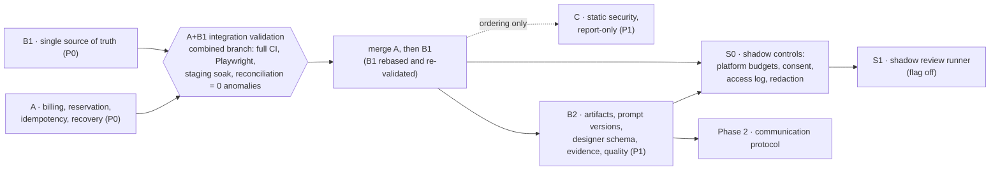

# Agent Collaboration & Continuous Quality: Plan (Revision 2, amended)

**Status:** planning document only. It authorizes no production code changes,
implementation PRs or merges.

**Change log**

| Revision | Commit | Content |
|---|---|---|
| 1 | `f6eaa2d` | Audit |
| 2 | `3047b82` | First set of owner decisions; implementation proposal |
| 2, amended (this document) | n/a | Decisions **C2, C4, C5, C7, C8, C9** approved; reservation formula approved subject to accounting verification; four-PR split approved; promotion thresholds set; Foundation A ledger specification and failure matrix added; new findings F25–F27; two corrections to Revision 2 (§2.4) |

**Scope:** the production build path (`backend/tasks/build_tasks.py` →
`backend/core/orchestrator.py`). Line references are to commit `3351bbd`.

**Guiding principle (owner):** *Forge AI must become better at engineering
without becoming worse at financial predictability.* For every model call we
must know who paid, why it happened, and whether the work it produced was
usable.

### Contents

| § | Section |
|---|---|
| 1 | Decisions of record |
| 2 | Evidence: reconciliation, ledger trace, findings F16–F27, corrections |
| 3 | Revised architecture |
| 4 | Accounting model and the ten accounting rules |
| 5 | Unified usage ledger: every provider channel |
| 6 | **Foundation A ledger specification**: stages, state machines, write protocols, reservation, settlement, recovery, reconstruction |
| 7 | **Failure-state transition matrix** |
| 8 | Reservation formula, funding sources and quotas (C2, C4, C5) |
| 9 | **Four-PR breakdown and explicit dependencies** |
| 10 | Database model changes |
| 11 | **Tests**: regression, concurrency, recovery, exhaustive accounting |
| 12 | Shadow review: budget and privacy controls (C7) |
| 13 | Promotion criteria for blocking reviews |
| 14 | Migration and rollback |
| 15 | **Unresolved decisions**, listed separately |
| A, B | Appendices: agent map; Revision 1 audit, condensed |

---

## 1. Decisions of record

| ID | Decision | Status | Where it is applied |
|---|---|---|---|
| A (funding) | **User-funded generation** and **platform-funded shadow reviews** as separate models. Reserve the worst case, never exceed it, refund the unused part, reject what cannot be funded, never absorb overruns silently | Approved | §4, §6, §8 |
| B (quality) | Execution status is separate from quality status. A failed quality check must not trigger a full refund, a duplicate run, a Celery retry or artifact loss. Unresolved critical findings block acceptance | Approved | §9 (B2), §10 |
| C (single source) | The backend is the single source of truth; fix `build_id`; remove Gemini generation from live mode; demo mode only behind an explicit flag | Approved | §9 (B1) |
| D (shadow first) | Exactly one edge, Architect → Developer: shadow, platform-funded, non-blocking, evidence-referenced, no revisions | Approved | §12, §13 |
| E (visibility) | Activity, Decisions and Escalations lanes, plus an expandable timeline; the escalation triggers listed | Approved | §3.4 |
| F (agents) | Business Model review last and non-blocking; QA after the framework; Security agent high priority after the foundation; static analysis as early as possible; universal communication capability with orchestrator-decided interactions | Approved | §3, §9 (C) |
| **C2** | Exempt build-related model calls from the *interactive* daily token budget, **replaced by**: per-build token and credit ceilings, plan-specific daily build limits, org/project/agent USD limits, provider rate limits, and complete tracking of every call (classifiers, repairs, retries, fallbacks). Builds must not become an unrestricted route around usage controls | **Approved with controls** | §8.4. The exemption may only be switched on once its replacement controls are live (U4, U5) |
| **C4** | BYOK builds reserve 0 Forge credits. Track provider usage separately; never switch silently to Forge's key; no Forge credits for calls billed to the customer's provider; platform security and infrastructure budgets kept separate | **Approved** | §4.3, §6.8, §8.2 |
| **C5** | The free first build includes Developer clarification (≤ 3 questions, under the configurable limit). Forge funds it within a defined free-build allowance. No surprise deductions; hard token and execution limits stay | **Approved** | §8.2 |
| **C8** | No Forge credits are charged for failed provider calls, or for operations that produce no usable, persisted output. Completed stages are chargeable at disclosed prices. Failed-call costs on Forge credentials are recorded and absorbed by the platform. BYOK providers may bill customers for failed requests, which Forge cannot reverse: this must be disclosed, and retries must never switch credentials silently | **Approved** | §4.4 rules 2–3, §6.1, §6.7 |
| **C9** | Exactly one platform-funded recovery attempt for an interrupted *mandatory* stage. Persist an interruption marker; preserve completed stages; no duplicate charges; record both attempts separately; if recovery fails, terminate and settle; no unlimited Celery retries. **BYOK exception:** never switch silently to a platform credential, and a platform-funded retry on a different credential needs explicit user authorization | **Approved with BYOK exception** | §6.8. BYOK default: terminate (U1) |
| **C7** | Human adjudication on **internal builds only**; external builds only with explicit opt-in. Redact credentials and sensitive data; minimum necessary material; access logged (who, which build, when); retention and deletion defined; AI review and human adjudication have **separate** policies; never use ordinary customer builds for human review silently | **Approved** | §12.3 |
| Formula | `max_build_cost` = 27 with current settings is the configured maximum, derived from prices, retry policy, clarification limits and enabled paths, **never hard-coded**. Reservation and settlement must be atomic and idempotent. A test must exercise every permitted combination | **Approved subject to accounting verification** | §8.1, §11.4 |
| Accounting workstream | Unified usage ledger: no provider call may be invisible to financial accounting. Platform-funded specialist reviews get their own identity and records. Shadow limits of **$0.20 per build and $100 per month** are initial, configurable values | **Approved** | §5, §12 |
| C11 | Four PRs: A (P0), B1 (P0), B2 (P1), C (P1). A and B1 developed independently, with their integration validated before merging. B2 after the execution and artifact foundation. Shadow reviews only after budget, accounting and privacy controls are operational | **Approved** | §9 |
| C13 (thresholds) | ≥ 50 representative builds; ≥ 100 adjudicated blocking findings; ≥ 95% blocking precision; ≥ 90% recall **per defect category**; 100% critical regression detection. **Plus:** report confidence intervals and per-category sample sizes; blocking is never activated just because a sample count was reached | **Approved** | §13 |

---

## 2. Evidence

### 2.1 Reconciling "7 versus 5"

Both numbers are correct; they measure different things.

At the clarification decision point, `credits_used` = 12 (architect 3 + business
model 2 + designer 2 + developer 5).

| Quantity | Formula | Value |
|---|---|---|
| Remaining reservation | 17 − 12 | **5** |
| Worst-case mandatory spend still ahead | PM 1 + 3 × (debug 2 + PM 1) | 10 (12 with integrations) |
| Code's `credit_ceiling` (`orchestrator.py:544`) | 17 − 10; an absolute cap on `credits_used` | **7** |
| Headroom for optional spend | 7 − 12 | **−5** |

The reservation was already 5 credits short of the pipeline's own worst case,
the same 5 by which a full debug loop overruns (22 − 17).

### 2.2 Stage-by-stage ledger trace

Measured with the real `Orchestrator` and stub agents. Charges happen at
`_start_agent`, before the LLM call.

| Scenario | Reserved | Final `credits_used` | Result |
|---|---|---|---|
| S1 happy path, no integrations | 17 | 13 | ok |
| S2 happy path, integrations | 17 | 15 | ok |
| S3 full debug loop | 17 | 22 | **+5 over** |
| S4 full debug loop + integrations | 17 | 24 | **+7 over** |
| S5 S4 + 3 answered clarifications | 40 | **27** | the configured maximum |
| S6 non-transient developer failure × 4 attempts | 17 | 27 | **refund 0, no code produced, 4 steps left RUNNING** |

### 2.3 Findings

F1–F15 are in Appendix B; F16–F24 were added in Revision 2; F25–F27 are new in
this amendment. *Measured* means reproduced with throwaway probes that are not
committed; everything else is from reading the code.

| # | Finding | Evidence | Fixed in |
|---|---|---|---|
| F16 | **Platform-funded calls leave no usage record.** The router writes `ai_usage` only when `user_id` is set (`core/llm/router.py:1166-1210`). The specialist shadow (`core/specialist_shadow.py`) and the repository monitor (`agent_registry/monitoring.py:277`) omit it, and the injection classifier calls the provider directly (`router.py:1223-1275`). Separately, `asyncio.create_task` inside a Celery task only progresses while a later task runs that worker's loop (`build_tasks.py:27-40`) | code | A |
| F17 | **The daily token budget can stop an admitted build halfway.** The developer call alone pre-authorizes ~8,978 tokens against the free plan's 10,000. The max configured path needs ≥ 59,396 *output* tokens (≥ 105,568 with one repair per structured operation) | measured | A (C2 controls) |
| F18 | **Every exception is retried**, even non-transient ones (`build_tasks.py:243-262`). Combined with F13 this produces S6 | measured | A |
| F19 | **Settlement isn't idempotent**: a bare `$inc` refund (`build_tasks.py:193-200`) can repeat on redelivery. **Nothing sweeps orphaned builds.** The production Celery broker is a Redis instance with `allkeys-lru` (`docker-compose.prod.yml:61, 197`), so queued tasks can be evicted | code | A |
| F20 | Deployment accepts any build (`api/deployments.py:132-136`) | code | B2 |
| F21 | Prices and reservation logic are duplicated in four places; the `tech_stack` multiplier is dead | code | A |
| F22 | Build status is never set to RUNNING. A retryable failure persists FAILED and emits `build_failed` before the build resumes | code | A |
| F23 | Uncharged provider calls: interactive clarify, question pass, structured-output repair, router retries and fallbacks, classifier, shadow | code | A (§5) |
| F24 | A production frontend has no `/api/gemini/synthesize-code` (dev-only Vite plugin); live mode charges a backend build that the UI never shows | code | B1 |
| **F25** | **`persist_files` deletes before it inserts.** It does `delete_many` then `insert_many` (`build_tasks.py:150-156`, again at `:186-191`). A crash between the two leaves the build with **no files**. Resume then sees "developer SUCCESS, no files" and regenerates, which re-charges under today's F13 | code | A |
| **F26** | **Output-guardrail LLM screens are the largest invisible cost.** `AIGateway.stream` re-screens the *accumulated* text every 400 characters (`gateway/service.py:22-30, 246-266`). `GuardrailsEngine._check_with_llm` calls the provider directly (`gateway/guardrails.py:114`) with the **calling agent's own model**, because `config/llm.yaml` gives each agent an override that the loader merges (`core/llm/config.py:72-75`), and `guardrails_enabled` defaults to true. Measured with the committed config and the real engine: **one 32,000-character Developer stream makes 73 screens on `claude-opus-4.8`, ~302,776 input tokens, ≈ $4.63, all unrecorded.** That is ~7× the Developer call itself (~$0.65). Architect: 14 screens, ≈ $0.21. Guardrail screens use Forge's providers even on BYOK requests | measured (token heuristic; confirm against provider invoices) | A records it; policy is U3 |
| **F27** | **Failed provider attempts are never recorded.** `_record_usage` returns when tokens ≤ 0 (`router.py:1180`), and the exception paths `continue` without recording (`router.py:566-600`) | code | A |

### 2.4 Corrections to Revision 2

1. **F12 ("no Mongo transactions")** is true of the *code* only. Production and
   staging run a replica set (`replicaSet=rs0`: `docker-compose.prod.yml:56,
   168`; `docker-compose.staging.yml:25`), so transactions are available there.
   Local docker-compose and CI's real-Mongo job (`ci.yml:372-383`) are standalone, so
   transactions are not available in dev and test. Foundation A therefore keeps
   single-document guarded updates (U10).
2. **Shadow cost.** Revision 2's worst case undercounted the repair call, which
   resends the whole conversation plus the rejected output and the schema
   (`gateway/service.py:131-155`). Recomputed: 24k input tokens costs **$0.218**
   worst case with one repair and one guardrail screen. To honour the approved
   **$0.20** cap, the input limit becomes **20,000 tokens (worst case $0.194)**
   on a Sonnet-class model (§12.1, U7).

---

## 3. Revised architecture

### 3.1 Principles

1. **`core/orchestrator.py` is the only control flow.** New modules are services
   it calls.
2. **Two ledgers, never mixed.**
   - The **credit ledger** records customer ↔ Forge: reservations, charges and
     refunds.
   - The **provider-cost ledger** records who paid a provider for each attempt.
   - Every provider attempt belongs to a ledger *operation*. No provider call
     exists outside an operation or a named platform account.
3. **Charge only usable, persisted output.** An operation is charged exactly
   once, when its output is validated, persisted, and committed in one
   single-document write.
4. **Single writer per build.** A lease plus a fencing token guarantee one live
   attempt. Every write is conditional on the token.
5. **Artifacts are immutable.** Recovery never deletes completed work.
6. **Quality never changes execution or money.**

### 3.2 Components

| Component | Module | PR |
|---|---|---|
| Price table, `max_build_cost()`, `pricing_version` | `core/pricing.py` (new) | A |
| Build ledger: operations, dispatches, ceiling, commit protocol | `core/build_ledger.py` (new) | A |
| Lease and fencing; orphan sweeper; reconciliation job | `tasks/build_tasks.py`, `tasks/maintenance_tasks.py` (new) | A |
| Reservation and settlement protocols | `core/credit_settlement.py` (new) | A |
| Provider response journal | `gateway/service.py` + collection | A |
| Unified usage recording: every provider attempt, every channel | `core/ai_usage.py`, `core/llm/router.py`, `gateway/guardrails.py`, `gateway/service.py` | A |
| Build quotas: token meters, daily build counter, operation binding for the C2 exemption | `core/build_quotas.py` (new), `core/llm/router.py` | A |
| Build subscription, hydration, state-only persistence, 402 and BYOK disclosure UI | frontend, `tasks/build_tasks.py` | B1 |
| Artifacts and blobs, prompt versions, designer schema, `Finding` and evidence verifier, PM on evidence, `core/quality.py`, deploy guard | see §9 | B2 |
| Static security analysis (report-only) | `sandbox/static_security.py` (new) | C |
| Platform budgets, consent, access log, redaction, adjudication UI | `core/platform_budgets.py`, `core/data_use.py`, admin UI | S0 |
| Shadow review runner (Celery queue `shadow`) | `tasks/review_tasks.py` | S1 |
| Protocol v2, capability registry, route policy, blackboard, visibility | `core/agent_communication.py`, `core/build_artifacts.py` | Phase 2 |

### 3.3 Phases

| Phase | Contents | Exit criterion |
|---|---|---|
| 1. Foundation reliability | A, B1, B2, C | §11 suites green. The staging soak shows zero reconciliation anomalies (§6.9) |
| 2. Universal communication | Protocol v2, capability registry, default-deny routes, blackboard, visibility and escalations, funded clarifications | Clarifications run on metered builds; every message authorized, persisted and hydrated |
| 3. Peer review | S0, S1 (shadow), adjudication, labelled set, critical suite; then blocking review **only after §13 and explicit owner approval** | §13 |
| 4. Engineering collaboration | Security agent (first), QA, Integration, Business Model (non-blocking), user escalations | Each edge passes its own §13 gate |
| 5. Continuous improvement | Retrospectives, evaluations, approval-gated prompt promotion | Regression evaluation is mandatory |

### 3.4 Visibility model (decision E, Phase 2)

Records carry `visibility ∈ {internal, activity, decision, escalation}`.

| Lane | Shows |
|---|---|
| Activity | Agent state chips |
| Decisions | Accepted clarifications, resolved disagreements with rationale |
| Escalations | Action cards for the user |
| Timeline (collapsed) | Everything `internal` |

When no user can answer, escalations resolve conservatively:

| Trigger | Resolution |
|---|---|
| Technical disagreement | Decision owner |
| Ambiguity | Architect's default, recorded as an Assumption |
| Security or permission | Deny |
| Additional spend | **Never auto-approved**; that work is skipped |
| Scope change | Reject |

**Shadow findings are never shown to users.**

---

## 4. Accounting model

### 4.1 Hierarchy

```
Build
 └─ Operation   (one billable unit of work, stage_key e.g. "developer", "pm#2", "clarification#1")
     └─ Dispatch     (1 = original; 2 = the single C9 recovery dispatch)
         └─ Provider attempt   (primary, retry, model/provider fallback, structured repair,
                                injection classifier, output guardrail screen, cache hit)
```

- **Credits** live on Operations, and are charged at most once per `stage_key`.
- **Provider cost** lives on Provider attempts, which are `ai_usage` rows keyed
  by `(operation_id, dispatch_no, attempt_seq)`.

### 4.2 Funding sources (credit ledger)

| Source | Customer credits | Typical use |
|---|---|---|
| `user_credits` | Reserved up front; charged per completed operation; unused part refunded | Metered builds on Forge credentials |
| `byok` | 0 reserved, 0 charged (C4) | Customer's own provider key |
| `free_grant` | 0 reserved; operations counted in credit-equivalents against the free-build allowance (C5) | First build |

### 4.3 Provider-cost accounts (who pays the provider)

| Account | Credential | Cost bearer | Examples |
|---|---|---|---|
| `generation` | Forge | Platform. Revenue comes from the credit ledger | Every attempt of a `user_credits` operation, including failed, retried, fallback and repair attempts |
| `customer_provider` | BYOK | **Customer's provider account** | Every attempt of a `byok` operation, including failed ones (C8 disclosure) |
| `free_grant` | Forge | Platform | Attempts of `free_grant` operations |
| `recovery` | Forge | Platform | The C9 recovery dispatch |
| `failure_absorbed` | Forge | Platform | Report view over `generation`/`free_grant` attempts of operations that ended uncharged (C8); not a separate write |
| `guardrail` | Forge | Platform (security budget) | Injection classifier, output-guardrail screens, on any build including BYOK (C4: kept separate) |
| `shadow` | Forge | Platform (pilot budget) | Shadow reviews, specialist shadow |
| `monitoring` | Forge | Platform (infrastructure) | Repository monitor suggestions |
| `interactive` | Forge or BYOK | Platform or customer | Non-build LLM features (still under the daily token budget) |

### 4.4 The ten accounting rules: mechanisms and proofs

| # | Rule (owner) | Mechanism | Proven by |
|---|---|---|---|
| 1 | Reserve the calculated worst-case user-funded cost before starting | `max_build_cost()` from settings; reservation protocol R1–R6 (§6.4) before dispatch | EX-1, CT-1, CT-9 |
| 2 | Record every provider attempt, including failures | One `ai_usage` row per provider attempt with `outcome`, written in `finally` paths (classifier, guardrail, repair, retries, fallbacks, cache hits); zero-token rows allowed | RG-F27, RG-F26, EX-3 |
| 3 | Charge only successfully completed, usable agent operations | Commit protocol W1–W7 (§6.3): usability predicate (§6.1), then persist, then CAS commit. `credits > 0` only on COMPLETED | EX-1, RT-3 |
| 4 | Refund unused reservations exactly once | Settlement protocol S1–S6 (§6.5): guarded `settle:<build_id>` key on the user document | CT-2, CT-3, RT-7 |
| 5 | Recover interrupted mandatory stages at most once, under the approved funding policy | §6.8: `dispatch_no ≤ 2`; dispatch 2 is account `recovery`; BYOK default terminate | RT-1…RT-5 |
| 6 | Keep platform and customer expenditure separate | Funding source on operations; `account` and `cost_bearer` on every attempt; per-build `provider_cost_summary` split by account | RG-acc, EX-3 |
| 7 | Every build and settlement is reconstructable from the ledger | `reconcile_build()` with invariants I-1…I-12 (§6.9); nightly job; read-only admin endpoint | RC-1, EX (asserted in every run) |
| 8 | A retry never consumes additional customer credits silently | Charge per `stage_key` at most once (I-4); FAILED and INTERRUPTED operations are uncharged; recovery is platform-funded | EX-2, RT-2, CT-4 |
| 9 | Daily quotas and build quotas are separate | The interactive daily budget is skipped only for calls bound to a live ledger operation; build token meters and the daily build counter are separate controls (§8.4) | RG-F17, CT-6 |
| 10 | Completed artifacts are preserved during failure recovery | Safe file persistence (F25), immutable artifacts (B2), recovery never deletes; `files_hash` checks across recovery | RT-6, RG-F25 |

---

## 5. Unified usage ledger: every provider channel

| Channel | Code path | Recorded today? | Account / bearer after A | Linked to |
|---|---|---|---|---|
| Normal agent call (generate) | `agents/base.py:308,370` → `gateway/service.py:79` → `router.py:555` | success only | `generation` / `customer_provider` / `free_grant` | operation, dispatch |
| Normal agent call (stream) | `gateway/service.py:213` → `router.py:900,1037` | success only (finalize) | same | operation, dispatch |
| Clarification answers and question pass | via `BaseAgent.run` | success only, not linked | operation's funding | `clarification#i`, `question_pass` |
| Interactive architect clarify | via `BaseAgent.run` | success only | operation's funding | `architect_clarify` |
| Structured-output repair | `gateway/service.py:145` → `router.generate` | success only, not linked | same as the repaired operation | same operation, `attempt_kind=repair` |
| Router retries | `router.py:542-600` | **no** for failures (F27) | same | `attempt_kind=retry` |
| Model and provider fallbacks | `router.py:424-600` | **no** for failures | same | `attempt_kind=fallback` |
| BYOK calls | `router.py:658-720` (`_generate_byok`) | success only, `byok=true` | `customer_provider` | operation; `credential=byok` |
| Injection classifier | `router.py:1223-1275` (`provider.chat_completion` direct) | **never** | `guardrail` (platform) | operation of the guarded request |
| Output guardrail screens | `gateway/guardrails.py:114`, per window on streams | **never** (F26) | `guardrail` (platform) | operation, `attempt_kind=output_guardrail` |
| Response-cache hit | `router.py:493-510` | no (no provider call) | `cache_hit`, zero cost | operation (needed for reconstruction) |
| Specialist shadow | `core/specialist_shadow.py:119` (no `user_id`) | **never** | `shadow` | platform principal + `beneficiary_user_id` |
| Shadow reviews (new) | `tasks/review_tasks.py` | n/a | `shadow` | shadow operation |
| Repository monitor | `agent_registry/monitoring.py:277` (no `user_id`) | **never** | `monitoring` | platform principal |
| LLM test endpoint | `api/llm.py:59` | success only | `interactive` | n/a (not a build) |

**Rule.** After A, a provider call with no `ai_usage` row is a defect. Test
RG-acc patches every provider adapter's `chat_completion`/`stream_completion`
with a counter and asserts *counted calls == recorded attempts* across a full
stub build, including guardrail windows, classifier, repairs and fallbacks.

---

## 6. Foundation A ledger specification

### 6.1 Stage-by-stage ledger

| `stage_key` | Mandatory | Price (setting) | Usable output: the commit predicate | Persisted **before** commit | Max dispatches | DISPATCHED with no journal on resume | Max per build |
|---|---|---|---|---|---|---|---|
| `architect_clarify` (interactive) | no | 0 (part of architect) | JSON list (may be empty) | Questions stored on the operation | 1 | INTERRUPTED; proceed without questions | 1 |
| `architect` | yes | `credits_architect` (3) | Schema-valid blueprint | `AgentStep.output` | 2 | C9 recovery | 1 |
| `business_model` | yes | `credits_business_model` (2) | Schema-valid | `build.business_model` + step output | 2 | C9 recovery | 1 |
| `designer` | yes | `credits_designer` (2) | Parseable JSON (schema-valid once B2 lands) | step output | 2 | C9 recovery | 1 |
| `question_pass` | no | `credits_question_pass` (C3; default 0) | JSON list ≤ Q | Questions as QUEUED messages | 1 | INTERRUPTED; no clarifications | 1 |
| `clarification#i` | no | `credits_clarification` (1) | Non-empty answer | `agent_messages[i]` | 1 | INTERRUPTED, never re-sent (today's guarantee) | Q (3) |
| `developer` | yes | `credits_developer` (5) | ≥ 1 parsed file | `build_files` via the safe write order (F25) | 2 | C9 recovery | 1 |
| `integration` | if `blueprint.integrations` | `credits_integration` (2) | Schema-valid | `build_files` | 2 | C9 recovery | 1 |
| `pm#k`, k = 0…N | yes | `credits_pm` (1) | Schema-valid validation | step output | 2 | C9 recovery | N + 1 (4) |
| `debug#k`, k = 1…N | yes (in loop) | `credits_debug` (2) | Schema-valid **and ≥ 1 changed file** (U6) | `build_files` | 2 | C9 recovery | N (3) |
| CSP, sandbox, moderation, static security | n/a | 0 | n/a | report | n/a | Re-run (deterministic, free) | n/a |

**Overheads inside an operation** (never charged separately, always recorded):
structured repair (≤ 1 per dispatch), router retries and fallbacks,
injection-classifier calls, output-guardrail screens. Hard cap:
`max_provider_attempts_per_dispatch` (engineering default 4: primary + up to 2
retries or fallbacks + 1 repair; guardrail and classifier calls are counted
separately under the platform token meter).

### 6.2 State machines

```
Operation:  AUTHORIZED ─▶ DISPATCHED ─▶ COMPLETED            (charged once)
                │             ├────────▶ FAILED               (uncharged: provider error, unusable output,
                │             │                                 non-transient policy error)
                │             └────────▶ INTERRUPTED          (outcome unknown; marker persisted)
                │                          └─(mandatory, Forge credential)─▶ DISPATCHED (dispatch 2, account=recovery)
                └────────────────────────▶ REFUSED            (ceiling/quota; no provider call)

Dispatch:   STARTED ─▶ COMPLETED | FAILED | INTERRUPTED       (each recorded separately; C9)

Funding:    RESERVING ─▶ RESERVED ─▶ SETTLED
                 │            └────▶ RELEASED                 (dispatch failed or lost; full refund)
                 └──────────────▶ ABORTED                     (no money moved)

Build execution: PENDING ─▶ RUNNING ─▶ COMPLETED | FAILED     (stored `status`: pending/running/debugging/
                                                                success/failed; `build_status` derived, C10)
```

### 6.3 Commit protocol for one operation

`T` is the attempt's fencing token. Every build-document write filters on
`{id, attempt_token: T}`.

| Step | Write | Crash after this step leads to |
|---|---|---|
| W1 Authorize | Ceiling and quota check in memory (single writer under lease); `$push` the operation `AUTHORIZED` with price and `stage_key` | Resume finds AUTHORIZED: no provider call happened, so it dispatches normally (not a recovery) |
| W2 Dispatch marker | `$set` the operation `DISPATCHED`, `$push` dispatch `{dispatch_no, account, credential, started_at}` | Resume finds DISPATCHED: W4 decides |
| W3 Provider attempts | One `ai_usage` row per attempt, success or failure, at attempt end | Rows are append-only; the reconciler links them |
| W4 Journal | On the final usable response: upsert `llm_response_journal{operation_id, dispatch_no}` **before** returning to the agent | Journal present: reuse it, with no provider call |
| W5 Validate | Apply the §6.1 predicate. Unusable output leads to W7 | n/a |
| W6 Persist output | Idempotent writes (safe file order; step output; message) | The journal path re-persists identical output |
| W7 Commit (CAS) | **One `$set`**: operation `COMPLETED` (or `FAILED`), `credits = price` (or 0), dispatch resolved, `credits_used = Σ credits`, `AgentStep` outcome, `request_ids`. Filter adds `ledger.$[op].status = DISPATCHED` | Done. A matched count of 0 means fenced off: abort without charging |

### 6.4 Reservation protocol (exactly once)

| Step | Action | Crash after this step |
|---|---|---|
| R1 | Compute `quote = max_build_cost(config)` and the funding snapshot (BYOK key present → `byok`; unclaimed grant → `free_grant`; else `user_credits`) | Nothing written |
| R2 | Insert the build with `funding = {state: RESERVING, source, reserved_credits, max_cost, breakdown, pricing_version}` | Sweeper: RESERVING with no `reserve:` key → ABORTED, build failed `admission_incomplete` |
| R3 | `user_credits`: `update_one({id: uid, credits ≥ quote, credit_ops ≠ "reserve:"+bid}, {$inc: {credits: −quote}, $push: {credit_ops: {$each: ["reserve:"+bid], $slice: −500}}})`. 0 matched → re-read: key present means already reserved (idempotent), otherwise 402 and the build ABORTED. `free_grant`: `update_one({id, free_build_used ≠ true}, {$set: {free_build_used: true, free_build_id: bid}})`. `byok`: no-op | Sweeper: RESERVING **with** the key → release (S-protocol with consumed = 0) → RELEASED |
| R4 | Build `funding.state = RESERVED`; upsert `credit_transactions{build_id, kind: reserve}` | Sweeper: RESERVED, no lease, older than `dispatch_timeout` → RELEASED (covers broker loss) |
| R5 | `run_build.apply_async` | Same as R4 |
| R6 | Dispatch exception → release (S-protocol, consumed = 0); `free_grant` rollback `update_one({id, free_build_id: bid}, {$unset: …, $set: {free_build_used: false}})` | Idempotent |

### 6.5 Settlement protocol (exactly once)

Settlement runs at a terminal state, from the worker, the sweeper or a dispatch
failure.

| Step | Action |
|---|---|
| S1 | Fence: the worker holds the lease, or the sweeper has CAS-set `attempt_token = "swept:<uuid>"`. After S1 no operation can commit |
| S2 | `consumed = Σ ledger[].credits` (COMPLETED only); `refund = reserved_credits − consumed`; assert `0 ≤ consumed ≤ reserved`. A violation raises a page alert, refunds 0, and records `settlement.anomaly`; by construction it cannot happen |
| S3 | `update_one({id: uid, credit_ops ≠ "settle:"+bid}, {$inc: {credits: refund}, $push: {credit_ops: {$each: ["settle:"+bid], $slice: −500}}})`. The key is written even when the refund is 0 |
| S4 | `update_one({id: bid, settlement: null}, {$set: {settlement: {consumed, refunded, settled_at, provider_cost_summary}, "funding.state": SETTLED}})` |
| S5 | Upsert `credit_transactions{build_id, kind: settle, amount: refund}` |
| S6 | Emit `credits_update` |

- **Crash between S3 and S4:** the re-run skips S3 (key present) and completes
  S4–S6.
- **Concurrent settlers:** S3's guard admits exactly one `$inc`. Both compute the
  same `consumed`, because the ledger is fenced at S1.
- **Residual risk:** the idempotency window is the last 500 credit operations
  per user. A settlement retry would have to arrive after 500 newer credit
  operations *and* still find `settlement: null`. The nightly reconciler (§6.9)
  detects it; production transactions are the long-term alternative (U10).

### 6.6 Lease, fencing and duplicate delivery

| Step | Action |
|---|---|
| L1 Acquire at attempt start | `update_one({id, settlement: null, "funding.state": RESERVED, $or: [{lease_expires_at: null}, {lease_expires_at: {$lt: now}}]}, {$set: {attempt_token: T, lease_expires_at: now + 90 s, status: "running"}})` |
| L1, 0 matched | If settled → acknowledge, no-op. If another lease is live → acknowledge, exit (`duplicate_delivery_suppressed` metric) |
| L2 Heartbeat | A background task renews the lease every 30 s, filtered on `T` |
| L3 Fencing | Every write filters on `T`. A write that matches 0 documents raises `AttemptSuperseded`: stop, no charge, no retry |
| L4 Sweeper | Every 5 min, beat. Lease expired by more than 120 s and build not terminal: if `recovery_enqueues == 0`, CAS-increment it and enqueue a resume (the interrupted operation follows §6.8); otherwise fence, set FAILED (`orphaned`), and settle. Also handles RESERVING and RESERVED-undispatched (§6.4) |

### 6.7 Retry classification (fixes F18)

| Class | Errors | Celery |
|---|---|---|
| Transient | Provider 5xx, 408/429, timeouts after router exhaustion; `CircuitBreakerOpen`; Mongo `AutoReconnect`/network timeouts; Redis connection errors; customer-provider 429 (same key, disclosed) | Retry, max 3, 60 s countdown. Operation FAILED (uncharged) each time; resume uses a new operation for the same `stage_key` |
| Model-output | Schema-invalid after repair; unusable output (§6.1) | **1** retry per `stage_key`, platform-absorbed (U13), then non-transient |
| Non-transient | `BudgetLimitExceeded` (USD limits), quota refusal (§8.4), `PolicyViolation`, prompt-injection rejection, ceiling refusal, BYOK 401/403, `SoftTimeLimitExceeded`, `BuildCancelled`, `AttemptSuperseded` | No retry. Build FAILED (or COMPLETED + quality if code exists, per §7). Settle |

### 6.8 Recovery policy (C9), including the BYOK exception

Recovery applies when, on resume or after a sweeper re-enqueue, an operation
is DISPATCHED with **no** journal entry.

| Case | Action | Customer credits | Provider cost |
|---|---|---|---|
| Journal present (any funding) | Reuse it; W5–W7; **no provider call** | Price once, if usable | Original dispatch only |
| Optional operation | Dispatch → INTERRUPTED; operation INTERRUPTED; continue without it | 0 | Dispatch 1 cost (if any) recorded as unknown |
| Mandatory, `user_credits` or `free_grant` | Dispatch 1 → INTERRUPTED (marker persisted); **dispatch 2** under account `recovery` on the **same Forge credential** | Price once, if dispatch 2 is usable | Dispatch 1 unknown; dispatch 2 platform-funded. Both recorded separately |
| Mandatory, dispatch 2 also interrupted or failed | Operation FAILED; build terminates (FAILED, or COMPLETED + quality per §7); settle; **no further Celery retries for this operation** | 0 for this operation | Both dispatches recorded |
| Mandatory, `byok` | **Default (U1): terminate.** Operation INTERRUPTED; build FAILED (`interrupted_byok`); completed stages and files kept; settle (0 reserved). **Never** a silent switch to a Forge credential. The alternatives in U1 (`same_key_once`, or `platform_with_authorization` via an explicit user action) are implemented only once decided | 0 | Dispatch 1 on the customer's account, recorded |

### 6.9 Reconstruction and reconciliation

`reconcile_build(build_id)` is pure and read-only. It runs nightly over builds
settled in the last 48 hours and on demand from an admin endpoint. It checks:

| # | Invariant |
|---|---|
| I-1 | The `credit_transactions` reserve row equals `funding.reserved_credits`, and `credit_ops` contains `reserve:<bid>` (for `user_credits`) |
| I-2 | `consumed = Σ op.credits ≤ reserved_credits` (for `free_grant`: ≤ `max_cost`) |
| I-3 | `refunded = reserved − consumed`; exactly one `settle:<bid>` key; one settle row |
| I-4 | At most one charged operation per `stage_key` |
| I-5 | Every COMPLETED operation has ≥ 1 successful provider attempt (or a journal reuse) under its `(operation_id, dispatch_no)` |
| I-6 | Every `ai_usage` row with this `build_id` maps to an existing operation or a named platform account. **No orphan provider calls** |
| I-7 | `dispatch_no ≤ 2` for mandatory operations, `≤ 1` for optional ones; `dispatch_no = 2` ⇒ `account = recovery` and the same credential as dispatch 1 |
| I-8 | `byok` builds: 0 credits, every generation attempt `credential = byok`, no `generation` account rows |
| I-9 | No AgentStep remains RUNNING once the build is terminal |
| I-10 | Files of every COMPLETED file-producing operation still exist (by `files_hash`) |
| I-11 | `provider_cost_summary` totals equal Σ `ai_usage.cost` grouped by account |
| I-12 | Funding state is consistent with execution: terminal build ⇒ SETTLED or RELEASED |

`ai_usage` keeps its 90-day TTL. The **permanent** financial record is the build
ledger, `credit_transactions` and `settlement.provider_cost_summary` (U11).

---

## 7. Failure-state transition matrix

Notation: Op = operation, D = dispatch, CR = customer credits.

| Scenario | Detection | Ledger transitions | CR | Provider-cost records | Celery | Build → quality | Artifacts | Settlement and user event |
|---|---|---|---|---|---|---|---|---|
| **1 Normal completion** | Usable response | Op AUTHORIZED → DISPATCHED → COMPLETED; D1 COMPLETED | +price, once | Attempt rows (`generation`/`free_grant`/`customer_provider`), plus guardrail rows (`guardrail`) | none | Continues; at the end COMPLETED → quality per B2 rules | Persisted before commit | At the end: S-protocol; `credits_update` |
| **2a Provider failure, recovered in router** | Retry or fallback succeeds | As 1 | +price once | Failed attempts recorded with `outcome=error`; the successful one recorded | none | As 1 | As 1 | As 1 |
| **2b Provider failure, router exhausted (transient)** | Exception after the attempt cap | Op FAILED (`provider_error`); D1 FAILED | 0 | All attempts recorded; cost (if any) under the operation's account, uncharged (`failure_absorbed` view; BYOK: customer's provider) | **Retry** (≤ 3) | RUNNING kept; `agent_update` "recovering"; `retry_scheduled_until` set | Kept | None yet |
| **2c Unusable output** | Predicate fails (e.g. 0 files) | Op FAILED (`unusable_output`) | 0 | Recorded; absorbed | 1 retry per `stage_key` (U13) | As 2b | Earlier files kept | None yet |
| **3 Non-transient failure** | §6.7 classes; soft time limit | Op FAILED or REFUSED; in-flight D marked FAILED (`cancelled` for time limit) | 0 for this operation | Recorded | **None** | No code yet → **FAILED**. Code exists and the failure is in validation → **COMPLETED**, quality `incomplete` (C1) or `needs_revision` | Kept | S-protocol; `build_failed` or `build_complete` with quality |
| **4 Celery retry (resume)** | New task attempt | L1 acquires a new lease `T'`; completed operations skipped (I-4); the failed `stage_key` gets a new operation | Unchanged by the retry itself | New operation's attempts recorded | Counted toward ≤ 3 | RUNNING | Completed stages reused | None until terminal |
| **5a Worker interruption, journal present** | DISPATCHED + journal on resume | D1 COMPLETED (from journal); Op COMPLETED | +price once | No new provider call | Redelivery or sweeper resume | RUNNING | Re-persisted idempotently | n/a |
| **5b Interruption, no journal, mandatory, Forge credential** | DISPATCHED, no journal | D1 INTERRUPTED (marker) → D2 (`recovery`) → Op COMPLETED or FAILED | +price once if D2 usable; else 0 | D1 unknown; D2 recorded as `recovery` | Resume; **no further retries for this operation if D2 fails** | RUNNING, or terminate as 3 if D2 fails | Kept | Settle on terminate |
| **5c Interruption, no journal, mandatory, BYOK** | As 5b | D1 INTERRUPTED; Op INTERRUPTED (default U1) | 0 | D1 on the customer's account | None | **FAILED** (`interrupted_byok`) | Kept | Settle (0); user told the build stopped and that no credential was switched |
| **5d Interruption, optional operation** | DISPATCHED clarification | D1 INTERRUPTED; Op INTERRUPTED | 0 | D1 unknown | Resume continues | RUNNING | n/a | n/a |
| **6a Duplicate delivery while a live attempt holds the lease** | L1 matches 0, lease live | none | 0 | none | Acknowledge and exit | unchanged | unchanged | none |
| **6b Duplicate delivery after settlement** | L1 matches 0, settled | none | 0 | none | Acknowledge, no-op | unchanged | unchanged | none |
| **6c Duplicate delivery after lease expiry** | L1 succeeds | Treated as 5a–5d | as 5 | as 5 | n/a | as 5 | as 5 | as 5 |
| **6d Stale writer after fencing** | Write matches 0 | No commit | 0 | Its provider attempts recorded (account per credential), uncharged | Task exits (`AttemptSuperseded`) | n/a | n/a | n/a |
| **7a Reservation exhaustion, optional operation** | W1 ceiling | Op REFUSED | 0 | none | none | Continues | n/a | n/a |
| **7b Exhaustion, mandatory, before code** | W1 ceiling | Op REFUSED | 0 | none | None (non-transient) | **FAILED** (`ceiling`). Configuration-drift alert: the formula should make this impossible | Kept | S-protocol |
| **7c Exhaustion, mandatory, after code** | W1 ceiling (e.g. `debug#3`) | Op REFUSED | 0 | none | None | **COMPLETED**, quality `incomplete` or `needs_revision`, with `incomplete_stages` | Kept | S-protocol |
| **8 Refund and settlement** | Terminal state or sweeper | Funding RESERVED → SETTLED (or RESERVING/RESERVED → RELEASED) | +refund **exactly once** | `provider_cost_summary` written | n/a | n/a | n/a | `credits_update`. Crashes and concurrent settlers handled by S3/S4 (§6.5) |
| **9a BYOK execution, normal** | Funding `byok` | As 1, with `credits = 0` | **0** | `customer_provider` for generation; `guardrail` and other platform rows separate | As 1 | As 1 | As 1 | Settle (0 reserved, 0 refunded); provider usage shown separately |
| **9b BYOK key missing or invalid at run time** | `_resolve_byok` returns None, or a provider 401 | Op FAILED (`byok_unavailable`) | 0 | Attempt recorded on the customer's account (if sent) | None | FAILED | Kept | Settle; message: "Your provider key is unavailable; Forge did not use its own key" |

---

## 8. Reservation formula, funding and quotas

### 8.1 Formula (approved, subject to the EX-1 proof)

```
max_build_cost = p_arch + p_bm + p_des + p_dev + p_int + p_pm        # one pass of every stage
               + N × (p_dbg + p_pm)                                  # configured debug loop
               + [Q > 0] × (p_qpass + Q × p_clar)                    # clarification bundle
               + V × p_rev                                           # production revisions (0 until enforcement)
```

| Symbol | Meaning | Current value |
|---|---|---|
| p_arch … p_dbg | Stage prices from `core/config.py` | 3, 2, 2, 5, 2, 1, 2 |
| N | `MAX_DEBUG_ITERATIONS` | 3 |
| Q | `developer_clarification_max_questions`, when clarifications are enabled in the build's `collab_config` | 3 |
| p_clar | `credits_clarification` | 1 |
| p_qpass | `credits_question_pass` (C3) | 0 |
| V | Revision cycles × enabled blocking edges | 0 |

- **Current value: 15 + 9 + (0 + 3) + 0 = 27.**
- Retries, repairs, fallbacks and recovery add **0 customer credits** by rule
  (§4.4 rules 3 and 8), so they do not appear in the formula. EX-2 proves they
  never move `consumed`.
- `breakdown` and `pricing_version` are stored on every build.

### 8.2 Funding sources at admission (C4, C5)

| Funding | Admission | Reserved | Ceiling during the run | Notes |
|---|---|---|---|---|
| `user_credits` | `credits ≥ max_build_cost`, else **402** `{required, available, breakdown, pricing_version}` | `max_build_cost` | Reservation | Typical build consumes 13, refunds 14 |
| `byok` | Key present at admission (snapshot) | **0** | Operation count plus per-build token meters; no credits | Never falls back to Forge providers (router guarantee kept, test RG-C4). Platform guardrail calls recorded under `guardrail` |
| `free_grant` | First build (atomic claim with `free_build_id`) | **0** | **Free-build allowance = `max_build_cost` credit-equivalents** (27 today, including ≤ 3 clarifications) **plus** the per-build token meters and `build_timeout` | Platform-funded, account `free_grant`; no deductions |

### 8.3 Effect with current settings

| | Today | After A |
|---|---|---|
| Metered admission threshold | 17 | 27 |
| S1 consumed / refunded | 13 / 4 | 13 / 14 |
| S4 | user pays 17; platform absorbs 7 silently | user pays 24; 3 refunded |
| S6 | user pays 17 for nothing | single attempt; pays 7 (completed stages only) |
| Balance 17–26 | can start | 402 with an explanation |
| BYOK | reserves 17, refunds all | reserves 0 |
| Free first build | reserves 0; clarifications impossible (F1); likely blocked by the daily budget (F17) | reserves 0; ≤ 3 clarifications; exempt from the interactive budget once U4/U5 controls are live |

### 8.4 Quotas: daily versus build-specific (C2 controls)

| Control | Scope | Applies to | Enforcement point | Value |
|---|---|---|---|---|
| Interactive daily token budget | User or org, per plan | Non-build LLM calls | `check_budget` (existing) | Existing (10k / 100k / 500k / 2M) |
| **Build exemption** from the above | Per call | **Only** calls carrying an `operation_id` that is AUTHORIZED or DISPATCHED on a non-terminal build owned by the caller, with a valid lease token. Anything else is not exempt | Gateway verifies the binding before the router skips `check_budget` | n/a |
| Per-build credit ceiling | Build | `user_credits` operations | W1 | Reservation |
| Free-build allowance | Build | `free_grant` | W1 | `max_build_cost` credit-equivalents |
| **Per-build token meters** | Build | `generation` meter (generation, `free_grant`, `customer_provider`) and `platform` meter (`recovery`, `guardrail`) | Gateway: atomic guarded `$inc` of `inflight` before each attempt, settled to actuals after | **U5** (plan values). The floor is derived from the max path (≥ 59,396 output tokens; startup validation rejects a ceiling below it) |
| Provider attempts per dispatch | Dispatch | Router loop | Router hard cap | Engineering default 4 |
| **Plan daily build limit** | User and org per day | Admission | `usage_counters` guarded `$inc` at R2 | **U4** |
| USD limits (org, project, agent) | Existing `BudgetManager` | Forge-credential calls | Router (existing) | Existing |
| Provider rate limits | User and platform principals | All calls, including BYOK and builds | Router `_check_rate_limit` (existing) | Existing |
| Platform security budget | Monthly | `guardrail` | `platform_budgets` | **U3** |
| Shadow budget | Per build and monthly | `shadow` | `platform_budgets` + preflight | $0.20 / $100 (approved, initial) |

**The C2 exemption ships behind flag `build_token_exemption`.** It may only be
enabled once the U4 and U5 values are set and the token meters and daily build
counter are live. Until then free-plan builds stay subject to F17.

---

## 9. Four-PR breakdown and explicit dependencies

### 9.1 Dependency graph and merge protocol



| PR | Hard dependencies | Ordering or soft | Validation before merge |
|---|---|---|---|
| **A** | none | Shares `tasks/build_tasks.py` (`emit`) with B1 | A+B1 integration branch (below) |
| **B1** | none | Renders A's 402 payload when present (tolerant of its absence) | A+B1 integration branch |
| A+B1 integration | both PRs approved | n/a | An `integration/foundation-a-b1` branch merging both: full backend and frontend CI, the Playwright live-build and reconnect specs against `vite build`, the `mongo-integration` job with CT-1…CT-10, and a staging soak (≥ 24 h of synthetic builds across funding sources) with **0** reconciliation anomalies. Then merge A, rebase B1, re-run CI, merge B1 |
| **C** | A merged (avoids orchestrator conflicts; C makes no provider calls) | Independent of B1 and B2 | Standard CI + `test_static_security.py` |
| **B2** | A and B1 merged | Integrates C's findings into the unified `Finding` if C landed first; otherwise C adopts `Finding` | Standard CI + schema-compatibility fixtures |
| **S0** | A, B2 | C7 controls must be operational (§12.3) | CT-7, privacy tests PV-1…PV-6 |
| **S1** | S0, B2 | Flag stays off until U7 and U8 are decided | Shadow tests SH-1…SH-8 |

### 9.2 Foundation A (backend only, P0)

| # | Change | Fixes |
|---|---|---|
| A1 | `core/pricing.py`, the single price table; `api/builds.py` and `api/admin.py` use it; dead `tech_stack` multiplier removed | F1, F2, F21 |
| A2 | Funding snapshot; reservation protocol R1–R6; `free_build_id`; 402 payload | Reservation persistence and atomicity |
| A3 | Ledger operations and dispatches; commit protocol W1–W7; `_complete_agent` targets `operation_id` | F13, stuck RUNNING steps, C8 |
| A4 | Hard ceiling at W1; graceful stop (§7, rows 7a–7c) | F2 |
| A5 | Response journal; recovery policy §6.8 (BYOK default terminate, U1) | C9 |
| A6 | Retry classification §6.7 | F18 |
| A7 | Settlement protocol S1–S6; terminal-state short-circuit | F19 |
| A8 | Status lifecycle; lease, heartbeat and fencing (§6.6); `agent_update` instead of `build_failed` before a retry | F22 |
| A9 | Sweeper: resume once, otherwise fail and settle; RESERVING/RESERVED-undispatched release | F19 |
| A10 | **Unified usage recording (§5):** every provider attempt (failures, retries, fallbacks, repairs, classifier, guardrail screens, cache hits, monitor, specialist shadow) with `operation_id`, `dispatch_no`, `attempt_seq`, `attempt_kind`, `outcome`, `credential`, `cost_bearer`, `account`. Platform principals instead of a missing `user_id`. `get_user_budget` excludes platform accounts | F16, F23, F26 (record only), F27 |
| A11 | Build quotas: operation-bound exemption (flag off until U4/U5), token meters, daily build counter | F17, C2 |
| A12 | Gate time budget | F14 |
| A13 | Broker on a `noeviction` Redis database | F19 |
| A14 | Safe `persist_files`: upsert changed paths first, then delete stale ones; never delete everything and re-insert | F25 |
| A15 | `reconcile_build()`, nightly reconciliation, read-only admin endpoint | Rule 7 |
| A16 | GDPR export/delete and retention for the new collections | n/a |

**Out of scope for A:** frontend, quality, artifacts, communication protocol,
any change to guardrail *behaviour* (U3).

### 9.3 Foundation B1 (P0)

| # | Change | Fixes |
|---|---|---|
| B1-1 | Typed `CreateBuildResponse`; the workspace uses `build_id`; no hard-coded demo id in live mode | F15 |
| B1-2 | No `synthesizeCodeForPrompt` in live mode; demo only when `!LIVE_MODE && VITE_DEMO_SYNTHESIS === "true"` | F15, F24, decision C |
| B1-3 | Hydration on mount and every reconnect (subscribe, buffer, snapshot, replay) | F4 |
| B1-4 | `emit` persists only state changes; tokens broadcast-only | F3 |
| B1-5 | Derived `build_status` in `GET /builds/{id}` (C10) | decision B |
| B1-6 | 402 explanation UI (required, available, breakdown); BYOK disclosure copy (wording U9). The copy renders only once the U9 wording is approved | decisions A, C8 |

### 9.4 Foundation B2 (P1)

Unchanged from Revision 2:

- artifact store and blobs;
- resume from artifacts;
- prompt version registry (content hash, `$setOnInsert`, so an unchanged prompt
  never creates a new version);
- `DESIGN_SYSTEM_SCHEMA`;
- stream parse failure becomes a failed operation;
- tautological harness evaluation removed;
- unified `Finding` and the deterministic evidence verifier;
- PM on evidence;
- `core/quality.py`: PM exhausted gives COMPLETED + `needs_revision`; an open
  verified critical finding gives `blocked`;
- deploy guard;
- GDPR and retention.

### 9.5 Foundation C (P1)

Unchanged from Revision 2:

- `bandit` on generated Python (subprocess, timeout, parse-only);
- curated JS/TS rules plus moderation's secret rules;
- report attached to validation;
- 0 credits, no LLM;
- **report-only**; per-rule promotion only after measurement.

---

## 10. Database model changes

All additions are optional with defaults; old code ignores them.

### 10.1 `builds`

```python
class FundingSource(str, Enum): USER_CREDITS="user_credits"; BYOK="byok"; FREE_GRANT="free_grant"
class FundingState(str, Enum):  RESERVING="reserving"; RESERVED="reserved"; SETTLED="settled"
                                RELEASED="released"; ABORTED="aborted"
class OperationStatus(str, Enum): AUTHORIZED; DISPATCHED; COMPLETED; FAILED; INTERRUPTED; REFUSED
class DispatchStatus(str, Enum):  STARTED; COMPLETED; FAILED; INTERRUPTED

class Dispatch(BaseModel):
    dispatch_no: int                       # 1 original, 2 = C9 recovery
    account: str                           # generation | free_grant | customer_provider | recovery
    credential: str                        # forge | byok
    status: DispatchStatus
    journaled: bool = False
    request_ids: List[str] = []
    error_class: Optional[str] = None
    started_at: datetime; resolved_at: Optional[datetime] = None

class LedgerOperation(BaseModel):
    operation_id: str                      # f"{build_id}:{stage_key}:{seq}"
    stage_key: str                         # architect | pm#2 | clarification#1 | ...
    seq: int
    agent: AgentType
    mandatory: bool
    funding_source: FundingSource
    price: int                             # from pricing table at W1
    credits: int = 0                       # > 0 only when COMPLETED
    status: OperationStatus
    reason: Optional[str] = None           # provider_error | unusable_output | ceiling | quota | interrupted | ...
    dispatches: List[Dispatch] = []
    retry_of: Optional[str] = None         # previous operation_id for the same stage_key
    authorized_at: datetime; resolved_at: Optional[datetime] = None

class BuildFunding(BaseModel):
    source: FundingSource
    state: FundingState
    reserved_credits: int                  # debited from the user (0 for byok / free_grant)
    max_cost: int                          # max_build_cost(); the free-grant allowance for free_grant
    breakdown: Dict[str, int]
    pricing_version: str
    byok_provider: Optional[str] = None    # provider name only (no URL, no key)

class TokenMeter(BaseModel):
    ceiling: int; consumed: int = 0; inflight: int = 0

class BuildSettlement(BaseModel):
    consumed: int; refunded: int; settled_at: datetime
    provider_cost_summary: Dict[str, Dict[str, float]]   # account -> {tokens, cost_usd, attempts}
    anomaly: Optional[str] = None

# Build: additions
schema_version: int = 1                    # 2 = ledger build
funding: Optional[BuildFunding] = None
ledger: List[LedgerOperation] = []         # bounded ~30
settlement: Optional[BuildSettlement] = None
attempt_token: Optional[str] = None
lease_expires_at: Optional[datetime] = None
recovery_enqueues: int = 0                 # sweeper resumes (≤ 1)
retry_scheduled_until: Optional[datetime] = None
token_meters: Dict[str, TokenMeter] = {}   # "generation", "platform"
collab_config: Optional[Dict[str, Any]] = None
quality: BuildQuality = BuildQuality()     # B2 (Revision 2 definition; `incomplete` pending C1)
error: Optional[str] = None
```

- **Indexes:** `(status, lease_expires_at)`; `("funding.state", created_at)`.
- **`AgentStep`** gains `operation_id`, `outcome`, `prompt_ref`, `model`,
  `provider`, `request_ids`, `usage`, `artifact_id` (Revision 2 §5.2).

### 10.2 Existing collections

| Collection | Change | PR |
|---|---|---|
| `users` | `credit_ops: List[str]` (capped 500, idempotency keys `reserve:`/`settle:`); `free_build_id: Optional[str]`; `is_internal: bool = False` (admin-set; C7) | A (S0 for `is_internal`) |
| `ai_usage` | `operation_id`, `dispatch_no`, `attempt_seq`, `attempt_kind` (primary/retry/fallback/repair/injection_classifier/output_guardrail/cache_hit), `outcome` (success/error/timeout/aborted/cache_hit), `error_class`, `credential` (forge/byok), `cost_bearer` (platform/customer_provider), `account` (§4.3), `request_id`, `principal` (user id or `platform:<account>`), `beneficiary_user_id`. Zero-token rows allowed. Indexes `(operation_id)`, `(account, created_at)`, `(build_id)`. A missing `account` on legacy rows is read as `generation` | A |
| `budget_limits` | Defence-in-depth AGENT MONTHLY limit for the shadow agent name | S0 (data) |
| `feature_flags` | Keys in §14.2 | per PR |

### 10.3 New collections

| Collection | PR | Key fields | Indexes / retention |
|---|---|---|---|
| `llm_response_journal` | A | `operation_id`, `dispatch_no`, `build_id`, `content`, `structured`, `usage`, `expires_at` | unique `(operation_id, dispatch_no)`; TTL 7 days |
| `credit_transactions` | A | `user_id`, `build_id`, `kind` (reserve/settle/release), `amount`, `funding_source`, `created_at` | unique `(build_id, kind)`; **no TTL** |
| `usage_counters` | A | `scope` (user/org), `scope_id`, `day`, `builds` | unique `(scope, scope_id, day)`; TTL 7 days |
| `build_artifacts`, `build_file_blobs`, `prompt_versions` | B2 | as in Revision 2 | as in Revision 2 |
| `platform_budgets` | S0 | `account`, `period` (YYYY-MM), `limit_usd`, `reserved_usd`, `spent_usd`, `max_calls`, `calls` | unique `(account, period)`; no TTL |
| `data_use_consents` | S0 | `user_id`, `scope` (`human_quality_review` / `ai_quality_review`), `policy_version`, `granted_at`, `revoked_at` | unique `(user_id, scope, policy_version)` |
| `adjudication_access_log` | S0 | `adjudicator_id`, `build_id`, `artifact_id`, `fields`, `purpose`, `at` | append-only; TTL 1 year (as `audit_logs`) |
| `adjudication_excerpts` | S0 | `finding_id`, `build_id`, `redacted_excerpt`, `redaction_report`, `expires_at` | TTL 90 days (U12) |
| `shadow_reviews`, `finding_adjudications` | S1 | as in Revision 2, plus `principal`, `consent_basis` (`internal`/`opt_in`) | as in Revision 2 |

All new collections are covered by GDPR export and delete in the PR that
creates them. `credit_transactions` is anonymized (`user_id` hashed) on deletion
rather than removed, because it is a financial record.

---

## 11. Tests

Backend tests use the stub-agent harness **with the real reservation formula**.
**FI** is a reusable fault injector that raises at the N-th persisted write
(build doc, journal, user doc, `credit_transactions`), for every N, then
resumes.

### 11.1 Regression tests per issue

| ID | Issue | Test (file::name) | PR |
|---|---|---|---|
| RG-F1 | Clarifications at the real reservation | `test_build_ledger.py::test_clarifications_run_at_real_reservation` | A |
| RG-F2 | Overrun | `test_build_ledger.py::test_no_path_exceeds_reservation` (via EX-1) | A |
| RG-F13 | Re-charge / RUNNING | `test_build_ledger.py::test_resume_does_not_recharge`, `::test_no_running_step_after_terminal` | A |
| RG-F16 | Platform calls invisible | `test_usage_attribution.py::test_platform_principals_recorded` (specialist shadow, monitor) | A |
| RG-F17 | Daily budget vs build | `test_quotas.py::test_free_plan_build_completes_with_exemption`, `::test_exemption_requires_live_operation_binding`, `::test_exemption_flag_off_keeps_daily_budget` | A |
| RG-F18 | Retry classes | `test_build_tasks_retry.py::test_classification` (parametrized over §6.7), `::test_s6_pays_completed_stages_only` | A |
| RG-F19 | Settlement and sweeper | covered by CT-2, CT-3, CT-5, CT-9 | A |
| RG-F21 | Single price source | `test_pricing.py::test_single_price_source` | A |
| RG-F22 | Lifecycle | `test_build_tasks_retry.py::test_running_status_and_no_build_failed_before_retry` | A |
| RG-F25 | File persistence | `test_persist_files.py::test_crash_mid_persist_never_loses_files` (FI between upsert and delete) | A |
| RG-F26 | Guardrail screens recorded | `test_usage_attribution.py::test_every_guardrail_window_recorded` (73-window stream fixture), `::test_guardrail_on_byok_is_platform_guardrail_account` | A |
| RG-F27 | Failed attempts recorded | `test_usage_attribution.py::test_failed_retry_and_fallback_attempts_recorded` | A |
| RG-acc | **No invisible provider call** | `test_usage_attribution.py::test_provider_calls_equal_recorded_attempts`: patched adapters count calls across a full stub build | A |
| RG-C4 | BYOK | `test_funding.py::test_byok_reserves_zero`, `::test_byok_never_uses_forge_provider` (router fallback chain empty), `::test_byok_failed_calls_recorded_customer_provider` | A |
| RG-C5 | Free build | `test_funding.py::test_free_grant_allows_three_clarifications`, `::test_free_grant_allowance_and_token_meter_enforced`, `::test_free_grant_attributed_platform` | A |
| RG-C8 | Usability | `test_build_ledger.py::test_unusable_output_uncharged` (0 files, schema-invalid, zero-change debug per U6) | A |
| RG-C9 | Recovery | see RT-1…RT-5 | A |
| RG-F14 | Gates | `test_config.py::test_gate_budget_fits_build_timeout` | A |
| RG-F3, F4, F15, F24 | B1 items | as in Revision 2 (`WorkspacePage.test.tsx`, Playwright `live-build.spec.ts`, `buildStore.test.ts`, `test_emit_persistence.py`) | B1 |
| RG-B1-402 | Admission UI | `WorkspacePage.test.tsx`: "402 shows required, available and breakdown" | B1 |
| RG-F5, F6, F7, F9, F20; decision B | B2 items | as in Revision 2 | B2 |
| RG-compat | Old documents | `test_schema_compat.py::test_v1_builds_load_resume_settle` | A, B2 |

### 11.2 Concurrency tests (real Mongo, `mongo-integration` CI job)

| ID | Scenario | Asserts |
|---|---|---|
| CT-1 | 20 concurrent `POST /builds` for a user whose balance funds k builds | Exactly k reserved; balance = initial − k × R; never negative |
| CT-2 | Worker + sweeper + duplicate task settle the same build concurrently (`asyncio.gather` × 10) | One refund; one `settle:` key; one settle row; balance exact |
| CT-3 | 10 builds of one user settle simultaneously | Final balance = initial − Σ consumed |
| CT-4 | Two attempts race for the lease of the same build | Exactly one proceeds; the other exits; only `T`'s writes persist; one charge per `stage_key` |
| CT-5 | Sweeper vs a live heartbeat; sweeper vs a stalled worker | Live: sweeper no-op. Stalled: fenced; the worker's next commit matches 0 and it aborts uncharged |
| CT-6 | Concurrent token-meter reservations near the ceiling | `consumed + inflight ≤ ceiling` always |
| CT-7 | 50 concurrent shadow preflights near the monthly limit | `reserved_usd + spent_usd ≤ limit_usd`; `calls ≤ max_calls` |
| CT-8 | 10 concurrent first-build requests | Exactly one `free_grant`; others `user_credits` or 402 |
| CT-9 | Crash at each of R2, R3 and R4, then the sweeper | Converges: correct balance; build ABORTED or RELEASED |
| CT-10 | `credit_ops` cap boundary | Idempotent within 500; reconciler flags a synthetic beyond-window duplicate |

### 11.3 Recovery tests (stub harness + FI)

| ID | Scenario | Asserts |
|---|---|---|
| RT-1 | Interrupt every mandatory operation, journal present | 0 extra provider calls; charged once |
| RT-2 | Interrupt every mandatory operation, no journal, Forge credential | D2 `recovery`; both dispatches recorded; charged once; I-7 |
| RT-3 | Same, D2 also fails | Operation FAILED; no third dispatch; terminate; settle; completed stages charged only |
| RT-4 | BYOK interruption | Terminate (default U1); 0 Forge-provider attempts; settled |
| RT-5 | Interrupt every optional operation | Never re-dispatched; uncharged |
| RT-6 | Any failure after the developer | Files of completed stages intact (I-10) |
| RT-7 | FI at every write of settlement | Exactly-once refund |
| RT-8 | Celery retries exhausted | ≤ 3 retries; then terminal; no RUNNING steps |
| RT-9 | Soft time limit mid-stream | Dispatch `cancelled`; uncharged; settled |
| RT-10 | Redelivery of a settled build | No agent call, no event, no refund |

### 11.4 Exhaustive accounting acceptance test (owner's "every permitted combination")

| Matrix | Dimensions | Runs |
|---|---|---|
| **EX-1 base matrix** | funding {user_credits, byok, free_grant} × clarifications (q = 0…3 questions, each {answered, failed, timed out, interrupted}: Σ 4^q = 85) × integrations {0, 1} × PM/debug sequences (pass at pass 0–3 or never, each debug usable/unusable: 23) | 3 × 85 × 2 × 23 = **11,730** |
| **EX-2 fault matrix** | every operation position of the max path (~20) × fault {transient × 1, 2, 3; model-output; non-transient; interrupt with journal; interrupt without journal → D2 ok / D2 fails; duplicate delivery} (9) × funding (3) × 4 base paths (min, max, max without integrations, all clarifications failing) | **2,160** |
| **EX-3 credit-neutral overheads** | Seeded random (standard library `random`, fixed seeds; no new dependency) over repairs, router retries, fallbacks, guardrail windows and cache hits | **2,000** |

**Every run asserts I-1…I-12 and:**

- `consumed ≤ reserved`, or ≤ allowance for `free_grant`;
- `consumed` equals the closed-form price of the COMPLETED usable operations;
- overheads never change `consumed`;
- BYOK `consumed = 0`;
- termination within the static call bound.

**CI placement:** PR CI runs a fixed stratified 5% subset plus every EX-2 row
for the max path. Nightly runs the full matrices. The EX-1 runtime will be
measured; if it exceeds 10 minutes, it moves to nightly only.

---

## 12. Shadow review: budget and privacy controls

### 12.1 Budget configuration (approved $0.20 and $100; initial, configurable)

| Setting | Value | Enforcement |
|---|---|---|
| `SHADOW_REVIEW_PER_BUILD_USD_CAP` | **$0.20** | Startup validation: `worst_case(model, input cap, output cap, 1 repair, 1 guardrail screen) ≤ cap`, else the feature refuses to enable. Preflight estimate per review. Post-call breach counted |
| `SHADOW_REVIEW_MAX_INPUT_TOKENS` | **20,000** (derived from the cap: worst case $0.194 on Sonnet-class pricing) | Deterministic file selection; truncation recorded |
| `SHADOW_REVIEW_MAX_OUTPUT_TOKENS` | 2,000 | Request |
| `SHADOW_REVIEW_MODEL` | **Sonnet-class** (`MODEL_COSTS` entry required). An Opus-class model (the production Architect's) costs ≈ $0.97 worst case and cannot fit the cap (U7) | Startup validation |
| `SHADOW_REVIEW_MONTHLY_USD_BUDGET` | **$100** (≥ 515 worst-case reviews) | `platform_budgets` atomic reservation: guarded `$inc reserved_usd` by the worst case before the call; reconciled to actual after. Plus the `budget_limits` AGENT MONTHLY limit as defence in depth |
| `SHADOW_REVIEW_MONTHLY_MAX_CALLS` | 1,000 (C12b, unresolved) | `platform_budgets.calls` |
| `SHADOW_REVIEW_MAX_CALLS_PER_BUILD` | 2 (review + ≤ 1 repair); 0 retries; no fallbacks (router config for the agent name) | Router hard cap |
| `SHADOW_REVIEW_TIMEOUT_SECONDS` | 90 per call; task soft limit 240 s | Task |
| `SHADOW_REVIEW_SAMPLE_RATE` | 0.25, stratified to fill §13.1 quotas | Enqueue |
| Eligibility | **Internal builds, or builds whose owner has an active `ai_quality_review` consent; BYOK builds excluded** (U2, U8) | Enqueue |
| Execution | Celery queue `shadow`, dedicated worker, concurrency 1; principal `platform:shadow`; never the user's concurrency lease, rate limit or daily budget | Router |
| Revisions and discussion | **None.** Results are never emitted to the user's WebSocket | By construction |

### 12.2 AI review policy (separate from human adjudication, per C7)

- AI shadow reviews process build content with Forge's provider, under the
  eligibility rule above.
- Findings are stored in `shadow_reviews`, with retention following build data
  (90 days).
- AI review of ordinary customer builds beyond internal and opt-in is
  **unresolved (U8)**. It is not enabled.

### 12.3 Human adjudication controls (C7, approved)

| Control | Implementation (S0) | Test |
|---|---|---|
| Internal builds only by default | `users.is_internal` (admin-set, audited) | PV-1: a non-internal, non-consented build is never queued for adjudication |
| External builds by explicit opt-in | `data_use_consents{scope: human_quality_review}`, versioned to the policy text; revocation purges excerpts | PV-2: revocation deletes `adjudication_excerpts` and blocks new access |
| Redaction | Excerpts are produced only through a redactor: moderation secret rules, the bandit secret checks, env-var value masking, emails and URLs with credentials. `redaction_report` stored | PV-3: seeded secrets never appear in excerpts |
| Minimum material | An adjudicator sees the finding, the evidence excerpt (±20 lines) and the relevant blueprint fragment. The full prompt or artifact needs an "expand" action that is logged with a purpose | PV-4: default view contains no full artifact |
| Access logging | `adjudication_access_log` for every view or expand (who, which build and artifact, which fields, when, purpose) | PV-5: every adjudication API read writes one row |
| Retention and deletion | Excerpts 90 days after adjudication; access log 1 year; labels kept and anonymized; GDPR deletion removes excerpts and anonymizes labels | PV-6: retention and GDPR tests |
| Policy text | Human review is not described in `PRIVACY_POLICY.md` §3. External opt-in stays disabled until the policy and the user disclosure are reviewed (legal; tracked as U12) | n/a |

### 12.4 Shadow tests (S1)

| ID | Asserts |
|---|---|
| SH-1 | The user is never charged |
| SH-2 | The platform key is used and BYOK builds are excluded |
| SH-3 | Per-build cap enforced, plus startup validation |
| SH-4 | Monthly dollar and call budgets hold under concurrency (CT-7) |
| SH-5 | 0 retries, 0 revisions |
| SH-6 | Nothing is broadcast to the user |
| SH-7 | Excluded from the user's daily budget, concurrency and rate limits |
| SH-8 | Enqueued on the `shadow` queue, never via `create_task` |

---

## 13. Promotion criteria for blocking reviews

Approved thresholds, applied **per edge and per exact configuration**
(`prompt content_hash`, `model`):

| Criterion | Minimum |
|---|---|
| Representative real builds (stratified as in Revision 2 §10.1; internal or opt-in only, C7) | 50 |
| Adjudicated blocking-eligible findings (critical or high, `evidence_verified = true`; two blind adjudicators, a third on disagreement) | 100 |
| Blocking-finding precision | 95% |
| Recall, **per defect category**, on the labelled set | 90% |
| Critical regression suite (3/3 runs per case) | 100% |
| Budget compliance (0 user charges, 0 user-budget tokens, 0 retries or revisions, cap and monthly budget held) | 100% |

**Reporting requirements (owner addition).** The promotion report must show:

- every rate with its **Wilson 95% confidence interval**;
- **per-category sample sizes** for precision (adjudicated blocking-eligible
  findings) and recall (labelled defects);
- `cannot_determine` rates;
- skipped, timeout and invalid-output rates.

Why sample sizes matter (Wilson lower bounds at exactly the threshold):

| n per category | 90% recall, lower bound | 95% precision, lower bound |
|---|---|---|
| 20 | 0.70 | 0.76 |
| 30 | 0.74 | n/a |
| 40 | n/a | 0.84 |
| 50 | 0.79 | n/a |
| 60 | n/a | 0.86 |
| 100 | 0.83 | 0.89 |

**Category-level gating.**

- Blocking is enabled **per finding category**, not per edge as a whole.
- A category may block only if it meets every threshold *on its own* and has at
  least the minimum per-category sample (C13e, unresolved). A category that
  doesn't stays advisory: recorded, shown to admins, never blocking.

**Activation.**

- Meeting the thresholds makes a category **eligible**. It is not enabled.
- Enabling it requires a recorded owner approval of the promotion report.
  Reaching a sample count never enables anything automatically.

**Changes after promotion.**

- Any prompt or model change re-runs the labelled set and the critical suite
  before the new configuration may block.
- Post-promotion demotion rules (C13d) and operational readiness thresholds
  (C13c) are still to be confirmed.

---

## 14. Migration and rollback

### 14.1 Rules

- Additive data only.
- Per-build snapshots (`schema_version`, `funding`, `collab_config`) fixed at
  creation.
- Builds in flight at deploy time (`schema_version = 1`) finish on the legacy
  path. That path stays in code for one release after `ledger_v2` reaches 100%.

### 14.2 Flags (fail-closed)

| Flag | PR | Off means |
|---|---|---|
| `ledger_v2` | A | Legacy charging and 17-credit reservation for new builds |
| `unified_usage_recording` | A | Legacy recording. Recommended **on** at deploy: it is record-only |
| `build_token_exemption` | A | Build calls stay under the interactive daily budget. **Stays off until U4 and U5 are set** |
| `live_single_source` | B1 | Release timing only |
| `artifacts_v1`, `pm_evidence_v2`, `quality_status_v1` | B2 | Legacy behaviour |
| `static_security_report` | C | Scanner not run |
| `shadow_review_architect_developer` | S1 | No shadow reviews |

### 14.3 Release order

| Step | Release | Notes |
|---|---|---|
| 1 | A+B1 integration validation (§9.1) | n/a |
| 2 | Deploy A with `ledger_v2` off and `unified_usage_recording` on | Watch the new platform-cost dashboards: F26's guardrail spend becomes visible, which may prompt a U3 decision |
| 3 | `ledger_v2` on for internal accounts → 10% → 100% | Watch: reconciliation anomalies (target 0); 402 rate (release note for balances of 17–26); settlements == terminal builds |
| 4 | B1 frontend, then the backend `emit` change | n/a |
| 5 | C on | Report-only |
| 6 | B2 | Frontend first, then the flags in order |
| 7 | S0, then S1 with its flag off until U7 and U8 are decided | n/a |

### 14.4 Rollback

| PR | Procedure | Data left behind |
|---|---|---|
| A | `ledger_v2` off → drain v2 builds (they settle with their stored `reserved_credits`, the same value as the Celery argument) → revert if needed. `unified_usage_recording` can be turned off independently | Ledger, funding, `credit_transactions`, `credit_ops`: kept for audit. The broker policy (A13) stays |
| B1 | Revert the frontend deploy; the backend `emit` change is independent | none |
| B2 | Flags off in reverse order | Builds already marked `completed + needs_revision` stay correct under decision B |
| C | Flag off | n/a |
| S0 / S1 | Flag off; stop the `shadow` worker | Shadow records and adjudications kept (C7 retention applies) |

---

## 15. Unresolved decisions (not assumed approved)

Each has the default that will be implemented until it is decided. A default
never relaxes a financial or privacy control.

### 15.1 Carried over from Revision 2

| ID | Question | Interim default | Affects |
|---|---|---|---|
| C1 | Add `incomplete` as a quality state? | Not added. Until decided, validation that could not finish is recorded as `needs_revision` with reason `validation_incomplete` and **never** accepted | B2 |
| C3 | Price of the Developer's question-generation call | 0 extra credits (`credits_question_pass = 0`); cost recorded | A |
| C6 | Follow-up builds amend from which build? | Unchanged: latest `success`/COMPLETED build, as today | B2 |
| C10 | `build_status` as a derived API field over the stored `status` | Implemented as derived; the stored value is unchanged | B1 |
| C12b | Monthly shadow call cap | 1,000 | S1 |
| C13b | Split the critical suite (architecture cases for the Architect edge; security cases for the combined gate and the Security edge) | Not split; all 15 cases required of the edge | §13 |
| C13c | Operational readiness thresholds (p95 ≤ 60 s, timeouts ≤ 2%, invalid output ≤ 2%) | Reported, not gating | §13 |
| C13d | Automatic demotion after promotion | None automatic; the owner flips the flag manually | §13 |
| C13e | Minimum per-category sample sizes | None; every category stays advisory until set | §13 |
| C14 | Who pays for reviews once they block | Not enforced until decided | Phase 3 enforcement |

### 15.2 New in this amendment

| ID | Question | Interim default | Affects |
|---|---|---|---|
| U1 | BYOK interrupted mandatory stage: terminate, re-dispatch once on the **same** customer key, or a platform-funded retry after explicit user authorization (and the resume UX for it) | **Terminate** and settle; completed stages kept | A |
| U2 | Can platform-credential calls process BYOK build content? Today: output-guardrail screens and the injection classifier. Proposed: shadow reviews | Guardrail and classifier behaviour unchanged (now recorded under `guardrail`); BYOK builds **excluded** from shadow reviews | A, S1 |
| U3 | Output-guardrail policy (F26): model (today the agent's own, Opus for Architect and Developer), windowing (re-screens accumulated text every 400 characters), monthly security budget | **Record only; no behaviour change** in A | A dashboards |
| U4 | Plan-specific daily build limits (values) | Counter built, **no limit**; `build_token_exemption` stays off | A |
| U5 | Per-build token ceilings (generation and platform meters, per plan) | Meters built and recorded, ceiling = derived floor × 2; exemption off | A |
| U6 | Is a debug iteration that changes no files "unusable" (uncharged) under C8? | **Uncharged**, still counts toward `MAX_DEBUG_ITERATIONS` | A |
| U7 | Shadow reviewer model under the $0.20 cap (Sonnet-class fits at 20k input; Opus-class needs ≈ $1.00) | Sonnet-class; the S1 flag stays off until decided | S1 |
| U8 | AI shadow-review eligibility for ordinary customer builds (separate from human adjudication) | Internal and `ai_quality_review` opt-in only | S1 |
| U9 | BYOK failed-call billing disclosure: wording and placement | Copy not shipped; no BYOK behaviour depends on it | B1 |
| U10 | Settlement atomicity: guarded single-document updates (works everywhere) vs Mongo transactions (production and staging only today) | Guarded single-document updates | A |
| U11 | Retention of provider-attempt detail beyond `ai_usage`'s 90-day TTL | Permanent `provider_cost_summary` per build; detail 90 days | A |
| U12 | Consent specifics: who counts as "internal", opt-in granularity, redaction standard, excerpt retention (90 days?), access-log retention (1 year?); legal review of `PRIVACY_POLICY.md` | External opt-in disabled until reviewed; internal only | S0 |
| U13 | Retries for unusable model output (schema-invalid or empty) | One Celery retry per `stage_key`, platform-absorbed, then non-transient | A |

**Blocking Foundation A:** none. Every item above has a safe default. U4 and U5
block only *enabling* the C2 exemption, so free-plan builds stay subject to F17
until they are decided.

---

## Appendix A: agent map

Unchanged from Revision 2.

| Agent | Position | LLM calls | Output | Credits |
|---|---|---|---|---|
| `ArchitectAgent` | Stage 1 | `clarify()`, `blueprint()`, `answer()` | `ARCHITECT_BLUEPRINT_SCHEMA` | 3 |
| `BusinessModelAgent` | Stage 2 | `improve()` | `BUSINESS_MODEL_SCHEMA` (consumed by no one, F11) | 2 |
| `DesignerAgent` | Stage 3 | `design()` | no schema (F9) | 2 |
| `DeveloperAgent` | Stage 4 | `identify_questions()`, `generate_files()`, `patch_files()` | `{files}` | 5 |
| `IntegrationAgent` | Stage 5, if integrations | `integrate()` | `INTEGRATION_SCHEMA` | 2 |
| `PMAgent` | Stage 7 and debug loop | `validate()` | `PM_VALIDATION_SCHEMA` | 1 per pass |
| Debugger (`patch_files`) | Debug loop ≤ 3 | `patch_files()` | `{files}` | 2 |

`QAAgent`, `SecurityAgent`, `DevOpsAgent` and `ResearchAgent` are not called (F10).

## Appendix B: Revision 1 audit, condensed

**Execution path.**

1. `POST /builds/` reserves credits and dispatches `run_build`.
2. `emit` writes state on every event and publishes over Redis pub/sub.
3. The orchestrator runs: Architect → Business Model → Designer → Developer (+
   clarifications) → Integration → checks → PM ⇄ Debugger (≤ 3).
4. The task refunds `reserved − used`.

**Existing communication** (`core/agent_communication.py`): route allow-list,
question limit, credit ceiling, timeout, delivery marker before the paid call,
and charge plus status in one write. 21 + 2 tests, passing.

**F1–F15:**

| # | Summary |
|---|---|
| F1 | Clarifications dormant at 17 credits |
| F2 | Overrun to 22 / 24 |
| F3 | Per-token document rewrites |
| F4 | No rehydration |
| F5 | Tautological harness evaluation |
| F6 | Per-call in-memory prompt "versions" |
| F7 | PM previews only |
| F8 | Agent content inlined unmarked |
| F9 | Designer schema missing; silent empty files |
| F10 | Specialist agents unused |
| F11 | Business Model output unused downstream |
| F12 | No transactions in code (see correction §2.4) |
| F13 | Resume re-charge and dangling RUNNING step |
| F14 | Gate time exceeds build timeout |
| F15 | `b.id` vs `build_id` |

**Probes.** F1, F2, F13, F17, F26 and the §2.2 traces (S1–S6) were reproduced
with throwaway probes driving the real code paths. The probes are not committed;
§11 makes each one permanent.
