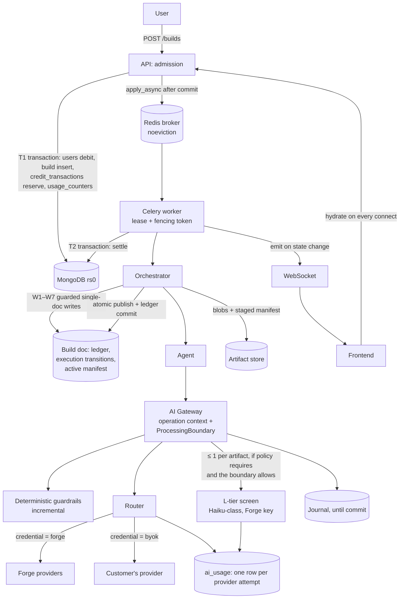
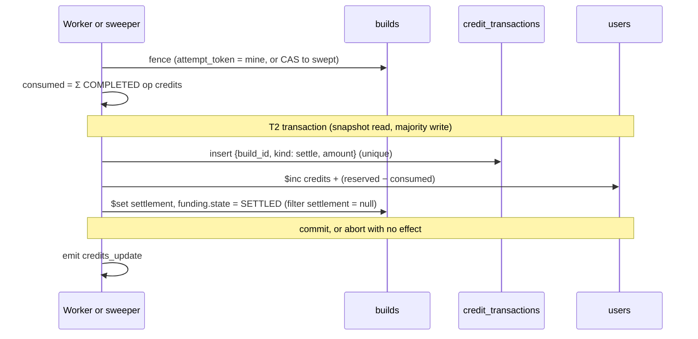
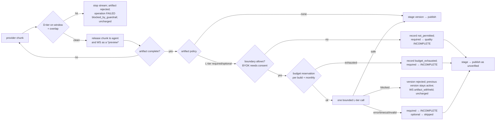
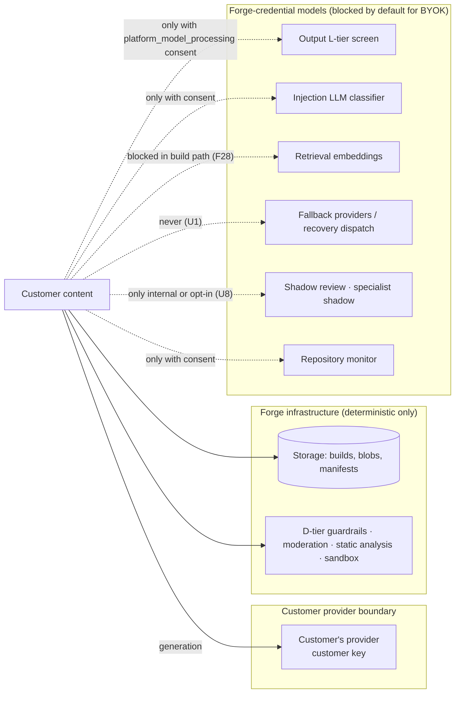
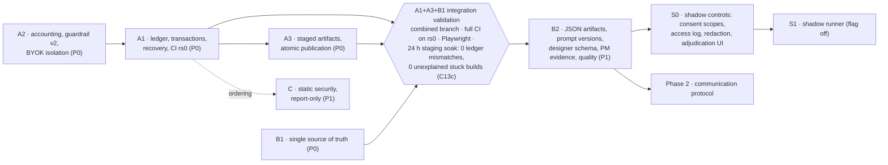

# Agent Collaboration & Continuous Quality: Plan (Revision 3)

**Status:** planning document only. It authorizes no production code changes,
implementation PRs or merges.

**Change log**

| Revision | Commit | Content |
|---|---|---|
| 1 | `f6eaa2d` | Audit |
| 2 | `3047b82` | First owner decisions |
| 2, amended | `0e2710d` | Accounting decisions C2, C4, C5, C7, C8, C9 and the Foundation A ledger specification |
| 3 (this document) | n/a | Owner dispositions for U1–U13, C1, C3, C6, C10, C12b, C13b–e and C14. P0 treatment of output guardrails, the BYOK privacy boundary and artifact integrity. MongoDB transactions with CI on a replica set. Fail-closed validation. New findings F28–F29 |

**Scope:** the production build path. Line references are to commit `3351bbd`.

**Owner direction for this phase:** prove the work is correct, account for every
operation, preserve every artifact, and never put customer data or money at
risk. Universal messaging and shadow reviews come **after** the foundations.

### Contents

| § | Section |
|---|---|
| 1 | Decision register |
| 2 | P0 findings and new evidence |
| 3 | Architecture and data-flow diagrams |
| 4 | **Guardrail execution model (v2)** |
| 5 | **BYOK data flow and privacy boundary** |
| 6 | Provider cost inventory |
| 7 | Accounting model and rules |
| 8 | Foundation A ledger specification |
| 9 | **Artifact integrity: staged versions and atomic publication** |
| 10 | **MongoDB transaction requirements** |
| 11 | **Fail-closed validation** |
| 12 | Failure-state transition matrix |
| 13 | Reservation formula and quotas |
| 14 | PR breakdown and dependencies |
| 15 | Database model changes |
| 16 | **Acceptance tests** |
| 17 | Shadow review, adjudication and promotion |
| 18 | **Migration and rollback requirements** |
| 19 | **Contradictions and remaining decisions** (listed separately) |
| A | Appendix: findings index |

---

## 1. Decision register

Status values: **Approved** (owner decision), **Defined** (specified by this
revision to satisfy an owner requirement; listed in §19 where confirmation is
useful), **Open** (§19).

### 1.1 Architecture and product decisions

| ID | Decision | Status | Section |
|---|---|---|---|
| A | User-funded generation and platform-funded reviews are separate funding models; reserve the worst case; refund the rest exactly once; never absorb overruns silently | Approved (Rev 2) | §7, §13 |
| B | Execution status is separate from quality status | Approved (Rev 2) | §11 |
| C | The backend is the single source of truth; no Gemini generation in live mode | Approved (Rev 2) | §14 (B1) |
| D | Exactly one shadow edge first: Architect → Developer | Approved (Rev 2) | §17 |
| E | Activity, Decisions and Escalations visibility lanes | Approved (Rev 2) | Phase 2 |
| F | Security agent high priority; static analysis early; universal communication capability under orchestrator control | Approved (Rev 2) | §14 |
| C2 | Exempt build calls from the interactive daily budget, **replaced by** per-build and per-agent ceilings, plan daily build limits, USD limits, rate limits and full tracking. **Implementation blocked until U4 and U5 are configured and validated** | Approved with controls | §13.3 |
| C4 | BYOK reserves 0 credits; no silent switch to Forge keys; separate provider accounting | Approved | §5 |
| C5 | Free first build includes ≤ 3 clarifications within a defined free-build allowance | Approved (see §19, X3) | §13 |
| C7 | Human adjudication on internal or opt-in builds only; redaction; minimum material; access logging; retention | Approved | §17.3 |
| C8 | No credits for failed operations or operations with no usable, persisted output; BYOK billing disclosed | Approved | §7, §8 |
| C9 | One platform-funded recovery for an interrupted mandatory stage; BYOK exception | Approved | §8.6 |
| C11 | Four foundation PRs: A, B1, B2, C | Approved (A split proposed, §19 X14) | §14 |
| C13 | 50 builds; 100 adjudicated blocking findings; 95% precision; 90% recall per category; 100% critical suite; confidence intervals and per-category sizes reported; never auto-activated | Approved | §17.4 |
| Formula | `max_build_cost` derived from settings (27 today), never hard-coded | Approved, subject to the EX-1 proof | §13 |

### 1.2 Dispositions in this revision

| ID | Approved disposition | Applied as | Section |
|---|---|---|---|
| **U1** | A BYOK interrupted build terminates; no automatic platform-key fallback | Recovery for BYOK = terminate and settle; completed stages kept | §8.6 |
| **U2** | No platform-key processing of BYOK content without explicit opt-in | `ProcessingBoundary`, enforced at one choke point, covering output guardrails, injection classifier, retrieval embeddings, fallback providers, recovery dispatch, specialist shadow, shadow reviews and monitoring | §5 |
| **U3** | Incremental deterministic guardrails, bounded LLM screening, separate budget | Guardrail v2 | §4 |
| **U4** | Keep the existing daily limits until plan-specific build limits are configured | `build_token_exemption` stays **off**; the 10,000-token free-plan safeguard stays | §13.3 |
| **U5** | Per-build **and per-agent** token ceilings before the C2 exemption is activated | Per-build meters and per-operation ceilings | §13.3 |
| **U6** | A genuine no-op debug pass is uncharged if it produces no usable persisted result | Usability predicate for `debug#k` | §8.1 |
| **U7** | Sonnet-class shadow reviewer, 20k input tokens, at most $0.20 per review | Startup-validated cost envelope | §17.1 |
| **U8** | AI shadow reviews only on internal or opted-in builds initially | Eligibility rule | §17.2 |
| **U9** | Clearly disclose that BYOK providers may bill for failed requests and retries | Disclosure (draft copy in §5.6) | §5.6 |
| **U10** | Transactions for multi-document financial operations; CI on the production replica-set topology | Transaction catalogue; CI and local `rs0` | §10 |
| **U11** | No raw provider payload retention by default; usage metadata 90 days | Journal retention aligned with this (X1) | §8.5, §15 |
| **U12** | Human and AI adjudication restricted to internal or opted-in builds pending privacy review | Consent scopes | §17.3 |
| **U13** | One bounded repair attempt for unusable platform-funded output; BYOK retries need explicit authorization | Retry classes by credential (X4) | §8.4 |
| **C1** | Introduce `quality_status = INCOMPLETE` | Quality states | §11 |
| **C3** | Question generation is included in the Developer stage price; actual usage recorded separately | `question_pass` priced 0, recorded | §8.1, §13 |
| **C6** | Follow-up builds are child builds with `parent_build_id`; previously accepted artifacts are never mutated | Parent manifest reference (X9) | §9.5 |
| **C10** | Persist canonical build execution state; UI status derived from persisted transitions, never from transient Celery state | `build_status` plus `execution_transitions` | §15.1 |
| **C12b** | Initial platform shadow-review budget $100 per month | Budget (call cap, X5) | §17.1 |
| **C13b** | A separate critical regression suite, mandatory on every PR, apart from extended evaluations | CI policy (X2) | §16.9 |
| **C13c** | 24 h staging with zero ledger mismatches and no unexplained stuck builds | Foundation exit and promotion precondition (X6) | §14.3 |
| **C13d** | Automatically demote a failing blocking category back to shadow | Demotion triggers (X11) | §17.4 |
| **C13e** | ≥ 100 labelled positive examples per defect category, with confidence intervals | Per-category gate (X10) | §17.4 |
| **C14** | The platform pays for mandatory quality reviews; no surprise per-review charge; an exhausted review budget yields INCOMPLETE, never success | Mandatory-review budget; fail-closed (X8) | §11, §17 |

### 1.3 Defined by this revision (owner requirement 9, fail-closed)

| ID | Definition | Section |
|---|---|---|
| FC-def | Every mandatory validation that cannot complete yields `quality_status = INCOMPLETE`, never `PASSED`. Artifacts are kept. Deploying or sharing requires an explicit, audited override (X15) | §11 |

---

## 2. P0 findings and new evidence

### 2.1 The three P0 issues

| # | Issue | Evidence | Fix |
|---|---|---|---|
| **F26** | **Output guardrails.** `AIGateway.stream` re-screens the *whole accumulated prefix* every 400 characters (`gateway/service.py:22-30, 246-266`). It uses the **calling agent's own model**, because `GuardrailsEngine._check_with_llm` loads the agent's config (`gateway/guardrails.py:78-114`, `core/llm/config.py:72-75`), and the provider is called directly with no usage record. Measured with the committed config: one 32,000-character Developer stream makes **73 calls on `claude-opus-4.8`, about 303k input tokens, ≈ $4.63**. Worst case per build is ≈ **$5.72 across 139 calls** (§6) | measured | A2 (§4) |
| **F26-B** | **BYOK privacy.** Guardrail screens run on Forge's providers even for BYOK requests: the gateway never consults `request.byok` before screening | `gateway/service.py:117-123, 203-266` | A2 (§5) |
| **F25** | **Artifact integrity.** `persist_files` runs `delete_many` and then `insert_many` (`tasks/build_tasks.py:150-156, 186-191`). A crash in between leaves a build with no files | code | A3 (§9) |

### 2.2 New findings in Revision 3

| # | Finding | Evidence | Severity | Fix |
|---|---|---|---|---|
| **F28** | **Context retrieval embeds build content with Forge's OpenAI key and searches across tenants.** Every context-engineered agent call (`agents/base.py:193-200` → `context_engineer/retriever.py:159-164, 209-214, 245-249`) calls `SemanticRetriever.retrieve(task, …)` **without `org_id` or `project_id`**. When `OPENAI_API_KEY` is set, that embeds the task text (blueprint, design, files) via `api.openai.com` with Forge's key (`retrieval/embeddings.py`), **including for BYOK builds**, with no usage record. `index.search` filters by tenant only when ids are passed (`retrieval/index.py:74-77`), so results come from **all organizations' indexed sources**. Today only opaque SHA-256 chunk ids reach the prompt: knowledge-base text goes into `project_state.extra`, which the template doesn't render (`prompt_builder/templates/base.py:26-83`). The cross-tenant exposure is therefore latent, not active | code; whether `OPENAI_API_KEY` is set in production is not visible in the repo (`docker-compose.prod.yml:38` passes it through, defaulting to empty) | P0 for the BYOK boundary when the key is set; P1 latent cross-tenant | A2: disable retrieval in the build path until it is tenant-scoped and boundary-checked |
| **F29** | **Both LLM safety tiers fail open.** `_check_with_llm` and `_check_injection_with_llm` return "not blocked" on any error (`gateway/guardrails.py:78-128`, `router.py:1223-1233`). Under the owner's fail-closed rule, a *required* screen that cannot run must not count as passing | code | P1 | A2 (§4.5) |
| F29-b | **The injection classifier is inactive with the committed config**: there is no `injection-check` override in `config/llm.yaml`, and `_check_injection_with_llm` returns early without one. A database override can enable it, in which case it runs on **every** provider call over all user-role content, BYOK included | code | Conditional | A2 governs it like L-tier (§4.6) |
| F29-c | **BYOK repair calls are automatic.** The gateway's structured-output repair calls the router again with the same `byok` (`gateway/service.py:131-155`), which is a second billed call on the customer's key. The BYOK router path itself has no retries or fallbacks (`router.py:658-720`) | code | P1 under U13 | A2 (§8.4) |

### 2.3 Earlier findings still open

F1–F27 are summarized in Appendix A. Their fixes are mapped to the PRs in §14.

---

## 3. Architecture and data-flow diagrams

### 3.1 Principles

1. `core/orchestrator.py` is the only control flow.
2. **Two ledgers, never mixed:**
   - the **credit ledger** (customer ↔ Forge);
   - the **provider-cost ledger** (payer ↔ provider), with one row per provider
     attempt.
3. **One processing boundary per build**, snapshotted at admission. Every
   platform-model call checks it first.
4. **Charge only usable, persisted output**, at most once per `stage_key`.
5. **Artifacts are immutable versions.** Publication is an atomic pointer switch.
6. **Multi-document money moves happen only in transactions.** Single-document
   state changes are guarded atomic updates.
7. **Fail closed.** Validation that could not run never counts as passed.

### 3.2 Build data flow



### 3.3 Settlement and reconciliation flow



---

## 4. Guardrail execution model (v2)

### 4.1 Goals (owner decision U3)

1. Deterministic guardrails run **incrementally**, at linear cost.
2. **No repeated full-prefix LLM screening.**
3. **At most one bounded, lower-cost LLM screen per artifact**, and only when
   policy requires it.
4. A **separate guardrail budget**, with every call recorded.
5. **No platform-key LLM screening of BYOK content without explicit consent.**
6. **Fail closed** when a *required* screen cannot complete.

### 4.2 Tiers

| Tier | What | When | Cost | BYOK |
|---|---|---|---|---|
| **D-tier** (deterministic) | Phrase and pattern rules with today's obfuscation-resistant normalization (`_strip_obfuscation`: NFKC, invisible characters, homoglyphs). Incremental: each window is scanned with a **tail overlap of `L` characters**, where `L` ≥ the longest normalized pattern + 32, so a phrase split across a window boundary is still found. Total work O(n) | Every stream window and every non-streamed response | No provider call | Always (Forge-side code, no model) |
| **L-tier** (LLM) | One classification call per **artifact** (an operation's final output), with input capped at `guardrail_llm_max_input_tokens` (default 8,000). Uses a **policy-configured model** (default Haiku-class), never the agent's own model | Only when the artifact policy says `llm_screen: required` or `optional`, the boundary allows it, and the budget reservation succeeds | ≈ $0.0065 per artifact at the cap (Haiku pricing) | Only with consent scope `platform_model_processing` (§5) |
| **Input D-tier** | `_contains_prompt_injection` (today's deterministic detector) | Every provider call | No provider call | Always |
| **Input L-tier** | The LLM injection classifier, today inactive by config (F29-b) | Only if explicitly enabled; then **once per operation**, not per provider attempt, retry or repair; input capped | Recorded under account `guardrail` | Only with consent |

### 4.3 Streaming release semantics



- Streamed text before the final verdict is a **preview**. It becomes a
  published artifact only after publication.
- An L-tier block withdraws the preview (`artifact_withheld` event) and never
  publishes the version.
- Policy may instead set `stream_mode: buffer_until_screened` for an artifact
  kind; then no preview is released before the L-tier verdict.

Which artifact kinds require L-tier, whether partial coverage is acceptable, and
whether previews may precede the verdict are open questions (X12).

### 4.4 Default policy shipped in A2 (until X12 is decided)

| Artifact kind | D-tier | L-tier | Stream mode |
|---|---|---|---|
| All agent outputs (architect, business model, designer, developer, integration, PM, debug, clarification answers) | required | **off** (no LLM screening by default) | preview after D-tier |
| Organizations with a policy override | required | `required` or `optional` per org policy (existing `policy` config block) | per org policy |

With the default, a full Developer stream makes **0** guardrail LLM calls
(today: 73). An org that requires L-tier gets **≤ 1 call per artifact** (≈ 16 per
max-path build, worst case ≈ $0.05).

### 4.5 Failure handling (fail-closed, F29)

| Situation | Required L-tier | Optional L-tier |
|---|---|---|
| Provider error, timeout or unparseable verdict | Version published **unverified**; `quality_status = INCOMPLETE` (`guardrail_unverified`); never accepted | Recorded as `skipped`; no quality effect |
| Guardrail budget exhausted (per build or monthly) | Same as above; alert on the budget | Recorded as `skipped` |
| Boundary does not allow it (BYOK without consent) | Same as above. **Policy must not require L-tier for BYOK builds without consent**: A2 validates org policies and rejects that combination at save time, so BYOK builds are never forced INCOMPLETE by configuration | Recorded as `not_permitted` |
| D-tier raises (code fault) | Operation FAILED, uncharged; artifact not published | n/a |

### 4.6 Budget and accounting

- **Account `guardrail`**, recorded in `ai_usage` with `purpose` set to
  `guardrail_output` or `guardrail_input`, plus `operation_id` and `attempt_seq`.
- **Budgets** live in `platform_budgets`, with an atomic reservation before each
  call (single-document guarded update):
  - `guardrail_monthly_usd` (value open, X12);
  - `guardrail_per_build_usd` (default: 16 artifacts × the per-call worst case,
    ≈ $0.11).
- The guardrail model must have an explicit `MODEL_COSTS` entry. Startup
  validation refuses an unpriced model.

### 4.7 Cost comparison

| | Today (committed config) | v2 default | v2 with L-tier required on every artifact |
|---|---|---|---|
| LLM guardrail calls, max-path build | 139 | **0** | ≤ 16 |
| Worst-case guardrail cost per build | ≈ $5.72 | **$0.00** | ≈ $0.05 |
| Model | the agent's own (Opus for Architect and Developer) | n/a | Haiku-class (policy) |
| Recorded | no | yes | yes |

---

## 5. BYOK data flow and privacy boundary

### 5.1 Boundary rule (U2, C4, U1, U13)

> For a BYOK build, customer content (prompt, blueprint, design, files,
> messages) may be sent **only** to the customer's own provider, using the
> customer's key. Forge infrastructure may store and process it with
> deterministic code (storage, D-tier guardrails, moderation patterns, static
> analysis, sandbox compile). **No Forge-credential model call may receive it**
> unless the owner holds an active `platform_model_processing` consent captured
> before the build started. **No additional billed call on the customer's key**
> (repair, retry, recovery) happens without explicit authorization.



### 5.2 Enforcement: one choke point

- A `ProcessingBoundary` value is computed at admission and snapshotted on the
  build:

  ```
  {credential_mode: forge | byok,
   consents: [platform_model_processing?, ai_quality_review?, human_quality_review?],
   policy_version}
  ```

  It travels in every `GatewayRequest`.
- `assert_platform_model_allowed(boundary, purpose)` is the **only** way to reach
  a Forge-credential model.
- It is called by:
  - the router's platform path;
  - `GuardrailsEngine` (L-tier);
  - the injection classifier;
  - `retrieval.embeddings`;
  - the shadow and specialist-shadow enqueue points;
  - the repository monitor;
  - the recovery dispatcher.
- Default for `byok`: **deny**.
- **This check is unconditional code, not a feature flag**, so no rollback can
  re-enable platform processing of BYOK content (§18).

### 5.3 Every platform-model path and its BYOK rule

| Path | Today on BYOK builds | After A2 |
|---|---|---|
| Output L-tier guardrail | **Forge provider, agent's model (Opus), unrecorded** (F26-B) | Denied without consent; D-tier only |
| Injection LLM classifier | Inactive by config; if enabled, runs on Forge providers for BYOK requests | Denied without consent |
| Retrieval embeddings in context assembly | **Forge OpenAI key when `OPENAI_API_KEY` is set**, unscoped (F28) | Disabled in the build path for everyone until tenant-scoped; then denied for BYOK without consent |
| Router fallback providers | Not used for BYOK (`router.py:374-406`) | Unchanged; asserted by test |
| Response cache | Bypassed for BYOK (`router.py:374-385`) | Unchanged; asserted |
| Recovery dispatch (C9) | n/a | Never on a Forge credential (U1: terminate) |
| Structured-output repair | **Automatic second call on the customer's key** (F29-c) | Off unless authorized (U13, X4) |
| Celery retry | Automatic, on the customer's key | Off unless authorized (U13, X4) |
| Specialist shadow (`core/specialist_shadow.py`) | Flag-gated (default off); would use Forge providers on BYOK content | Denied without consent |
| Shadow review | n/a | Excluded unless internal or opted in (U8) **and** `platform_model_processing` consent |
| Repository monitor | Forge provider, no `user_id` | Boundary taken from the project owner; denied for BYOK owners without consent |

### 5.4 Consent model

| Scope | Allows | Granted | Revoked |
|---|---|---|---|
| `platform_model_processing` | Forge-credential guardrail, classifier and retrieval calls over this user's BYOK content | Explicit opt-in screen, versioned to policy text | Immediately: narrows running builds at their next operation; **grants apply only to builds admitted afterwards** |
| `ai_quality_review` | Shadow AI review of this user's builds (U8) | Explicit opt-in | Immediately; queued reviews dropped |
| `human_quality_review` | Human adjudication (C7, U12) | Explicit opt-in | Immediately; excerpts purged |
| `byok_auto_retry` | Up to N automatic repairs or retries on the customer's key (X4) | Explicit opt-in with N chosen | Immediately |

Consents are stored in `data_use_consents` and snapshotted into
`build.processing_boundary`.

### 5.5 BYOK accounting

- Every attempt on the customer's key is recorded with `credential = byok`,
  `cost_bearer = customer_provider` and 0 credits. The UI shows it separately as
  "billed by your provider".
- Platform calls on a BYOK build (only with consent) use account `guardrail`,
  `cost_bearer = platform`.
- A missing or invalid key at run time makes the operation FAILED
  (`byok_unavailable`): no retry, no switch, build terminates and settles.

### 5.6 Disclosure (U9), draft copy for product and legal approval

> **Using your own API key.** Requests Forge sends with your key are billed by
> your provider, including requests that fail. Forge does not charge credits for
> them and cannot refund provider charges. Forge never switches to its own key
> during your build. Automatic retries and repairs on your key are off unless you
> turn them on, and Forge's own models will not process your content unless you
> opt in.

Placement: the BYOK settings page (before saving a key) and the build-start
confirmation for BYOK builds. Implemented in B1; ships only once the copy is
approved.

---

## 6. Provider cost inventory

### 6.1 Calls per build, by channel

| Channel | Per-build calls (max path) | Model | Recorded today | Account after A |
|---|---|---|---|---|
| Agent primary calls | 16 (incl. 3 answers, 4 PM, 3 debug) | per `config/llm.yaml` | success only | `generation` / `free_grant` / `customer_provider` |
| Structured-output repairs | ≤ 1 per structured operation (≤ 10) | same as the agent | success only, unlinked | same operation, `attempt_kind = repair` |
| Router retries and fallbacks | ≤ `max_attempts` (2) × chain | fallback chain | failures never (F27) | same operation |
| **Output guardrail screens** | **139 today** → 0 default / ≤ 16 | **agent's model today** → Haiku-class | **never** | `guardrail` |
| Injection classifier | 0 (inactive); if enabled, every provider call | config | never | `guardrail` (once per operation) |
| Retrieval embeddings | 2 per context-engineered call when `OPENAI_API_KEY` is set (FILE_CONTENT + KNOWLEDGE_BASE sources) | `text-embedding-3-small` (no `MODEL_COSTS` entry) | never | disabled in the build path (A2) |
| Recovery dispatch | ≤ 1 per mandatory operation | same as the agent | n/a | `recovery` |
| Specialist shadow | ≤ 1 (flag off) | specialist config | never | `shadow` |
| Shadow review | ≤ 2 (review + repair) | Sonnet-class | n/a | `shadow` |
| Repository monitor | outside builds | role config | never | `monitoring` |

### 6.2 Worst-case output-guardrail cost per build today

`MODEL_COSTS` prices; 3.86 characters per token, from the measured Developer
stream.

| Operation | Path | Model | Screens today | Today $ | v2 with L-tier required $ | Primary output $ (for scale) |
|---|---|---|---|---|---|---|
| architect_clarify | stream | Opus | 5 | 0.03 | 0.001 | 0.04 |
| architect blueprint | generate | Opus | 1 | 0.06 | 0.003 | 0.31 |
| business_model | generate | Haiku | 1 | 0.00 | 0.003 | 0.01 |
| designer | stream | Sonnet | 29 | 0.15 | 0.003 | 0.04 |
| question_pass | stream | Opus | 5 | 0.03 | 0.001 | 0.04 |
| clarification answers × 3 | stream | Opus | 12 | 0.07 | 0.001 | 0.09 |
| **developer** | stream | Opus | **78** | **4.95** | 0.007 | 0.60 |
| integration | generate | Sonnet | 1 | 0.02 | 0.005 | 0.09 |
| pm × 4 | generate | Sonnet | 4 | 0.03 | 0.007 | 0.12 |
| debug × 3 | generate | Opus | 3 | 0.37 | 0.020 | 1.84 |
| **Total** | n/a | n/a | **139** | **≈ 5.72** | **≈ 0.05** | 3.19 (output only) |

Estimates use the repository's token heuristic; confirm against provider
invoices.

---

## 7. Accounting model and rules

Unchanged from Revision 2 (amended) §4 except where noted.

### 7.1 Hierarchy

Build → Operation (`stage_key`, charged at most once) → Dispatch (≤ 2; dispatch
2 is the C9 recovery, never for BYOK) → Provider attempt (`ai_usage` row:
primary, retry, fallback, repair, guardrail, classifier, cache hit).

### 7.2 Funding sources and accounts

| Funding source | Customer credits |
|---|---|
| `user_credits` | Reserved, charged per completed operation |
| `byok` | 0 |
| `free_grant` | 0; counted against the allowance |

| Account | Cost bearer |
|---|---|
| `generation` | Platform; revenue from the credit ledger |
| `customer_provider` | Customer's provider |
| `free_grant` | Platform |
| `recovery` | Platform |
| `guardrail` | Platform security budget |
| `shadow` | Platform pilot budget |
| `mandatory_review` | Platform (C14) |
| `monitoring` | Platform |
| `interactive` | Non-build features |

`failure_absorbed` is a report view over uncharged operations' attempts.

### 7.3 The ten accounting rules

The mechanisms and proofs are those of Revision 2 (amended) §4.4, with these
changes:

| Rule | Change in Revision 3 |
|---|---|
| 1 (reserve before start) | Transaction T1 |
| 4 (refund exactly once) | Transaction T2 with a unique `credit_transactions(build_id, kind)`. **Replaces the capped `credit_ops` idempotency array** |
| 5 (one recovery) | BYOK terminates (U1) |
| 6 (separate expenditure) | Adds accounts `mandatory_review` and `guardrail` with their own budgets |
| 8 (no silent extra credits) | BYOK: no automatic extra billed calls (U13) |
| 10 (preserve artifacts) | Staged versions plus atomic publication (§9) |

---

## 8. Foundation A ledger specification

### 8.1 Stage-by-stage ledger

| `stage_key` | Mandatory | Price | Usable output (commit predicate) | Persisted before commit | Max dispatches (Forge / BYOK) | Max per build |
|---|---|---|---|---|---|---|
| `architect_clarify` (interactive) | no | 0 (part of architect) | JSON list | on the operation | 1 / 1 | 1 |
| `architect` | yes | `credits_architect` | schema-valid blueprint | step output (+ artifact, B2) | 2 / 1 | 1 |
| `business_model` | yes | `credits_business_model` | schema-valid | `business_model` + step output | 2 / 1 | 1 |
| `designer` | yes | `credits_designer` | parseable JSON (schema in B2) | step output | 2 / 1 | 1 |
| `question_pass` | no | **0: included in the Developer price (C3)**; usage recorded | JSON list ≤ Q | queued messages | 1 / 1 | 1 |
| `clarification#i` | no | `credits_clarification` | non-empty answer | `agent_messages[i]` | 1 / 1 | Q |
| `developer` | yes | `credits_developer` | ≥ 1 file; manifest validates (§9) | blobs + staged manifest; **published in the commit write** | 2 / 1 | 1 |
| `integration` | conditional | `credits_integration` | schema-valid; manifest validates | blobs + staged manifest | 2 / 1 | 1 |
| `pm#k` | yes | `credits_pm` | schema-valid validation | step output | 2 / 1 | N + 1 |
| `debug#k` | yes | `credits_debug` | schema-valid **and the manifest differs from the active one (U6: a genuine no-op is uncharged)** | blobs + staged manifest | 2 / 1 | N |

### 8.2 State machines

```
Operation: AUTHORIZED → DISPATCHED → COMPLETED (charged once)
                          ├→ FAILED       (uncharged: provider error, unusable output,
                          │                 guardrail block, policy error)
                          └→ INTERRUPTED  (marker persisted)
                                └→ dispatch 2 (Forge credential, mandatory only, account=recovery)
           AUTHORIZED → REFUSED (ceiling, quota or budget; no provider call)
Funding:   RESERVED → SETTLED | RELEASED  (T1 makes admission atomic; there is no RESERVING state)
Execution: PENDING → RUNNING → COMPLETED | FAILED   (canonical `build_status` + persisted transitions, C10)
Quality:   PENDING → PASSED | PASSED_WITH_WARNINGS | NEEDS_REVISION | BLOCKED | INCOMPLETE (C1)
```

### 8.3 Commit protocol (single document; fencing token `T`)

| Step | Action |
|---|---|
| W1 | Authorize: ceiling, quota and boundary check; `$push` the operation AUTHORIZED |
| W2 | `$set` DISPATCHED plus the dispatch record, **before** the provider call |
| W3 | One `ai_usage` row per provider attempt (success or failure) |
| W4 | Journal the final usable response |
| W5 | Validate (usability predicate; D-tier; manifest validation) |
| W6 | Write output: blobs plus a **staged** manifest; step output; messages (idempotent) |
| W7 | **One `$set`:** operation COMPLETED or FAILED, `credits`, `credits_used`, `active_manifest_version` (for file-producing operations), the execution transition, and `AgentStep` outcome. Filtered on `T` and `ledger.$[op].status = DISPATCHED` |

The crash analysis per step is as in Revision 2 (amended) §6.3. Additionally, a
crash between W6 and W7 leaves a staged manifest that was never published, so
the previous active version stays valid (§9).

### 8.4 Retry classes by credential (U13)

| Class | Forge credential | BYOK credential |
|---|---|---|
| Transient (provider 5xx, 408/429, timeouts, circuit open, Mongo/Redis connectivity) | Celery retry ≤ 3; each failed operation uncharged | **No automatic retry**: terminate and settle, unless `byok_auto_retry` is authorized (X4). Interactive builds may show a gate `kind = authorize_retry` |
| Model output (schema-invalid after repair; unusable) | **1 bounded repair** inside the dispatch (the gateway repair), platform-absorbed if it fails; then 1 Celery retry per `stage_key`; then non-transient | **No automatic repair** (the repair call is disabled for BYOK requests); terminate unless authorized |
| Non-transient (USD limit, quota, policy, injection rejection, ceiling, key 401/403, soft time limit, cancel, superseded) | No retry | No retry |

### 8.5 Journal and retention (U11)

- `llm_response_journal` holds a usable response only **between W4 and W7**. It
  is deleted right after W7 commits, with a TTL of 24 h as a backstop.
- Unusable or blocked outputs are never journaled.
- No other raw provider payload is retained.
- `ai_usage` keeps metadata (tokens, cost, ids, outcome), never content, for
  90 days.

See X1 for why this needs confirmation.

### 8.6 Recovery (C9, U1)

| Case | Action |
|---|---|
| Journal present (any credential) | Reuse it; no provider call; charged once if usable |
| Optional operation | INTERRUPTED; continue without it; uncharged |
| Mandatory, Forge credential | Dispatch 2 under account `recovery` (same Forge credential); charged once if usable; if dispatch 2 fails, terminate and settle |
| Mandatory, **BYOK** | **Terminate** (`interrupted_byok`), settle (0); completed stages and the active manifest kept; no Forge or customer re-dispatch |

### 8.7 Lease, fencing and the sweeper

Unchanged from Revision 2 (amended) §6.6:

- lease of 90 s, heartbeat every 30 s;
- a write matching 0 documents raises `AttemptSuperseded`;
- the sweeper resumes once (Forge credential only), otherwise fails and settles;
- it also releases builds that are RESERVED but were never dispatched (broker
  loss).

---

## 9. Artifact integrity: staged versions and atomic publication

### 9.1 Rule

Write the new version, validate it, then atomically switch the active manifest.
**Never delete or overwrite the last valid version before its replacement is
committed.**

### 9.2 Model

| Element | Content |
|---|---|
| `build_file_blobs` | Immutable, content-addressed per build: `(build_id, sha256)` unique; `content`, `size` |
| `build_manifests` | `(build_id, version)` unique. `{parent_version, entries: {path: sha256}, producer: {operation_id, stage_key}, state: staged \| published \| superseded \| rejected, validation: {...}, created_at}` |
| Build document | `active_manifest_version`: the single pointer every reader follows |

### 9.3 Publication sequence

```mermaid
sequenceDiagram
  participant O as Orchestrator (lease T)
  participant Bl as build_file_blobs
  participant M as build_manifests
  participant B as builds
  O->>Bl: upsert blobs for new or changed paths (idempotent by sha256)
  O->>M: insert version v+1, state = staged
  O->>O: validate (every blob present and hash matches; path rules; size caps; ≥ 1 file; D-tier passed)
  alt valid
    O->>B: W7 single $set: active_manifest_version = v+1, ledger commit (filter T, DISPATCHED)
    O->>M: v+1 published, v superseded (derivable; best-effort)
  else invalid or guardrail-blocked
    O->>M: v+1 rejected
    Note over O,B: active_manifest_version unchanged (v stays valid)
  end
```

**Validation rules:**

- paths are relative POSIX, with no `..`, no leading `/` and no NUL;
- at most `max_files` files and `max_total_bytes` in total;
- every entry resolves to a blob whose sha256 matches;
- file-producing operations need ≥ 1 file;
- debug versions must differ from their parent to be chargeable (U6).

### 9.4 Readers and the legacy projection

- **Readers switch to the manifest before writers change.** This is a two-phase
  rollout (§18):
  - `GET /builds/{id}/files`;
  - deployments (`api/deployments.py:454-503, 654`);
  - `tasks/pm_tasks.py:181`;
  - GDPR export (`api/gdpr.py:92`);
  - rollback (`api/builds.py:359-406`);
  - the follow-up/amend flow (`api/builds.py:264-286`);
  - resume (`tasks/build_tasks.py:122-127`).
- The `build_files` collection becomes a **derived projection** of the active
  manifest. It is updated after publication by upserting first and deleting
  stale paths second (**never delete-all**), and kept for one release for
  external readers. Builds without a manifest (legacy) are read from
  `build_files`.
- Superseded versions are kept until the build's retention TTL (90 days). GDPR
  deletion removes all versions.

### 9.5 Child builds (C6)

- A follow-up build is a child with `parent_build_id` and
  `parent_manifest_version`. It starts from that **immutable** manifest and
  publishes its own versions.
- The parent's artifacts are never mutated. Rollback becomes a child build
  whose first version copies a chosen ancestor manifest (no file rewriting).
- The Celery task receives `parent_build_id` and the manifest version instead of
  the full `existing_files` dictionary. Today that dictionary travels through
  the Redis broker as task arguments (`api/builds.py:219-229`), which adds broker
  memory pressure (relevant to F19).
- Parent selection is X9.

---

## 10. MongoDB transaction requirements (U10)

### 10.1 Topology

| Environment | Today | Required |
|---|---|---|
| Production | `mongo:7`, replica set `rs0`, keyFile + auth (`docker-compose.prod.yml:156-168`) | Unchanged |
| Staging | `rs0` (`docker-compose.staging.yml:25`) | Unchanged |
| CI `mongo-integration` | Standalone `mongo:7.0` service (`ci.yml:372-383`) | **Single-node `rs0`, Mongo 7, keyFile + auth as in production** |
| CI other jobs using Mongo | Standalone | Same as above |
| Local docker-compose | Standalone (`docker-compose.yml:111-121`) | Single-node `rs0` with an init step |

**CI implementation note.** GitHub Actions service containers cannot override
the container command, so `--replSet` cannot be passed through `services:`. The
job therefore starts Mongo in a step:

1. `docker run -d … mongo:7.0 --replSet rs0 --bind_ip_all --keyFile …`;
2. run `rs.initiate({_id: "rs0", members: [{_id: 0, host: "localhost:27017"}]})`;
3. wait for `PRIMARY`;
4. connect with `…?replicaSet=rs0&authSource=admin`.

**A guard test fails the job** if `hello.setName != "rs0"` (TX-6), so the
transactional tests can never silently run on a standalone server.

**Production startup guard.** Financial paths (`ledger_v2`) refuse to start if
the server is not a replica-set member: fail closed (TX-5).

### 10.2 Multi-document financial operations: transactions required

| ID | Operation | Documents in the transaction | Idempotency |
|---|---|---|---|
| **T1** | Admission and reservation | `users` (guarded `$inc −R`, `credits ≥ R`; or the free-grant claim with `free_build_id`), `builds` (insert with `funding.state = RESERVED`, boundary snapshot), `credit_transactions` (insert `reserve`), `usage_counters` (guarded daily-build `$inc`) | Unique `credit_transactions(build_id, kind)`; unique `builds.id`. A retried request with the same idempotency key finds the existing build |
| **T2** | Settlement | `credit_transactions` (insert `settle`), `users` (`$inc +refund`), `builds` (`$set settlement`, `funding.state = SETTLED`, filter `settlement: null`) | Unique `(build_id, settle)` |
| **T3** | Release (dispatch failure, orphan, undispatched) | As T2 with `consumed = 0`, kind `release`; free-grant rollback (`users` filter `free_build_id = bid`) | Unique `(build_id, release)` |
| **T4** | Platform budget settlement (S0/S1) | `platform_budgets` (`reserved −est`, `spent +actual`), `shadow_reviews` (status, cost) | Unique `shadow_reviews.id`; settled flag |
| **T5** | Mandatory-review budget settlement (Phase 3 enforcement) | `platform_budgets`, the review record | as T4 |

`credit_transactions` writes outside T1–T3 are forbidden.

### 10.3 Single-document operations: guarded atomic updates

| ID | Operation | Document |
|---|---|---|
| G1 | Ledger W1, W2, W7 (including `credits_used` and the manifest pointer) | `builds` |
| G2 | Lease acquire, heartbeat, fencing | `builds` |
| G3 | Token meters (per build, per operation) | `builds` |
| G4 | Guardrail and shadow budget *reservation* (`$inc reserved_usd` with `$expr reserved + spent + est ≤ limit`) | `platform_budgets` |
| G5 | Consent grant or revoke | `data_use_consents` |
| G6 | Manifest state transitions | `build_manifests` |

### 10.4 Transaction rules

1. Use `session.with_transaction(callback)`. The callback **must be idempotent**,
   because the driver retries on `TransientTransactionError` and
   `UnknownTransactionCommitResult`.
2. Read concern `snapshot`, write concern `majority`, read preference `primary`.
3. **No provider calls, broker calls or other network I/O inside a transaction.**
   Celery dispatch happens after T1 commits; a failure triggers T3.
4. Keep transactions short: target < 1 s, hard bound well under
   `transactionLifetimeLimitSeconds` (60 s).
5. Collections and indexes are pre-created at startup (`_ensure_indexes`),
   never implicitly inside a transaction.
6. A duplicate-key error on the idempotency index aborts the transaction and
   is treated as "already applied". The caller re-reads the state.
7. Write conflicts with a concurrent guarded update (e.g. T2 versus a late W7)
   abort one side, and the driver retries. T2 always runs after fencing, so a
   late W7 matches 0 documents.
8. **Testing seam.** `core/db_tx.py: run_financial_txn(fn)`.
   - Unit tests with fake collections exercise the logic but **cannot prove
     atomicity**.
   - Atomicity, concurrency and fault behaviour are proven only in the `rs0`
     `mongo-integration` job (TX-*, CT-*).

---

## 11. Fail-closed validation

**Rule.** If a mandatory validation cannot complete:

- quality becomes `INCOMPLETE`, with `incomplete_stages` naming it;
- the build is **never** marked accepted;
- artifacts are kept (decision B; §9);
- money moves only as the ledger says (no refund or retry triggered by quality).

| Validation | Mandatory? | Cannot complete because | Result |
|---|---|---|---|
| PM final acceptance | always | ceiling refusal; provider failure after retries; unusable output; timeout; BYOK terminated before PM | `INCOMPLETE` (execution COMPLETED if a published manifest exists, otherwise FAILED) |
| Deterministic checks (moderation, CSP, sandbox compile) | always | scanner error or timeout | `INCOMPLETE` |
| D-tier guardrail | always | code fault | Operation FAILED (uncharged); version not published |
| L-tier guardrail | per policy (§4.4) | not permitted, budget exhausted, error | Required: `INCOMPLETE`, version published as `unverified`. Optional: recorded as skipped |
| Mandatory review (after promotion) | per promoted category | **review budget exhausted (C14)**, timeout, invalid output | `INCOMPLETE`; never silently skipped |
| Static security (Foundation C) | report-only | error | Recorded as skipped; no quality effect until a rule is promoted |
| Evidence verification | per finding | quote or locator not resolvable | The finding cannot block; no `INCOMPLETE` |
| Token ceiling | per build and per operation | reached during validation | `INCOMPLETE` |

**Acceptance and distribution.**

| Quality status | Accepted? | Deploy or share |
|---|---|---|
| `PASSED`, `PASSED_WITH_WARNINGS` | yes | allowed |
| `NEEDS_REVISION`, `INCOMPLETE`, `BLOCKED` | no | requires an explicit, audited user override (X15) |

A blocking verdict from a *required* L-tier screen is never overridable: the
version is not published.

---

## 12. Failure-state transition matrix

Rows 1–9 are those of Revision 2 (amended) §7, with the credential-specific
changes shown. Rows 10–17 are new.

| # | Scenario | Ledger / dispatch | Credits | Provider-cost record | Retry | Execution → quality | Artifacts | Settlement / event |
|---|---|---|---|---|---|---|---|---|
| 1 | Normal completion | Op COMPLETED; manifest published in W7 | +price once | attempts under the operation's account; guardrail rows under `guardrail` | none | continues → per §11 | new version active | at end: T2 |
| 2a | Provider failure recovered in the router (Forge) | as 1 | +price once | failed attempts recorded | none | as 1 | as 1 | as 1 |
| 2b | Provider failure, router exhausted (Forge) | Op FAILED | 0 | recorded; `failure_absorbed` | Celery ≤ 3 | RUNNING; `agent_update` | previous version active | none yet |
| 2b′ | Same on **BYOK** | Op FAILED | 0 | `customer_provider` | **none** unless `byok_auto_retry` | **FAILED** (`byok_transient_no_authorization`); quality `INCOMPLETE` if code exists | kept | T2 (0); message names the provider error and that no retry or switch occurred |
| 2c | Unusable output (Forge) | repair ≤ 1 in dispatch; then Op FAILED | 0 | recorded; absorbed | 1 Celery retry per `stage_key` | as 2b | kept | none yet |
| 2c′ | Unusable output (**BYOK**) | **no repair**; Op FAILED | 0 | `customer_provider` | none unless authorized | FAILED or COMPLETED + `INCOMPLETE` | kept | T2 (0) |
| 3 | Non-transient failure | Op FAILED or REFUSED | 0 | recorded | none | no code: FAILED; code: COMPLETED + `INCOMPLETE` | kept | T2 |
| 4 | Celery retry (Forge) | new lease; completed ops skipped; new op for the failed `stage_key` | unchanged | recorded | counted | RUNNING | reused | none |
| 5a | Interruption, journal present | Op COMPLETED from the journal | +price once | no new call | resume | RUNNING | published at W7 | n/a |
| 5b | Interruption, no journal, mandatory, Forge | D1 INTERRUPTED → D2 (`recovery`) | +price once if D2 usable | D2 `recovery` | resume once | RUNNING, or terminate if D2 fails | active version kept | T2 on terminate |
| 5c | Interruption, mandatory, **BYOK** | Op INTERRUPTED | 0 | D1 on the customer's account | none (U1) | **FAILED** (`interrupted_byok`) | kept | T2 (0) |
| 5d | Interruption, optional op | Op INTERRUPTED | 0 | D1 unknown | continue | RUNNING | n/a | n/a |
| 6a–6d | Duplicate delivery / stale writer | lease and fencing (unchanged) | 0 | stale attempts recorded, uncharged | ack / exit | unchanged | unchanged | none |
| 7a–7c | Reservation exhaustion | Op REFUSED | 0 | none | none | optional: continue; mandatory before code: FAILED; after code: COMPLETED + `INCOMPLETE` | kept | T2 |
| 8 | Settlement | T2 (exactly once; concurrent settlers serialize on the unique index) | +refund once | `provider_cost_summary` | n/a | n/a | n/a | `credits_update` |
| 9a | BYOK normal | as 1, credits 0 | 0 | `customer_provider`; no Forge-model rows without consent | none automatic | as 1 | as 1 | T2 (0) |
| 9b | BYOK key unavailable | Op FAILED (`byok_unavailable`) | 0 | if sent, customer | none | FAILED | kept | T2 (0) |
| **10** | **Guardrail D-tier hit mid-stream** | stream stopped; Op FAILED (`blocked_by_guardrail`) | 0 | attempts recorded | none (non-transient) | if a previous version exists: COMPLETED + `BLOCKED`; else FAILED | **previous version stays active**; new version rejected | T2; `artifact_withheld` |
| **11** | **Required L-tier blocks** | Op FAILED (`blocked_by_guardrail`) | 0 | L-tier row `guardrail` | none | as 10 | as 10 | as 10 |
| **12** | **Required L-tier cannot run** (budget, error, not permitted) | Op COMPLETED (output usable) | +price once | `guardrail` row (or `not_permitted` record) | none | COMPLETED + `INCOMPLETE` (`guardrail_unverified`) | version published **unverified** | T2 |
| **13** | **BYOK build, policy requests L-tier, no consent** | prevented at policy save (§4.5); at run time recorded `not_permitted` | as 1 | none from Forge models | n/a | as 1 (D-tier only) | as 1 | as 1 |
| **14** | **Crash during artifact publication** | staged manifest never published, or published by W7 | as W7 | n/a | resume | RUNNING | **active = the last valid version, never empty** | n/a |
| **15** | **T1 or T2 transaction aborted** (transient, write conflict, unknown commit) | driver retries the idempotent callback; a duplicate key means already applied | exactly once | n/a | n/a | n/a | n/a | consistent; reconciliation verifies |
| **16** | **Mandatory review budget exhausted** (after promotion) | review op REFUSED | 0 (platform-funded anyway) | none | none | COMPLETED + `INCOMPLETE` (`review_budget_exhausted`) | kept | T2; budget alert |
| **17** | **Financial path on a non-replica-set server** | startup refuses `ledger_v2` (fail closed) | n/a | n/a | n/a | admission rejected with a service error | n/a | no money moves |

---

## 13. Reservation formula and quotas

### 13.1 Formula (unchanged; C3 applied)

```
max_build_cost = p_arch + p_bm + p_des + p_dev + p_int + p_pm
               + N × (p_dbg + p_pm)
               + [Q > 0] × Q × p_clar          # question generation included in p_dev (C3)
               + V × p_rev                     # 0 until a blocking review edge exists
```

- **Current value: 15 + 9 + 3 + 0 = 27.** It is derived from settings and
  stored with `breakdown` and `pricing_version`.
- `credits_question_pass` is removed. The `question_pass` operation has price 0,
  and its usage is recorded under the Developer bundle.
- Retries, repairs, guardrails and recovery add 0 customer credits.

### 13.2 Funding at admission

| Funding | Reserved | Ceiling |
|---|---|---|
| `user_credits` | `max_build_cost` (402 with required, available and breakdown when insufficient) | reservation |
| `byok` | 0 | operation and token ceilings; no automatic extra billed calls |
| `free_grant` | 0 | free-build allowance = `max_build_cost` credit-equivalents (including ≤ 3 clarifications, C5) + token ceilings + `build_timeout` |

### 13.3 Quotas (C2 controls, U4, U5)

| Control | Applies to | State in A |
|---|---|---|
| Interactive daily token budget (10k / 100k / 500k / 2M) | **All calls, builds included, until U4 and U5 are live** | **Unchanged.** The free-plan 10,000-token safeguard stays in force (consequence for C5: X3) |
| `build_token_exemption` | Calls bound to a live ledger operation | **Built, flag off.** Enabling requires (a) U4 values configured, (b) U5 per-build and per-agent ceilings configured, (c) acceptance tests QT-1…QT-5 green on staging |
| Per-build token meters | `generation` and `platform` | Built and recorded; ceilings configurable; no limit until set |
| **Per-agent (per-operation) token ceilings** (U5) | each `stage_key` | Built. Ceiling = (input cap + `max_tokens`) × max provider attempts per dispatch × max dispatches; values configurable |
| Plan daily build limits (U4) | admission (`usage_counters`, inside T1) | Built; no limit until configured |
| USD limits (org, project, agent) | Forge-credential calls | Existing |
| Provider rate limits | all calls | Existing |
| Guardrail budget | `guardrail` | New (§4.6) |
| Shadow budget | `shadow` | $0.20 per review, $100 per month (§17) |
| Mandatory-review budget | `mandatory_review` | Value open (X8) |

---

## 14. PR breakdown and dependencies

### 14.1 Foundation A as a milestone of three PRs (proposal X14)

The approved PR "A" covers six areas: financial correctness, provider
accounting, recovery, BYOK isolation, guardrails and artifact integrity. To keep
reviews small, I propose delivering it as three PRs inside the A milestone. A2
carries the largest immediate cost and privacy reduction and touches no
billing code.

| PR | Scope | Fixes |
|---|---|---|
| **A2: provider accounting, guardrail v2, BYOK isolation** (first) | Unified usage recording (every provider attempt, every channel, platform principals, `purpose`); guardrail v2 (§4); `ProcessingBoundary` choke point (§5) and `data_use_consents` (`platform_model_processing`, `byok_auto_retry`); disable build-path retrieval embeddings; no automatic BYOK repair; `platform_budgets` for `guardrail`; fail-closed L-tier semantics; policy-save validation | F16, F23, F26, F26-B, F27, F28, F29, F29-b, F29-c |
| **A1: ledger, transactions, recovery** | `core/pricing.py`; T1/T2/T3 transactions; CI and local `rs0`; startup topology guard; ledger operations W1–W7; retry classes by credential; journal (§8.5); lease, fencing, sweeper; canonical `build_status` + transitions (C10); quotas (meters, per-operation ceilings, daily counter; exemption flag off); gate time budget; broker `noeviction`; reconciliation | F1, F2, F13, F14, F17 (controls), F18, F19, F21, F22 |
| **A3: artifact integrity** | Blobs and manifests; validation; atomic publication in W7; readers switched first; `build_files` as a derived projection; child builds (C6) | F25, C6 |

### 14.2 Dependency graph



| PR | Hard dependencies | Merge gate |
|---|---|---|
| A2 | none | Its own acceptance tests (§16.1–§16.3), plus a 24 h staging soak showing guardrail calls per build ≤ artifacts and 0 Forge-model calls on BYOK builds |
| A1 | A2 (operation ids are attached to the usage rows A2 records) | Integration validation with A3 and B1 |
| A3 | A1 (publication happens in the W7 commit) | Integration validation |
| B1 | none (developed in parallel) | Integration validation |
| Integration validation | A1, A3 and B1 approved | Combined branch, rs0 CI, Playwright live-build and reconnect specs, 24 h staging soak with 0 mismatches and 0 unexplained stuck builds. Then merge A1 → A3 → B1, re-validating after each rebase |
| C | A1 merged (orchestrator conflicts only) | §16.8 |
| B2 | A1, A3, B1 merged | §16.7 |
| S0 | B2; C7 privacy review status known | privacy tests (PV-*) |
| S1 | S0; flag off until enabled by the owner | shadow tests (SH-*) |

### 14.3 Foundation exit criterion (C13c)

All §16 suites green, plus a 24 h staging run with **zero ledger mismatches**
(reconciliation invariants I-1…I-12) and **no unexplained stuck builds**: every
non-terminal build older than `build_timeout` + 15 min must have a recorded
reason.

---

## 15. Database model changes

These are the changes relative to Revision 2 (amended) §10.

### 15.1 `builds`

| Change | Detail | PR |
|---|---|---|
| Add | `build_status` (canonical: `pending/running/completed/failed`) and `execution_transitions[]` `{from, to, at, reason, attempt_token}`, written in the same `$set` as the state change. The legacy `status` is kept in sync in that same write for one release (C10) | A1 |
| Add | `processing_boundary {credential_mode, consents[], policy_version}` (snapshot) | A2 |
| Add | `active_manifest_version`, `parent_build_id`, `parent_manifest_version` | A3 |
| Add | `token_meters` per build and `operation_token_ceilings` per `stage_key` | A1 |
| Change | `funding.state` ∈ {RESERVED, SETTLED, RELEASED} (no RESERVING; T1 is atomic) | A1 |
| Change | `quality.status` gains `INCOMPLETE` (C1); `quality.incomplete_stages`; `quality.unverified_versions` | B2 (A1 writes `incomplete_stages` for ceiling and budget stops) |
| Keep | `ledger[]` (with `dispatches[]`), `settlement` (with `provider_cost_summary`), `attempt_token`, `lease_expires_at`, `recovery_enqueues`, `retry_scheduled_until`, `collab_config`, `error` | A1 |

### 15.2 Other collections

| Collection | Change | PR |
|---|---|---|
| `users` | **Remove** the Revision 2 `credit_ops` proposal (replaced by transactions). Keep `free_build_id`. `is_internal` (S0) | A1 |
| `ai_usage` | Add `purpose` (`generation`, `repair`, `retry`, `fallback`, `guardrail_output`, `guardrail_input`, `retrieval_embedding`, `recovery`, `shadow`, `monitoring`, `cache_hit`), `processing_boundary.credential_mode`, `operation_id`, `dispatch_no`, `attempt_seq`, `outcome`, `error_class`, `credential`, `cost_bearer`, `account`, `request_id`, `principal`, `beneficiary_user_id`. **Metadata only, never content (U11)**. TTL 90 days (existing) | A2 |
| `credit_transactions` | Unique `(build_id, kind)`; written only inside T1–T3; no TTL | A1 |
| `llm_response_journal` | TTL **24 h**; deleted after W7; usable outputs only | A1 |
| `usage_counters` | Written inside T1 | A1 |
| `platform_budgets` | Accounts `guardrail`, `shadow`, `mandatory_review`; G4 reservation | A2 (guardrail), S0 (shadow), Phase 3 (mandatory_review) |
| `data_use_consents` | Scopes `platform_model_processing`, `byok_auto_retry` (A2); `ai_quality_review`, `human_quality_review` (S0) | A2, S0 |
| `build_file_blobs`, `build_manifests` | New (§9). TTL 90 days, aligned with `build_files`; GDPR export and delete | A3 |
| `build_files` | Becomes a derived projection (safe order); kept one release | A3 |
| `semantic_chunks` | No schema change; build-path retrieval disabled (A2). Re-enabling requires mandatory `org_id` and `project_id` scoping in `SemanticRetriever.retrieve` | A2 |

---

## 16. Acceptance tests

All IDs are mandatory for the PR shown. Backend tests use the stub-agent
harness with the **real** reservation formula. Tests marked *rs0* run in the
`mongo-integration` job on a replica set. **FI** = fault injection at the N-th
persisted write, for every N.

### 16.1 Guardrail v2 (A2)

| ID | Test | Pass criterion |
|---|---|---|
| GR-1 | `test_guardrail_v2.py::test_dtier_incremental_linear` | Characters scanned ≤ stream length + overlap × windows; no full-prefix rescans |
| GR-2 | `::test_dtier_detects_phrase_split_across_windows` (plain and obfuscated: homoglyph, zero-width, spacing) | Detected in 100% of boundary positions |
| GR-3 | `::test_developer_stream_makes_zero_llm_screens_by_default` (32,000-char fixture) | **0** LLM guardrail calls (today: 73) |
| GR-4 | `::test_required_policy_makes_at_most_one_screen_per_artifact` | ≤ 1 call per artifact; input ≤ `guardrail_llm_max_input_tokens`; model == policy model ≠ agent model |
| GR-5 | `::test_required_screen_failure_is_incomplete_not_pass` (error, timeout, garbage verdict, budget exhausted) | `quality = INCOMPLETE`, `guardrail_unverified`; never `PASSED` |
| GR-6 | `::test_llm_block_withholds_version_previous_stays_active` | New version rejected; `active_manifest_version` unchanged; `artifact_withheld` emitted; op uncharged |
| GR-7 | `::test_every_guardrail_call_recorded` | `ai_usage` rows == calls; account `guardrail`; `operation_id` set |
| GR-8 | `::test_guardrail_budget_atomic` *(rs0)* | 50 concurrent reservations: `reserved + spent ≤ limit` |
| GR-9 | `::test_policy_rejects_required_ltier_for_byok_without_consent` | Policy save rejected |
| GR-10 | `::test_cost_regression_guard` | Guardrail calls per max-path stub build ≤ number of artifacts (16) |

### 16.2 BYOK isolation (A2)

| ID | Test | Pass criterion |
|---|---|---|
| BY-1 | `test_byok_boundary.py::test_no_forge_model_call_on_byok_build` | Every Forge provider adapter, the OpenAI embeddings URL (httpx transport), the guardrail L-tier and the classifier patched to raise. A full BYOK stub build makes **0** such calls on every channel |
| BY-2 | `::test_boundary_check_is_unconditional` | With every guardrail, retrieval and shadow flag in every state, including the rollback state, BY-1 still holds |
| BY-3 | `::test_no_automatic_repair_on_customer_key` | Schema-invalid BYOK response → exactly 1 customer-key call; op FAILED; build settles at 0 |
| BY-4 | `::test_no_celery_retry_without_authorization` | Transient BYOK error → `self.retry` not called; build FAILED with reason |
| BY-5 | `::test_authorized_retries_bounded` | With `byok_auto_retry = N`: ≤ N extra calls, recorded `customer_provider` |
| BY-6 | `::test_interruption_terminates` | No dispatch 2 on any credential; settled at 0 (U1) |
| BY-7 | `::test_consent_snapshot_semantics` | A grant mid-build does not widen the running build; a revocation narrows it at the next operation |
| BY-8 | `::test_byok_usage_attribution` | Generation rows `credential = byok`, `cost_bearer = customer_provider`, 0 credits |
| BY-9 | `::test_shadow_and_specialist_shadow_never_enqueued_for_byok_without_consent` | n/a |
| BY-10 | `test_retrieval_scoping.py::test_build_path_retrieval_disabled` and `::test_retrieve_requires_org_and_project` | n/a |

### 16.3 Unified usage accounting (A2)

| ID | Test | Pass criterion |
|---|---|---|
| UA-1 | `test_usage_attribution.py::test_provider_calls_equal_recorded_attempts` | Patched adapters count calls across a full build (repairs, retries, fallbacks, guardrails, classifier when enabled) == `ai_usage` rows |
| UA-2 | `::test_failed_attempts_recorded` | Zero-token error rows present with `outcome = error` |
| UA-3 | `::test_platform_principals_recorded` | Specialist shadow and monitor rows recorded without `user_id` |
| UA-4 | `::test_platform_usage_excluded_from_user_daily_budget` | n/a |
| UA-5 | `::test_no_content_in_usage_rows` | Schema allow-list: no prompt or completion text fields (U11) |

### 16.4 Ledger, transactions and recovery (A1)

| ID | Test | Pass criterion |
|---|---|---|
| EX-1 | Base matrix (funding × clarification outcomes × integrations × PM/debug sequences; 11,730 runs) | `consumed ≤ reserved` (or allowance); `consumed` = closed-form price of COMPLETED usable ops; BYOK = 0; I-1…I-12 hold. PR CI: stratified 5% + the full max path; nightly: all |
| EX-2 | Fault matrix (op position × fault × credential; 2,160 runs) | Same assertions + §12 row semantics |
| EX-3 | Credit-neutral overheads (seeded; 2,000) | Overheads never change `consumed` |
| TX-1 | `test_tx_admission.py` *(rs0)*: FI inside T1 at every statement | All four documents written, or none |
| TX-2 | `test_tx_settlement.py` *(rs0)*: worker + sweeper + duplicate × 10 concurrently | Exactly one settle row; balance exact |
| TX-3 | *(rs0)*: settlement racing a late W7 | Late W7 matches 0; `consumed` excludes it |
| TX-4 | *(rs0)*: simulated `UnknownTransactionCommitResult` (connection drop at commit) | No double refund |
| TX-5 | `test_topology_guard.py` | `ledger_v2` refuses to start on standalone; admission returns a service error; no money moves |
| TX-6 | CI step | The `mongo-integration` job fails if `hello.setName != "rs0"` |
| CT-1…CT-10 | *(rs0)* concurrency suite from Revision 2 (amended) §11.2, with CT-10 replaced by TX-4 | as specified there |
| RT-1…RT-10 | Recovery suite from Revision 2 (amended) §11.3, with **RT-4 = BYOK terminate**, plus RT-11: BYOK journal-present interruption commits from the journal with no customer-key call | as specified |
| LC-1 | `test_execution_state.py::test_canonical_state_and_transitions` | Every state change persisted with a transition; the UI status derived from it; no `running` without a lease; no `failed` emitted before a retry (C10, F22) |
| QT-1…QT-5 | `test_quotas.py` | QT-1: exemption flag off keeps the daily budget. QT-2: an exemption call without a live operation binding is rejected. QT-3: per-build meter atomic *(rs0)*. QT-4: per-operation ceiling refusal → op REFUSED, `INCOMPLETE` if validation. QT-5: daily build limit inside T1 *(rs0)* |

### 16.5 Artifact integrity (A3)

| ID | Test | Pass criterion |
|---|---|---|
| AR-1 | `test_artifact_publication.py`: FI at every step (blob upsert, manifest insert, W7, projection) | `active_manifest_version` is always the last valid complete version; a build never has zero files once a version was published |
| AR-2 | `::test_invalid_manifest_rejected` (missing blob, hash mismatch, `..`, absolute path, NUL, empty, oversize) | Rejected; previous version active |
| AR-3 | `::test_stale_attempt_cannot_publish` *(rs0)* | Fenced W7 matches 0 |
| AR-4 | `::test_readers_follow_active_manifest` | Files API, deployments, `pm_tasks`, GDPR export, rollback, amend flow, resume; legacy builds fall back to `build_files` |
| AR-5 | `::test_child_build_never_mutates_parent` (C6) | The parent manifest hash is unchanged after the child completes or fails |
| AR-6 | `::test_retention_and_gdpr_cover_all_versions` | n/a |
| AR-7 | `::test_noop_debug_uncharged` (U6) | Identical manifest → op FAILED `no_change`, 0 credits, counts toward N |

### 16.6 B1

The Revision 2 tests:

- `WorkspacePage` subscribes to the `build_id` from the create response;
- live mode never calls `synthesizeCodeForPrompt`;
- Playwright live-build and reconnect specs against `vite build`;
- `buildStore` hydration;
- no build-document write per token.

New:

- **B1-7**: the UI status comes from persisted `build_status` and transitions,
  never from WS event order alone;
- **B1-8**: the BYOK disclosure renders before a key is saved and at BYOK build
  start, once the copy is approved;
- **B1-9**: a 402 response shows the required amount, the available amount and
  the breakdown.

### 16.7 B2

The Revision 2 tests (prompt versions, designer schema, PM evidence, deploy
guard), plus:

- FC-1…FC-8: one per row of §11 → `INCOMPLETE`, never accepted;
- FC-9: deploy or share of `NEEDS_REVISION`, `INCOMPLETE` or `BLOCKED` requires
  an audited override;
- FC-10: a required L-tier block is not overridable.

### 16.8 C

`test_static_security.py`: seeded fixtures per rule; bandit timeout handled; 0
provider calls; report-only (no quality change beyond warnings).

### 16.9 Critical regression suite policy (C13b)

| Layer | When | How |
|---|---|---|
| Deterministic critical checks (static security rules, moderation, deterministic guardrails, fixture apps) | **every PR** (required check) | No provider calls |
| Review critical suite, *replay mode* | **every PR** once a review edge exists | Recorded model outputs (pinned to prompt hash and model); verifies parsing, evidence verification and gating logic |
| Review critical suite, *live* (3/3 runs per case) | Required before merge for any PR touching review or guardrail prompts, models or policy; nightly on `main` | The existing manual, approval-gated `llm-validation.yml` pattern, so secrets are never exposed to PR CI (X2) |
| Extended evaluations (labelled set, recall per category) | Nightly and before promotion | Billed; budget account `shadow` |

---

## 17. Shadow review, adjudication and promotion

### 17.1 Budget (U7, C12b; values preserved)

| Setting | Value |
|---|---|
| Per review (= per build; one review per build) | **≤ $0.20**, startup-validated worst case (review + ≤ 1 repair + its guardrail handling) |
| Reviewer model | **Sonnet-class** with a `MODEL_COSTS` entry |
| Input cap | **20,000 tokens** (worst case $0.194) |
| Output cap | 2,000 tokens |
| Monthly budget | **$100** (`platform_budgets.shadow`) |
| Monthly call cap | 1,000 (X5) |
| Retries | 0 |
| Revisions | none |
| Execution | Celery queue `shadow`; principal `platform:shadow` |

### 17.2 Eligibility (U8)

Internal builds (`users.is_internal`), or owners with `ai_quality_review` consent.

BYOK builds additionally need `platform_model_processing` consent, because the
reviewer is a Forge-credential model (U2).

### 17.3 Adjudication (C7, U12)

Unchanged from Revision 2 (amended) §12.3:

- internal or opt-in only;
- redaction;
- minimum material (finding, ±20-line excerpt, blueprint fragment);
- logged "expand" action;
- `adjudication_access_log`, kept 1 year;
- excerpts deleted after 90 days;
- external opt-in disabled until the privacy review completes.

### 17.4 Promotion and demotion

Promotion uses the approved thresholds (§1.1 C13), applied **per category**:

| Criterion | Requirement |
|---|---|
| Labelled positive examples per category | **≥ 100** (C13e) |
| Recall per category | **≥ 90%**, with its Wilson 95% interval reported (at n = 100, observed 90% gives a lower bound ≈ 0.83) |
| Precision | ≥ 95% on ≥ 100 adjudicated blocking-eligible findings |
| Critical suite | 100% (live, 3/3) |
| Budget compliance | 100% |
| Staging | 24 h staging gate (C13c) |
| Activation | Requires recorded owner approval; never automatic on reaching a count |

**Automatic demotion (C13d).** A blocking category returns to shadow
automatically, with the flag flip recorded, on:

- (a) any live critical-suite regression;
- (b) rolling-window adjudicated precision below 95%;
- (c) any budget-cap breach;
- (d) timeout rate above the threshold.

The window sizes and the timeout threshold are X11. Re-promotion requires the
full §17.4 evidence again.

**Funding (C14).** Mandatory reviews are platform-funded (account
`mandatory_review`; budget X8). An exhausted budget yields `INCOMPLETE` (§11,
row 16). Review-triggered *revisions* remain user-funded production work within
the reservation (decision A; X8 asks for confirmation).

---

## 18. Migration and rollback requirements

### 18.1 Requirements that apply to every PR

1. **Additive data; per-build snapshots.** `schema_version`, `funding`,
   `processing_boundary`, `collab_config` and `pricing_version` are fixed at
   admission.
2. **Readers before writers.** Code that reads a new representation (manifest,
   `build_status`, new usage fields) is deployed and verified *before* the code
   that writes it is enabled. Writer flags can be turned off without breaking
   readers.
3. **Non-rollbackable safety properties.**
   - The BYOK processing boundary (§5.2) and the "never delete the last valid
     version" rule are **unconditional code, not flags**.
   - Rolling back any PR must keep them. A rollback that cannot keep them is
     not permitted; fix forward.
4. **In-flight builds** finish on the path they started on.

### 18.2 Per-PR rollback

| PR | Flags | Rollback procedure | Must remain after rollback |
|---|---|---|---|
| A2 | `guardrail_v2`, `unified_usage_recording`, `build_path_retrieval` (default **off**) | `guardrail_v2` off → the legacy windowed screens, **still subject to the BYOK boundary** (no L-tier on BYOK without consent) and recorded. `unified_usage_recording` off → legacy recording | BYOK boundary; build-path retrieval stays disabled; consent records |
| A1 | `ledger_v2`, `build_token_exemption` (off) | `ledger_v2` off → new builds legacy; v2 builds drain and settle through T2 (their stored `reserved_credits` equals the Celery argument) | rs0 topology in CI and local; the `credit_transactions` unique index; the broker `noeviction` policy |
| A3 | `manifest_publication` | Off → writes go to `build_files` using the **safe order** (upsert, then delete stale; never delete-all). Readers keep reading manifests for builds that have one | Manifest readers; existing manifests and blobs |
| B1 | `live_single_source` | Revert the frontend deploy | Backend state-only persistence (independent) |
| B2 | `artifacts_v1`, `pm_evidence_v2`, `quality_status_v1` | Flags off in reverse order | Builds already marked `completed + needs_revision/incomplete` stay as recorded |
| C | `static_security_report` | Off | n/a |
| S0 / S1 | `shadow_review_architect_developer` | Off; stop the `shadow` worker | Consent and access-log records; retention rules |

### 18.3 Release order

| Step | Release | Watch |
|---|---|---|
| 1 | A2: deploy readers and recording | Expect visible guardrail spend; confirm `OPENAI_API_KEY` status in production (F28) |
| 2 | `guardrail_v2` on: internal → 10% → 100% | Guardrail calls per build; D-tier hit rate; false blocks |
| 3 | A1: CI and local rs0 first, then deploy with `ledger_v2` off | n/a |
| 4 | `ledger_v2` on: internal → 10% → 100% | Reconciliation mismatches (target 0); 402 rate |
| 5 | A3: readers, then `manifest_publication` on | n/a |
| 6 | B1 frontend | n/a |
| 7 | The 24 h staging gate (§14.3) over the combined state | n/a |
| 8 | C, then B2, then S0/S1 | n/a |
| 9 | `build_token_exemption` on | Only after U4 and U5 values are configured and QT-1…QT-5 pass on staging |

---

## 19. Contradictions and remaining decisions

These are listed separately and **not assumed approved**. Each has an interim
default that never relaxes a financial or privacy control.

| ID | Issue | Why it needs a decision | Interim default |
|---|---|---|---|
| **X1** | **U11 vs the provider response journal.** "No raw provider payload retention" conflicts with A1's journal, which stores the usable response so a crash between receiving and committing it doesn't force a second paid call | Without a journal, every such crash costs a recovery dispatch (Forge), or terminates a BYOK build | Journal kept **only until the operation commits** (deleted at W7; 24 h TTL backstop); usable outputs only; the same content becomes the artifact anyway |
| **X2** | **C13b "critical suite on every PR" vs the billed-LLM trust boundary.** Live review runs need provider secrets, which `llm-validation.yml` deliberately never exposes to PR CI | Live 3/3 × 15 cases per PR also costs ≈ $9 at the shadow envelope | Every PR: deterministic plus replay-mode critical suite (required check). Live runs required before merge only for PRs touching review or guardrail prompts, models or policy (manual, approved workflow), plus nightly |
| **X3** | **C5 vs U4.** With the 10,000-token free-plan daily budget still applied to builds (U4), the free first build likely cannot pass the Developer stage at all (F17: its call alone pre-authorizes ~8,978 tokens), with or without clarifications | C5 is not deliverable until U4 and U5 ship and the exemption is enabled | Accept the sequencing: C5 delivered when `build_token_exemption` is enabled. Alternative: an interim exemption scoped to `free_grant` builds only, once U5 ceilings exist |
| **X4** | **What counts as "explicit authorization" for BYOK retries (U13)?** Strictly, BYOK builds become single-shot per operation: one transient provider error or invalid JSON ends the build. U9's disclosure mentions retries | n/a | No automatic BYOK retries or repairs. A standing account-level `byok_auto_retry` (N chosen by the user) is built but off; interactive builds may also show a per-build `authorize_retry` gate |
| **X5** | **C12b** asked about the monthly shadow *call* cap; the disposition restated the $100 budget | n/a | Keep the 1,000-call cap as a secondary bound |
| **X6** | **C13c** asked about review operational thresholds (latency, timeouts, invalid output); the disposition set the 24 h staging gate | n/a | Staging gate adopted. Review latency and timeout thresholds are reported, not gating; a timed-out mandatory review → `INCOMPLETE` |
| **X7** | The Revision 2 C13b sub-question (which critical cases apply to the Architect edge vs the combined gate) was not addressed | n/a | All 15 cases required of the Architect edge (stricter) |
| **X8** | **C14 budget and scope.** The size of the `mandatory_review` budget is open. When it is exhausted, **every** build becomes `INCOMPLETE`: correct, but an availability risk. Also confirm that review-triggered *revisions* stay user-funded (decision A), while reviews are platform-funded | n/a | No blocking review is enabled until the budget is set. Revisions stay user-funded within the reservation |
| **X9** | **C6 parent selection.** Which build is the parent: latest COMPLETED regardless of quality, latest accepted, or user-chosen? B2 makes PM-exhausted builds COMPLETED + `NEEDS_REVISION`, which today's selector (`status == success`) would start choosing | n/a | Latest COMPLETED build regardless of quality; the child inherits the parent's open findings as context. Explicit user choice later |
| **X10** | **C13e** fixes 100 labelled positives for recall; the per-category *precision* minimum and any lower-bound threshold are unstated | n/a | A category blocks only if it also has ≥ 100 adjudicated blocking-eligible findings of its own; lower bounds reported, no lower-bound threshold |
| **X11** | **C13d demotion triggers**: window size for rolling precision and the timeout threshold | n/a | Rolling 100 enforced decisions per category; timeout rate > 5% |
| **X12** | **Guardrail policy contents (U3)**: which artifact kinds require L-tier; whether partial coverage (artifact > input cap) is acceptable; whether previews may stream before the L-tier verdict (today every 400-character window is LLM-screened before release); the `guardrail_monthly_usd` value; the L-tier model | Defaulting L-tier off reduces LLM-based coverage relative to today, by design (U3). That is a security-policy choice | D-tier on everything; L-tier off by default and on per org policy; previews after D-tier; Haiku-class model; monthly budget unset (L-tier cannot run until set) |
| **X13** | **LLM screening for BYOK via the customer's own key** (customer-billed, no platform processing) as an alternative to consent | It is an additional billed call on the customer's key (U13) | Not offered; BYOK gets D-tier only unless `platform_model_processing` consent exists |
| **X14** | **Splitting Foundation A into A2, A1 and A3**, with A2 merging ahead of the A+B1 integration validation | Modifies the approved four-PR structure | Proposed in §14; A2 touches no billing or `emit` code |
| **X15** | **Deploy and share gating under fail-closed.** Today any build can be deployed. Proposed: `NEEDS_REVISION`, `INCOMPLETE` and `BLOCKED` require an audited override; a required L-tier block is never overridable | User-visible behaviour change | As proposed, shipping with B2 |
| **X16** | **Operational verification: is `OPENAI_API_KEY` set in production?** If yes, F28 is active today: BYOK content is sent to OpenAI on Forge's key, and unscoped cross-tenant search runs on every build | Determines whether to treat F28 as an incident (customer notification and policy review) | A2 disables build-path retrieval regardless |

**Parameters to sign off before the corresponding flag is enabled** (values, not
policy):

| Parameter | Unblocks |
|---|---|
| U4 plan daily build limits | `build_token_exemption` |
| U5 per-build and per-agent token ceilings | `build_token_exemption` |
| `guardrail_monthly_usd` | L-tier for any org |
| `mandatory_review` monthly budget | Blocking reviews |
| `guardrail_llm_max_input_tokens` | n/a (default 8,000) |
| Lease, heartbeat and sweeper timings | n/a (90 s / 30 s / 5 min) |

---

## Appendix A: findings index

| # | Summary | Fixed in |
|---|---|---|
| F1 | Clarifications dormant at 17 credits | A1 |
| F2 | Stage charges exceed the reservation | A1 |
| F3 | Per-token build-document rewrites | B1 |
| F4 | No rehydration | B1 |
| F5 | Tautological harness evaluation | B2 |
| F6 | Per-call in-memory prompt "versions" | B2 |
| F7 | PM sees 500-character previews | B2 |
| F8 | Agent content inlined unmarked | Phase 2 |
| F9 | Designer has no schema; silent empty files | B2 |
| F10 | Specialist agents unused | Phase 4 |
| F11 | Business Model output unused downstream | Phase 4 |
| F12 | No transactions in code (production supports them) | A1 |
| F13 | Resume re-charges a stage and leaves RUNNING steps | A1 |
| F14 | Gate waits exceed the build timeout | A1 |
| F15 | `b.id` vs `build_id` | B1 |
| F16 | Platform calls unrecorded | A2 |
| F17 | Daily token budget stops admitted builds | A1 controls; exemption gated |
| F18 | Every exception retried | A1 |
| F19 | Settlement not idempotent; no sweeper; evictable broker | A1 |
| F20 | Any build deployable | B2 |
| F21 | Duplicated price tables | A1 |
| F22 | Status never RUNNING; `build_failed` before retry | A1 |
| F23 | Uncharged provider channels | A2 |
| F24 | Gemini path in production frontend | B1 |
| F25 | Delete-then-insert files | A3 |
| F26 | 73-call Opus guardrail screening per Developer stream | A2 |
| F26-B | Guardrails on Forge keys for BYOK | A2 |
| F27 | Failed attempts unrecorded | A2 |
| F28 | Build-path retrieval embeds BYOK content with Forge's OpenAI key; unscoped cross-tenant search | A2 |
| F29 | LLM safety tiers fail open | A2 |
| F29-b | Injection classifier inactive by config | A2 |
| F29-c | Automatic BYOK repair calls | A2 |

**Probes.** F1, F2, F13, F17 and F26, and the ledger traces S1–S6, were
reproduced with throwaway probes driving the real code. The §6 costs are
computed from `MODEL_COSTS`, `config/llm.yaml` and the agents' `max_tokens`. No
probe is committed; §16 makes each one a permanent test.
