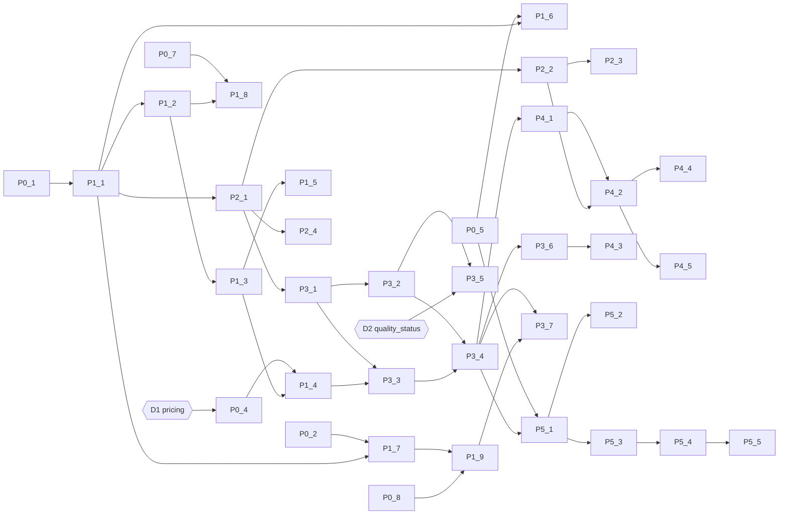

# Agent Collaboration & Continuous Quality: Audit, Gap Analysis and Plan

Status: **proposal. No production code has changed.** It answers the Technical
Requirements Specification "Universal Agent-to-Agent Communication,
Collaborative Validation & Continuous Improvement" (the TRS).
Audience: the engineers who will implement it and the owner who approves each phase.
Scope: the production build path only (`backend/tasks/build_tasks.py` →
`backend/core/orchestrator.py`). `orchestration/` is out of scope (its README
already says not to wire it into builds), and so is the PM/initiative layer
(`core/pm_orchestrator.py`).

Line references are to the tree at commit `3351bbd`.

---

## 0. TL;DR

1. **The TRS direction fits the code.** `core/agent_communication.py` already
   has the right shape: orchestrator-mediated routing, a route allow-list, a
   per-build limit, a credit ceiling, a timeout, a persisted delivery marker
   before the paid call, and a charge committed atomically with the answer. It
   generalizes cleanly. No second engine is needed, and none is proposed.
2. **The existing clarification feature is dormant for paying users.** At the
   reservation `api/builds.py` really applies (17 credits, because nothing ever
   populates `Project.tech_stack`), the clarification ceiling is 7. The pipeline
   has already used 12 credits by the time the Developer could ask. The result:
   **zero Developer → Architect questions run on any metered build.** Only BYOK
   builds ever use it. (Reproduced; see §1.8 F1.)
3. **Every TRS feature costs LLM calls, and today's reservation cannot fund
   even the existing pipeline's worst case.** A full debug loop charges 22
   credits against a 17-credit reservation (F2). Reviews and revisions have no
   budget to spend. **The first blocking decision is a pricing one, not an
   engineering one** (§8, D1).
4. Three recovery and accounting defects need fixing *before* more paid calls
   are added. A resumed build re-charges a crashed stage and leaves a dangling
   RUNNING step (F13). Every streamed token rewrites the whole build document,
   including the message history (F3). WebSocket events are never persisted, and
   the frontend never rehydrates (F4).
   Separately, **the live workspace does not follow the real build at all.** It
   reads `b.id` where the API returns `build_id`, and runs its own client-side
   synthesis (F15). Every TRS §12 requirement depends on fixing that first.
5. Several things that look like quality signals are not evidence:
   - The per-step "harness evaluation" checks an output against its own first
     50 characters, so it always passes (F5).
   - PM acceptance reads only 500-character previews of each file (F7).
   - Prompt "versioning" is in-memory and logs a new version on every call (F6).
6. **Recommended sequence:**
   - **Phase 0:** fix the foundation (accounting, persistence, provenance).
   - **Phase 1:** generalize the protocol and router and prove it with a second
     real route.
   - **Phase 2 onward:** artifacts, then reviews, starting with the single
     highest-value edge, the Architect reviewing the Developer's code. Run it in
     shadow mode first, then enforce it.
   - Everything sits behind fail-closed feature flags, snapshotted per build so
     a resumed build never changes mode.
7. The TRS names 10 logical components. They map onto **4 modules** called
   from `orchestrator.py` (§4.1). The orchestrator stays the only place that
   decides what runs next.

---

## 1. Audit of the current production agent architecture

### 1.1 Execution path

```
POST /builds/ (api/builds.py:67)
  ├─ reserve credits atomically (api/builds.py:125-163)
  │    max_credits = max(3*debug, sum(CREDIT_COSTS) * (len(project.tech_stack)+1))
  │    first build per account: reserve 0, unmetered (api/builds.py:144-155)
  └─ run_build.apply_async(build_id, …, reserved_credits)      # Celery
        tasks/build_tasks.py:76  run_build (soft limit settings.build_timeout=600s)
          emit(event)  = $set {status, agents, credits_used, business_model,
                               agent_messages} on builds doc, then WS publish   (:129-142)
          persist_files = replace build_files rows for build_id                  (:144-156)
          Orchestrator.run_build(...)                                            (core/orchestrator.py:75)
            1 Architect   clarify()* → gate → blueprint() → gate                 (:136-199)
            2 BusinessModel improve() → gate                                     (:203-225)
            3 Designer    design() → gate                                        (:227-245)
            4 Developer   [_run_developer_clarifications] → generate_files()     (:247-331)
                          (streamed; shadow specialist comparison, flag-gated)
            5 Integration integrate()   only if blueprint.integrations           (:333-359)
            - apply_csp, sandbox_runner.run (best-effort), scan_code             (:362-381)
            7 PM validate() ⇄ Debugger(developer.patch_files) ≤ MAX_DEBUG_ITERATIONS=3 (:392-457)
            8 BUILD_COMPLETE                                                      (:459-482)
          refund max(0, reserved - credits_used)                                 (build_tasks.py:193-200)
          on exception: manual self.retry() up to 3 (resume-aware)               (build_tasks.py:243-262)
  agents/base.py → gateway (AIGateway.generate/stream) → core/llm/router.py
          → provider; router._record_usage → ai_usage row {build_id, agent, tokens, cost}
```

`*` `clarify()` asks the **user** questions and runs only on interactive first
builds. Gates (`_wait_for_gate`, :650) run only on interactive builds.

### 1.2 How context moves between agents today

The TRS assumes a `previous_outputs` mechanism. **The production pipeline does
not use it.** `previous_outputs` is plumbed through `BaseAgent`
(`agents/base.py:172`) and `context_engineer`, but `orchestrator.py` never
passes it, so it is always `{}`. Context moves in three ways:

- **Explicit Python arguments:** `designer.design(blueprint)`,
  `developer.generate_files(blueprint, design, clarifications=…)`,
  `pm.validate(blueprint, files)`.
- **`AgentStep.output`:** a JSON string per stage, persisted on the build doc
  and used **only** for resume (`_try_recover_json`, :736).
- **`files`:** a dict persisted to `build_files`.

The TRS's "artifact references instead of text outputs" therefore means
replacing these explicit arguments and `AgentStep.output` with versioned
artifacts. There is no unused mechanism to evolve.

### 1.3 Existing agent-to-agent communication

`core/agent_communication.py` (280 lines, 21 tests in
`tests/test_agent_communication.py`, plus 2 crash tests in
`tests/test_build_tasks_resume.py`):

| Concern | How it is handled today | Where |
|---|---|---|
| Authorization | `(sender, recipient)` must be in `policy.allowed_routes` **and** have a registered responder; otherwise REJECTED `route_not_allowed` | `:151-158` |
| Identity | Sender is set by orchestrator code, never by LLM output, so impersonation is structurally impossible | `orchestrator.py:620` |
| Limits | `max_questions` counts *delivered* messages (answered/timeout/failed) | `:176-179, :247` |
| Budget | `credit_ceiling`: refuse if `credits_used + cost > ceiling`; `None` = unmetered BYOK | `:77-80, :181-184` |
| Crash safety | `delivery_attempts += 1` persisted (via `emit`) **before** the responder is called; a resumed PENDING message with attempts > 0 closes as FAILED `interrupted`, with no second provider call | `:186-211` |
| Atomic charge | `credits_used += cost` and status ANSWERED reach Mongo in the same `$set` on the build doc | `:239-244` + `build_tasks.py:129-141` |
| Timeouts | `asyncio.wait_for(responder, timeout_seconds)` → TIMEOUT, uncharged | `:215-223` |
| Batch durability | `submit()` records every question as PENDING before any `resolve()` | `:130-169`, `orchestrator.py:619-627` |
| Observability | `agent_message_request` / `agent_message_response` WS events | `:164-168, :270-275` |

The budget rule (`_clarification_policy`, `orchestrator.py:525-550`) is sound in
principle. Optional spend may only use reservation headroom that the worst case
of all *remaining mandatory* stages provably cannot need. **This is the rule to
generalize into a build budget** (§4.4). Its inputs are wrong today (F1, F2).

### 1.4 Credit accounting

- Stage charges are taken in `_start_agent` (`:785-811`) **before** the LLM call,
  at fixed rates (`core/config.py:125-142`). They are never checked against the
  reservation. Only clarifications are bounded.
- The reservation is a Celery argument only. **It is not stored on the build
  document**, so nothing else (an API, telemetry, a later phase) can see it.
- Real token usage and USD cost are recorded per LLM call in `ai_usage`
  (`core/ai_usage.py:260-321`, via `router._record_usage`), keyed by
  `build_id` and `agent` (the class name). They are not linked to a specific
  message or stage attempt. The gateway's `request_id` is generated
  (`gateway/service.py:75`) but not stored on the usage row. `usage_out` exists
  on `GatewayRequest` and the router fills it, but no pipeline agent passes it.
- There is a separate, unrelated USD spend-limit system,
  `core/llm/budget_manager.py`, scoped to org, project or agent and enforced in
  the router. Note the naming clash with the TRS "AgentBudgetManager".

### 1.5 Persistence and recovery

- **No Mongo transactions anywhere** (`start_session` / `with_transaction`
  appear nowhere in the codebase). Single-document atomicity on `builds` is the
  only atomic primitive. That is why `agent_messages` is embedded.
- Resume works at stage granularity: a stage with a SUCCESS `AgentStep` is
  skipped, and the PM/debug loop always restarts from PM.
  `build.debug_iterations` carries across attempts.
- Interactive gates persist `pending_gate` and poll Mongo (cross-process safe).

### 1.6 WebSocket and frontend

- `services/ws_manager.py`: same-process delivery plus Redis pub/sub fan-out to
  web replicas. **Nothing is persisted. There are no sequence numbers and no
  replay.**
- `frontend/src/hooks/useBuildSocket.ts` reconnects with backoff but **never
  re-fetches build state**. `GET /builds/{id}` (which returns `agent_messages`)
  is never called by the workspace (`buildsApi.get` has no callers).
- `frontend/src/store/buildStore.ts:95,404-430` keeps `agentMessages` and
  renders each exchange only as a system chat line. There is no collaboration
  panel.
- `frontend/src/lib/wsContract.ts:176-186` **rejects** any `agent_message_*`
  event without a string `question` field. Unknown event *types* are dropped
  silently (`isValidBuildEventType`). That is forward-compatible for new event
  types, but not for new shapes of the existing ones.
- Event types are generated from `WSEventType` by
  `backend/scripts/export_ws_events.py` into `src/lib/generated/wsEvents.ts`.
- In live mode, `WorkspacePage.tsx` subscribes to the wrong build id (F15), so
  none of the above reaches the user today.

### 1.7 Adjacent systems: what to reuse, what to leave alone

| System | What it is | Use for this work? |
|---|---|---|
| `agent_registry/` (`AgentRegistry`, `AgentProfile`) | Persistent per-project "employee" personas; the orchestrator logs stage outcomes to them (`_resolve_agent_profile`, `record_task_result`) | **Provenance only.** Attach `agent_profile_id` to messages, reviews and artifacts. Do **not** route by it: it is Mongo-backed and project-scoped, and its roles do not map 1:1 to pipeline stages |
| `agent_registry/team_chat.py` (`TeamMessage`, `MessageType` incl. REVIEW_REQUEST/APPROVAL/REJECTION/ESCALATION/FINDING) | Project-level persistent message board for org agents and humans | Reuse the **vocabulary**, not the store. Build messages need build-scoped budget and crash semantics that `team_messages` lacks. Optionally mirror escalations there later |
| `agent_registry/pr_workflow.py` (`ReviewDecision`, stage machine) | Review *lifecycle bookkeeping*, with no LLM judgment (see `review-board-reconciliation-proposal.md`) | Not on the build path. Do not couple |
| `agent_registry/monitoring.py` (`FindingSeverity` LOW..CRITICAL) | Repository-monitor findings | Align severity names; the TRS adds INFORMATIONAL |
| `harness/` (evaluator, regression, ab_test, benchmark) | Offline prompt evaluation primitives | **Reuse in Phase 5** for regression gates |
| `loop_engineer/` | Iterative prompt improver; works on a deep copy and never writes the registry. `/engineering/loop/improve` uses a stub "agent" that returns the system prompt itself | Safe today (admin-only, no write-back). Phase 5 must keep it unable to promote |
| `prompt_builder/` registry + `persistence.py` | Code templates plus a Mongo overlay; mutation is admin-only (`api/prompts.py:114-141`) | The promotion target in Phase 5. Already human-gated |
| `core/specialist_shadow.py` | Flag-gated, fire-and-forget, read-only shadow pattern | **Copy this pattern** for shadow-mode reviews |
| `core/feature_flags.py` | Fail-closed DB flags | Gate every phase |
| `orchestration/` | Experimental, unused | Out of scope (TRS §3) |

### 1.8 Findings that change the plan

Each finding was verified by reading the code. F1, F2 and F13 were also
reproduced with the real `Orchestrator` and stub agents, using the reservation
formula `api/builds.py` actually applies. That probe was a throwaway script and
is not committed.

| # | Finding | Evidence | Impact on TRS |
|---|---|---|---|
| **F1** | Developer → Architect clarifications **never run on metered builds.** Reservation = 17 (tech_stack is never written by any API). Ceiling = 17 − (PM 1 + 3×(debug 2 + PM 1)) = 7. `credits_used` at that point = 12. | Probe: `reserved=17 architect_answers=0 messages=0`. Tests pass only because they use `RESERVED_AMPLE = 40`. | The "first implementation" the TRS builds on has never served a paying user. Phase 1 must ship with a funded budget or it changes nothing |
| **F2** | Stage charges are unbounded by the reservation. Worst case 22 (no integrations) or 24 (with integrations) > 17. The user is charged `min(reserved, used)`; the platform absorbs the rest; `credits_used` is reported above the reservation | Probe: `reserved=17 credits_used=22` | TRS §10 "hard maximum per build" is not true even before collaboration |
| **F3** | Every `STREAM_TOKEN` goes through `emit`, which `$set`s the whole `agents` and `agent_messages` arrays | `orchestrator.py:270-276` → `build_tasks.py:129-141` | Write amplification grows linearly with message history. Must fix before adding messages |
| **F4** | WS events are not persisted; the client never rehydrates; agent messages are only chat lines | §1.6 | TRS §12 "reconstruct after reconnect" needs a state endpoint and client hydration |
| **F5** | `_evaluate_agent_output` builds a test case whose expected pattern is `output[:50]`. It always passes, and it emits an AGENT_UPDATE "Harness evaluation" | `orchestrator.py:813-849` | Not a quality signal. Must not feed retrospectives |
| **F6** | `VersionManager` is in-memory and records a `SECTION_MODIFIED` version on **every** agent call. `AgentStep` records neither the template version, model nor provider request id | `prompt_engineer/versioning.py:35-36`, `agents/base.py:215-227` | TRS §9.3 "versioned prompts" and §14 "provider call IDs" have no source of truth |
| **F7** | PM validates against the blueprint plus **500-character previews** of each file. `passed` defaults to `True` if missing | `agents/pm.py:13-17`, `orchestrator.py:406` | TRS "PM acceptance uses actual evidence" is not met |
| **F8** | Agent outputs are inlined into other agents' prompts unmarked. The Developer's question goes raw into the Architect's user turn | `agents/architect.py:73-77`, `developer.py:144-155` | TRS §13 prompt-injection defence is absent |
| **F9** | Designer has no `output_schema`, so it uses raw `json.loads`; one malformed reply fails the build and triggers a full retry. Streamed `generate_files` silently returns `{"files": {}}` on a parse error | `agents/designer.py:17-22`, `developer.py:169-172` | Artifacts that cannot be validated cannot be reviewed. A schema is a prerequisite |
| **F10** | QA, Security, DevOps and Research agents have AgentTypes, credit settings and prompt templates, but **no production caller**. They take a free-text task and use raw `json.loads` | `agents/{qa,security,devops,research}.py` | They can be registered as reviewers later; they need schemas first |
| **F11** | The Business Model output is consumed by **no downstream agent** (designer, developer, integration and PM never receive it) | `orchestrator.py:210, 233, 283, 341, 396` | TRS Scenario D (PM reviews the business model) cannot change app quality. Lowest priority |
| **F12** | No Mongo transactions; single-doc atomicity only | §1.5 | Any move of messages or ledger out of the build doc needs an explicit commit-point design (§4.5) |
| **F13** | Resume re-charges a crashed stage and leaves a dangling RUNNING step. `_start_agent` charges at start; the resumed attempt appends a new step and charges again; `_complete_agent` then marks the *old* step SUCCESS and leaves the new one RUNNING | Probe: `credits 12 → 18, developer_steps=['success','running']` | Violates TRS §11 "never duplicate the credit charge" at stage level |
| **F14** | Interactive builds can wait up to 4 gates × `gate_timeout` 180s = 720s > `build_timeout` 600s. An absent user gets the build killed by the soft time limit | `core/config.py:266-272` | Escalation to the user via gates (Phase 4) adds more waiting. Needs a per-build time budget |
| **F15** | **The live workspace never subscribes to the real build.** `POST /builds/` returns `{build_id, status}` (`api/builds.py:261`), but the workspace reads `b.id`, which is `undefined`, so `useBuildSocket` never connects to the new build. The initial `buildId` is a hard-coded demo id, `"build-auth-oauth"`. Since `3351bbd`, live mode also no longer returns early: it runs a separate client-side synthesis through `/api/gemini/synthesize-code` and shows *those* files | `frontend/src/pages/WorkspacePage.tsx:488, 575-592` | **Blocks all of TRS §12.** No collaboration UI can show anything until the workspace follows the real build. Two sources of truth for files in live mode (D7) |

---

## 2. Agent map

| Agent (file) | AgentType → registry role | Position | LLM calls | Inputs | Output (schema) | Credits | Communication today |
|---|---|---|---|---|---|---|---|
| `ArchitectAgent` (`agents/architect.py`) | ARCHITECT → architect/leadership | Stage 1 | `clarify()` (user Qs, interactive only, ≤4), `blueprint()`, `answer()` | prompt, conversation_history, template | blueprint (`ARCHITECT_BLUEPRINT_SCHEMA`) → `AgentStep.output` | 3 | **Responder** for developer→architect |
| `BusinessModelAgent` (`agents/business_model.py`) | BUSINESS_IMPROVER → business_improver/research | Stage 2 | `improve()` | prompt, blueprint | `BUSINESS_MODEL_SCHEMA` → `build.business_model`; consumed by no one (F11). Inline `system_prompt`, no `prompt_role`, so it bypasses the template registry | 2 | none |
| `DesignerAgent` (`agents/designer.py`) | DESIGNER → designer/frontend | Stage 3 | `design()` | blueprint | design system dict, **no schema** (F9) | 2 | none |
| `DeveloperAgent` (`agents/developer.py`) | DEVELOPER → developer/specialists | Stage 4 | `identify_questions()`, `generate_files()` (streamed), `patch_files()` | blueprint, design, clarifications, existing_files | `{files}` (`DEVELOPER_FILES_SCHEMA` for the non-streamed path) → `build_files` | 5 | **Sender** developer→architect |
| `IntegrationAgent` (`agents/integration.py`) | INTEGRATION → integration/backend | Stage 5, only if `blueprint.integrations` | `integrate()` | integration names, playbooks, **only `backend/main.py`** | `INTEGRATION_SCHEMA` | 2 | none |
| `PMAgent` (`agents/pm.py`) | PM → build_validator/qa | Stage 7 and every debug iteration | `validate()` | blueprint, file list, 500-char previews (F7) | `PM_VALIDATION_SCHEMA` (passed, score, issues, missing_features) | 1 per pass | none (sole quality authority) |
| Debugger (pseudo-agent: `DeveloperAgent.patch_files`) | DEBUGGER → debugger/qa | Debug loop, ≤3 | `patch_files()` | ≤20 files / 40k chars selected by error mentions, plus errors | `{files}` | 2 | none. The Developer fixes its own code; the PM re-judges |
| `QAAgent`, `SecurityAgent`, `DevOpsAgent`, `ResearchAgent` | QA, SECURITY, DEVOPS, RESEARCH | **not called** (F10) | `review/audit/plan/investigate(task)` | free text | raw JSON, no schema | 2 each (configured) | none |
| Non-LLM validators | n/a | After stage 5 | none | files | `apply_csp` report, sandbox output (best-effort), `scan_code` moderation (blocking lines fed to the debug loop) | 0 | none |
| Specialist shadow (`core/specialist_shadow.py`) | registry backend specialists | After stage 4, flag-gated, fire-and-forget | 1 | blueprint, design, files | logged comparison only | 0 | none |

The PM-layer agents (`prd_writer`, `epic_generator`, `story_generator`,
`sprint_planner`, `scrum_master`, `task_generator`, `task_executor`,
`decision_engine`, `business_analyst`) run the initiative pipeline. They are not
part of builds and are out of scope.

**Typical metered build today:** 6-7 LLM calls (blueprint, business model,
design, generate, [integrate], PM), plus up to 6 in the debug loop, plus 0
clarifications (F1).

---

## 3. Gap analysis against the TRS

Disposition key: **P0-P5** = phase in §5. **Reuse** = existing code covers it.
**Deviate** = I recommend doing it differently from the TRS, with the reason
given.

| TRS § | Requirement | Today | Gap | Disposition |
|---|---|---|---|---|
| 2.1 / 4.2 | Every agent can address every authorized agent | One route; responders registered ad hoc in one method | Generic responder table, typed operations | P1. **Deviate:** universal *capability* in the protocol, but a default-deny route table, with each route enabled only when it has a measurable purpose (your "no activity for its own sake" rule) |
| 2.2 / 6.1 | No self-validation; independent review of every major artifact | The PM judges everything; the Debugger is the Developer | Review policy, reviewer ≠ producer invariant | P3 |
| 2.3 | Evidence-based decisions | PM sees 500-char previews (F7); harness eval is tautological (F5) | Evidence-carrying findings with **mechanical verification** (§4.6); PM gets real evidence | P3 |
| 2.4 / 10 | Bounded autonomy and spend; hard ceiling | Only clarifications are bounded; stages are not (F2) | Build budget ledger with categories and a mandatory reserve | P0 (fix) + P1 (generalize) |
| 3 | Extend the production path; no Redis Streams; no second engine | Satisfied by construction | n/a | Reuse |
| 4.1 | 10 components | 1 class | n/a | **Deviate:** 4 modules (§4.1); `AgentRegistry` becomes a code-defined capability table, not `agent_registry/` |
| 4.3 | Typed protocol: 12 message types, QUEUED→DISPATCHED→COMPLETED, plus terminal states | 5 statuses, `message_type="clarification"` | Extend `AgentMessage` in place, with a backward-compatible status mapping (§4.3) | P1 |
| 4.3 | `token_usage`, `cost` per message | Cost (credits) yes; tokens no; `ai_usage` not linked | Pass `usage_out`; store gateway `request_id` on messages and `ai_usage` | P0 (provenance) + P1 |
| 5 | Shared blackboard with provenance, versioning, conflict escalation | None. Answered clarifications are passed as a kwarg and forgotten | Typed entries; orchestrator-only writes; conflict = escalation | P2 |
| 6 | Artifact registry (id, version, hash, parent, status, review history) | `AgentStep.output` strings and `build_files` | Artifact records; files by hash manifest | P2 |
| 6.2 | Structured review output and findings | `PM_VALIDATION_SCHEMA.issues` is the closest | Review and finding schemas; severity including INFORMATIONAL | P3 |
| 7 | Produce→review→challenge→revise→revalidate→accept; ≤2 revisions; ≤3 clarifications per review; time limit | Only PM⇄Debugger, ≤3 | Review loop in the orchestrator, per artifact; time budget (F14) | P3 + P4 |
| 7.2 | Critical unresolved findings block acceptance | No acceptance concept beyond SUCCESS/FAILED | A `quality_status` field separate from `BuildStatus` (§4.7) | P3 |
| 8 A | Developer asks Architect | Implemented but dormant (F1); decision not recorded | Fund it; record the decision on the blackboard | P0 + P1 + P2 |
| 8 B, E | Architect challenges Developer; Integration finds defects | none | Review edges | P3, P4 |
| 8 C | Designer ↔ Developer convergence | Designer has no schema (F9) | Schema first, then review | P0 + P3 |
| 8 D | Business Model ↔ PM | BM output is a dead end (F11) | n/a | P3, last; **deviate:** optional (decision D5) |
| 8 F | Disagreement → decision owner → recorded rationale | none | Bounded rebuttal plus a decision-owner rule | P4 |
| 9 | Retrospectives, proposals, gated promotion | Harness primitives; no per-build provenance (F6) | Retrospective task, proposal store, eval set, approval flow | P5 (needs P0 provenance) |
| 11 | Persist everything; delivery marker; no duplicate charge | Messages: yes. Stages: double charge (F13) | Fix stage resume; commit-point design for any new records | P0 + P1 |
| 12 | Collaboration panel, timelines, dashboard, typed events, rehydrate | The workspace does not follow the real build (F15); chat lines only; no rehydrate (F4) | Fix the build subscription; state endpoint, client hydration, panel | P0-8, P1 (timeline), P3 (reviews, dashboard) |
| 13 | AuthZ, untrusted inputs, injection defence, secrets, immutable audit | AuthZ and identity: yes. Injection: no (F8) | Untrusted envelope; moderation on message content; append-only transitions | P1 |
| 14 | Unified trace and metrics | `ai_usage` per call; Prometheus build metrics | Link ids; collaboration metrics | P1 (ids), P5 (metrics) |

---

## 4. Target design

### 4.1 Component mapping: 10 TRS components → 4 modules, no new engine

| TRS component | Lives in | Notes |
|---|---|---|
| AgentCommunicationService, AgentMessageRouter, AgentPermissionPolicy, AgentEventPublisher | `core/agent_communication.py` (extended) | One `dispatch()` path; typed wrappers `ask`, `send`, `request_review`, `submit_review`, `request_revision`, `publish_finding`, `broadcast`, `escalate`. Events go out through the existing `emit` callback |
| AgentRegistry (capabilities) | `core/agent_communication.py`: `AGENT_CAPABILITIES` | Code-defined, keyed by `AgentType`: which message types each agent can *answer*, and its responder factory. QA/Security/DevOps/Research are listed but not routable until they have schemas |
| AgentBudgetManager | `core/build_budget.py` (new) | Per-build credit ledger. Distinct from `core/llm/budget_manager.py` (USD limits), which still applies per call in the router |
| SharedBlackboard, AgentArtifactRegistry | `core/build_artifacts.py` (new) | Both are build-scoped, versioned and provenance-carrying records |
| ReviewCoordinator, ValidationCoordinator | `core/peer_review.py` (new) | Policy matrix, reviewer selection, evidence verification, revision-cycle bookkeeping. It **returns verdicts**; the orchestrator decides control flow |

`orchestrator.py` gains stage hooks (`await self._review_stage(...)`) at the
points where it already calls `_complete_agent`. The stage order is unchanged.

### 4.2 Authorization model

- The **sender is always the stage the orchestrator is running**, set in
  orchestrator code. An LLM may *propose* a recipient (for example
  `identify_questions` returns `[{to, question}]`); the router checks the
  proposal against the route table.
- The route table is keyed by `(sender, recipient, message_type)`. The default
  is deny. Each enabled route has an owning feature flag.
- Responders are agent methods invoked by the router with **build-scoped,
  orchestrator-selected context only**. An agent never receives another
  agent's raw tool or credential surface. (Pipeline agents have no tools today:
  `GatewayRequest.tools` is always `None`. That keeps the escalation surface to
  prompt-steering, which §4.8 addresses.)

### 4.3 Protocol v2: extend `AgentMessage` in place

New fields, all optional with defaults so existing build documents still load:
`message_type` (enum of the 12 TRS types), `subject`, `content` (text) and
`payload` (structured), `artifact_refs`, `parent_message_id`, `token_usage`,
`provider_request_ids`, `sender_profile_id`, `transitions` (append-only list of
`{status, at, reason}`).

Status mapping (old documents are read through a validator; new code writes
only v2 states):

| v1 (stored today) | v2 |
|---|---|
| `pending`, `delivery_attempts == 0` | `queued` |
| `pending`, `delivery_attempts > 0` | `dispatched` (the existing delivery marker) |
| `answered` | `completed` |
| `rejected` | `rejected` |
| `timeout` | `timed_out` |
| `failed`, reason `interrupted` | `interrupted` |
| `failed`, other | `failed` |

Wire compatibility:

- Keep emitting `question` and `answer` on `agent_message_*` payloads (as
  aliases of `content` and the response) until the frontend parser is relaxed,
  because `wsContract.ts:176-186` rejects payloads without `question`.
- New review lifecycle events use **new** event types (`agent_review_started`
  and so on). Old clients drop them silently, which is safe.
- Regenerate `wsEvents.ts` with `export_ws_events.py` in the same PR.

### 4.4 Build budget (generalizing `_clarification_policy`)

On the build document: `budget = {reserved, used: {pipeline, communication,
review, revision, retry}, mandatory_reserve}`. `reserved` is written at build
creation; today it exists only as a Celery argument.

Rule (the same principle as today, applied everywhere):

> Optional spend `c` in any category is authorized only if
> `used_total + c + worst_case_remaining_mandatory ≤ reserved`.
> Mandatory work = the remaining pipeline stages + the debug loop + final PM
> acceptance + **one** review of each artifact whose review policy is
> `required`.

- If a mandatory stage cannot be afforded, the build ends with
  `quality_status = INCOMPLETE_VALIDATION`. It names the unvalidated stages and
  is **never** `ACCEPTED` (TRS §10).
- BYOK keeps today's semantics: unmetered credits, limits still apply.
- Limits from TRS §10 become settings: `collab_max_messages_per_build`,
  `collab_max_review_cycles` (2), `collab_max_clarifications_per_review` (3),
  `collab_max_parallel_reviews` (bounded additionally by
  `core/llm/concurrency.py`, which allows a free-plan user 2 concurrent calls),
  `collab_validation_time_budget_s`.

### 4.5 Persistence and atomicity (F3, F12)

- **The commit point stays on the build document.** A message's status, its
  `credits_charged` and the ledger totals change in one `$set`, exactly as
  today. If documents grow too large, bulky bodies (review text, finding
  evidence, artifact JSON) move to `build_artifacts` / `agent_message_bodies`
  collections. Content is written first (idempotent upsert by id), then status
  is committed on the build doc. An orphaned body without a committed status is
  harmless and is ignored on resume.
- **Fix F3 first:** `emit` persists only on state-changing events. Token
  streaming broadcasts without a database write.
- **Rehydration:** add `GET /builds/{id}/collaboration`. It returns messages,
  reviews, findings, artifacts and budget, derived from build state, with a
  monotonic `seq` per record. The client calls it on every (re)connect and
  merges WS deltas by id and `seq`. This is preferred over an event log because
  the build doc is already the source of truth. An append-only `build_events`
  log is deferred until something needs non-state events.
- **Flag snapshot:** on the first attempt, record the effective collaboration
  config on the build (`build.collab_config`). Resumed attempts use the
  snapshot, so flipping a flag never changes a build mid-flight.

### 4.6 Reviews: making "evidence-based" mechanical

- Every finding must carry `evidence: {artifact_id, locator (file path or JSON
  pointer), quote}`.
- Before a finding is accepted, the orchestrator **checks deterministically**
  that the locator resolves and the quote occurs in that artifact version.
- Unverifiable findings are downgraded to INFORMATIONAL and never block. This
  is cheap, needs no LLM, and is the main defence against hallucinated defects
  and against a reviewer being prompt-injected into blocking a build.
- Verdicts: PASS, PASS_WITH_WARNINGS, NEEDS_REVISION, REJECTED.
- Severity: CRITICAL, HIGH, MEDIUM, LOW, INFORMATIONAL.
- Revision loop:
  - The producer revises, using a new `revise(artifact, findings)` method; the
    Developer reuses `patch_files`.
  - The result is a new artifact version with `parent_version`.
  - The **same reviewer** re-reviews that version.
  - At most 2 cycles.
- Challenge (Phase 4): the producer answers each finding ACCEPT or DISPUTE
  (with its own evidence). The reviewer gets one reply. A finding still in
  dispute goes to the decision owner from the policy (Architect for
  architecture findings, PM for requirements, orchestrator default "keep as an
  open warning"). A disputed CRITICAL blocks acceptance.

### 4.7 Acceptance semantics

Add `build.quality_status ∈ {ACCEPTED, ACCEPTED_WITH_WARNINGS, NOT_ACCEPTED,
INCOMPLETE_VALIDATION}` and leave `BuildStatus` untouched. Refunds, retries,
the amend flow (`_get_prior_build_context` picks the latest SUCCESS) and the
frontend all key off `BuildStatus`. Overloading it would change billing and
follow-up behaviour silently (decision D2).

### 4.8 Security (F8)

- All agent-generated content passed to another agent goes inside an
  untrusted-data envelope, with explicit "this is data, not instructions"
  framing. Delimiter tokens are escaped inside the content.
- Message content and blackboard writes are scanned with the existing
  `sandbox.moderation.scan_code` secret patterns before they are persisted or
  broadcast.
- BYOK keys never enter context (they travel only in `GatewayRequest.byok`).
  Keep it that way, and add a test.
- Status transitions are append-only (`transitions[]`). Decisions record
  provenance (producer, message id, artifact version).

### 4.9 Review priority: where reviews pay for themselves

Order by expected quality impact per credit:

1. **Developer code ← Architect conformance review**, plus deterministic checks
   (sandbox, moderation). The code is the product.
2. **PM acceptance on real evidence:** selected full files (reuse
   `_select_relevant_files`), sandbox output, open findings.
3. **Blueprint ← Developer feasibility review.** This is the generalized
   clarification and is cheap.
4. **Integration ← Developer** (only when integrations exist).
5. **Design ← Developer** (needs a designer schema first).
6. **Business model ← PM** (optional; F11).

Your review matrix in TRS §6.1 is kept as the default *policy table*. The order
above is the *enablement* order.

---

## 5. Phased backlog

Each item ships behind a flag where it changes behaviour. "Done" means its tests
are listed in §7 and green.

### Phase 0: Foundation fixes (no new collaboration behaviour)

| ID | Item | Files | Depends |
|---|---|---|---|
| P0-1 | Store `reserved_credits` and the `collab_config` snapshot on the build doc at creation and first start | `api/builds.py`, `tasks/build_tasks.py`, `core/models.py` | n/a |
| P0-2 | `emit` persists only state-changing events; `STREAM_TOKEN` broadcast-only (F3) | `tasks/build_tasks.py` | n/a |
| P0-3 | Resume: close a crashed attempt's RUNNING step as `interrupted`; do not re-charge a stage already charged for that step (F13) | `core/orchestrator.py` | n/a |
| P0-4 | Fix the reservation formula to the real worst case plus a configurable collaboration allowance; enforce the ceiling for stage charges (F1, F2) | `api/builds.py`, `core/orchestrator.py`, `core/config.py` | **D1** |
| P0-5 | Provenance: record template role/version (content hash), model, provider and gateway `request_id` per `AgentStep`; store `request_id` on `ai_usage` rows (F6) | `agents/base.py`, `gateway/service.py`, `core/llm/router.py`, `core/ai_usage.py` | n/a |
| P0-6 | Remove the tautological harness-eval emit, or relabel it as non-signal (F5) | `core/orchestrator.py` | n/a |
| P0-7 | Designer `output_schema` via `_call_structured`; streamed-generation parse failure becomes a recorded error, not silent empty files (F9) | `agents/designer.py`, `agents/structured_schemas.py`, `agents/developer.py` | n/a |
| P0-8 | Workspace follows the real build: read `build_id` from the create response; drop the hard-coded demo id in live mode; one source of truth for files in live mode (F15) | `frontend/src/pages/WorkspacePage.tsx` | **D7** (for the synthesis path only; the id fix needs no decision) |

### Phase 1: Universal communication foundation

| ID | Item | Depends |
|---|---|---|
| P1-1 | Protocol v2 fields, status mapping, legacy reader, wire-compat aliases (§4.3) | P0-1 |
| P1-2 | `AGENT_CAPABILITIES` and the `(sender, recipient, type)` route table, default-deny, flag per route | P1-1 |
| P1-3 | Single `dispatch()` with typed wrappers; `broadcast` = fan-out of individually authorized and charged messages under one `conversation_id` | P1-2 |
| P1-4 | `core/build_budget.py`: categories, mandatory reserve, `authorize()`; `_clarification_policy` becomes a caller | P0-4, P1-3 |
| P1-5 | Untrusted-content envelope plus a moderation scan on message content (F8) | P1-3 |
| P1-6 | `usage_out` and `request_id` captured per message (`token_usage`, `provider_request_ids`) | P0-5, P1-1 |
| P1-7 | `GET /builds/{id}/collaboration`; client hydration on (re)connect (F4) | P1-1, P0-2 |
| P1-8 | **Second real route** to prove generality: Developer may direct each question to the Architect *or* the Designer (`identify_questions` returns `{to, question}`) | P1-2, P0-7 |
| P1-9 | Frontend Collaboration panel v1: message timeline, statuses, credits; relaxed `wsContract` parser; regenerated `wsEvents.ts` | P1-7 |

### Phase 2: Artifacts and blackboard

| ID | Item | Depends |
|---|---|---|
| P2-1 | `BuildArtifact` records for blueprint, business model, design, file manifest (per-file hashes; content stays in `build_files`), integration output, PM validation | P1-1 |
| P2-2 | Typed blackboard entries (Decision, Assumption, OpenQuestion, Risk, Constraint) with provenance and version; orchestrator-only writes; conflicting value for the same key → escalation record, never an overwrite | P2-1 |
| P2-3 | Answered clarifications become Decision entries; downstream agents receive blackboard decisions instead of the ad hoc `clarifications` kwarg (Scenario A, step 4) | P2-2 |
| P2-4 | Resume reads the latest accepted artifact version, falling back to `AgentStep.output` for pre-v2 builds | P2-1 |

### Phase 3: Peer review and validation

| ID | Item | Depends |
|---|---|---|
| P3-1 | Review and finding schemas; configurable policy matrix (TRS §6.1 default); a construction-time assertion that the producer is never among the reviewers | P2-1 |
| P3-2 | Deterministic evidence verifier (§4.6) | P3-1 |
| P3-3 | `revise()` per agent; revision loop ≤2 with same-reviewer revalidation; validation time budget (F14) | P3-1, P1-4 |
| P3-4 | **First review edge: Architect reviews the Developer's code.** Shadow mode (recorded, non-blocking, using the `specialist_shadow` pattern), then enforced | P3-2, P3-3 |
| P3-5 | PM acceptance on evidence (§4.9 item 2); `quality_status`; open CRITICAL → NOT_ACCEPTED | P3-2, D2 |
| P3-6 | Remaining edges in §4.9 order, each shadow first | P3-4 |
| P3-7 | Review timeline, quality dashboard, new WS events | P3-4, P1-9 |

### Phase 4: Collaborative problem solving

| ID | Item | Depends |
|---|---|---|
| P4-1 | Challenge/rebuttal turn, ≤3 per review conversation | P3-4 |
| P4-2 | Disagreement detection; decision-owner resolution recorded on the blackboard with rationale (Scenario F) | P4-1, P2-2 |
| P4-3 | Debug loop routes each finding to `finding.responsible_agent`; the Architect confirms architecture-tagged fixes; Integration re-runs (Scenario E) | P3-6 |
| P4-4 | Controlled delegation: an agent requests another's analysis; orchestrator approval; no capability transfer | P4-2 |
| P4-5 | Interactive builds only: escalations as a gate `kind="escalation"`, within the time budget (F14) | P4-2, D3 |

### Phase 5: Continuous improvement

| ID | Item | Depends |
|---|---|---|
| P5-1 | Post-build retrospective task (non-blocking Celery task) → `build_retrospectives`: durations, messages, reviews, findings by severity, revisions, repeat defects, cost from `ai_usage` | P0-5, P3-4 |
| P5-2 | Collaboration metrics (Prometheus plus an admin view), §14 table | P5-1 |
| P5-3 | `improvement_proposals` store: evidence refs, expected benefit, risk, eval method. Agents may *create* proposals only | P5-1 |
| P5-4 | Frozen eval set plus seeded-defect fixtures; regression runner on `harness/`; billed runs via the existing `llm-validation.yml` pattern | P5-3 |
| P5-5 | Promotion: admin approval through the existing admin-only template API; versioned by content hash; one-click rollback; `loop_engineer` stays read-only | P5-4 |

### Dependency graph



Critical path to the first measurable quality gain:
**D1 → P0-4 → P1-1..P1-4 → P2-1 → P3-1..P3-4.**

---

## 6. Migration strategy

1. **Additive schema.** Every new `Build` and `AgentMessage` field is optional
   with a default. Pydantic loads pre-v2 documents unchanged. v1 statuses are
   mapped on read (§4.3). No backfill migration is required. An optional
   one-off script can rewrite statuses for analytics.
2. **Per-build config snapshot (P0-1).** A build runs under the collaboration
   config it started with, across all retries. Builds in flight at deploy time
   have no snapshot, so they run with all collaboration off. That is exactly
   today's behaviour.
3. **Flags per capability.** Each route, review edge and enforcement mode has
   its own fail-closed flag in `feature_flags`. Turning a flag off reverts new
   builds to current behaviour without a deploy.
4. **Shadow → enforce.** Every review edge first runs in shadow. Findings are
   recorded and shown in an admin view; they neither block nor charge, but are
   costed via `ai_usage`. It is enforced only after its precision on
   seeded-defect fixtures and live shadow data meets a threshold you set (D4).
5. **Wire compatibility.** Backend keeps the v1 `agent_message_*` payload keys
   until the relaxed frontend parser is deployed everywhere (Cloudflare Pages
   deploy). New lifecycle events use new types that old clients ignore.
6. **Accounting changes are user-visible.** P0-4 changes how many credits a
   build reserves up front, not what it ultimately costs (unused credits are
   refunded exactly). It still needs release notes and a check that low-balance
   users are not newly blocked (D1).
7. **Rollback.** Flags off gives the current pipeline. Additive fields are
   ignored by old code. A revert deploy is safe because no field changes
   meaning.

---

## 7. Implementation and testing plan

### 7.1 Invariants: each gets a dedicated test, and property-style tests where noted

| # | Invariant | How tested |
|---|---|---|
| I1 | `credits_used ≤ reserved` for every metered build, after P0-4 | Property-style test over random PM failure patterns, question counts, review verdicts, revision counts and crash points, using the stub-agent harness in `tests/test_agent_communication.py` with the **real** reservation formula (not `RESERVED_AMPLE`) |
| I2 | At most one provider call and one charge per message and per stage attempt | Fault injector that raises inside `emit` after the N-th persisted write, for every N, then resumes. Generalizes `test_delivery_marker_is_persisted_before_the_recipient_is_called` and `test_crash_after_paid_answer_before_persist_does_not_repeat_the_call_or_charge` |
| I3 | No artifact is ever reviewed by its producer | Policy unit test plus an assertion in `ReviewCoordinator` |
| I4 | Termination: total LLM calls ≤ a static maximum computed from config | Count stub calls under adversarial stubs (reviewers always NEEDS_REVISION, producers always DISPUTE) |
| I5 | Pre-v2 build documents load, resume and render | Fixtures captured from the current schema (including v1 `agent_messages`) |
| I6 | A resumed build uses its snapshotted config even if flags flipped | Flip flags between the crash and the resume |
| I7 | Client state rehydrated from `/collaboration` equals state built from the live event stream | `buildStore` reducer test; Playwright reconnect test (drop the socket mid-build) |
| I8 | Unverifiable findings never block | Evidence-verifier tests with fabricated quotes and locators |
| I9 | Agent content cannot escape the untrusted envelope; secrets in messages are redacted before persist and broadcast | Unit tests with injection strings and the existing moderation fixtures |
| I10 | No full-document rewrite per streamed token (P0-2) | Count `update_one` calls during a streamed developer stage |

### 7.2 Test layers

- **Unit:** protocol, mapping, route table, budget `authorize()`, evidence
  verifier, review policy.
- **Orchestrator integration:** stub agents, the pattern already used by 21
  tests. Every new stage hook gets a happy path, a budget-exhausted path, a
  timeout, a responder failure and a resume case.
- **Celery and persistence:** `tests/test_build_tasks_resume.py` pattern, plus
  `tests/test_mongo_integration.py` in CI for real single-document atomicity.
- **Contract:** regenerate `wsEvents.ts`; a CI check that the generated file is
  up to date; `wsContract` parser tests for every new event.
- **Frontend:** store reducer tests; a Playwright test for the panel and for
  reconnect.
- **Real-LLM (manual, billed):** extend `scripts/validate_clarifications.py`
  and `llm-validation.yml` with:
  - (a) clarification usefulness;
  - (b) review precision and recall on a **seeded-defect suite**: known bugs
    injected into generated apps, measuring detection rate, false positives
    and cost per detected defect. This is the evidence that decides shadow →
    enforce.

### 7.3 Baseline before Phase 3

Capture current values over a fixed prompt set so improvements are measurable:

- PM first-pass pass rate
- Mean debug iterations
- Build success rate
- Credits and USD per successful build
- p50/p95 build duration

The §14 TRS metrics are reported as deltas against this baseline. Message
volume is not a target.

### 7.4 Latency budget

Each added sequential LLM call costs roughly as much as one stage. Phase 3 must
define a validation time budget inside `build_timeout`: run independent
reviewers concurrently, bounded by the per-plan concurrency limit, and record a
skipped review as `INCOMPLETE_VALIDATION`, never as a pass. F14 shows the
current timeouts are already inconsistent for interactive builds.

---

## 8. Decisions needed from you

| # | Decision | Options | Recommendation |
|---|---|---|---|
| **D1** | **Who pays for collaboration, and how much is reserved** (blocks P0-4 and everything after it) | (a) Reserve the true worst case plus a collaboration allowance and refund the unused part. Users need a larger balance to start. (b) Collaboration only for Pro/BYOK at first. (c) Platform-funded during beta, capped per build | **(a)** with the allowance configurable, plus (c) for the shadow phase. Shadow reviews cost real money but must not change what users pay |
| **D2** | What a NOT_ACCEPTED build means | (a) Separate `quality_status`; `BuildStatus` unchanged (b) Map to FAILED | **(a)**: does not alter refunds, retries or the amend flow |
| **D3** | Do users see escalations? | (a) Interactive builds only, as a new gate kind (b) Never; the decision owner resolves | **(a)** for interactive, **(b)** otherwise; both within the time budget |
| **D4** | Enforcement threshold for a review edge | Precision on seeded defects ≥ X%, false-block rate ≤ Y% | Set X and Y before shadow data exists, so the bar is not fitted to the results |
| **D5** | Business Model review (Scenario D) | Build it / make it optional / defer | Defer until the BM output feeds something downstream (F11) |
| **D6** | Bring QA/Security agents in as reviewers | Phase 3 (after schemas) / later | Security as a code reviewer in P3-6; `scan_code` is regex-level today |
| **D7** | Live-mode client-side Gemini synthesis in the workspace (added in `3351bbd`) | (a) Remove it in live mode; the backend build is the source of truth (b) Keep it as a separate, clearly labelled feature | **(a)**. Collaboration, reviews and acceptance all describe the backend build, so showing other files beside them would be misleading |

---

## 9. Proposed first increment

One PR, no change to collaboration behaviour, everything behind defaults that
match today:

- **P0-1, P0-2, P0-3, P0-5, P0-6, P0-7**, with tests I2 (stage-level), I5, I10.
- **P0-8**, the `build_id` fix. Removing the parallel synthesis waits for D7.
- **P0-4 waits for D1.** Without it, Phase 1 would generalize a feature that
  never runs for paying users.

After D1, the next PR is **P0-4 plus P1-1 to P1-4 plus P1-8** (the second real
route), which turns clarification into a funded, observable, multi-recipient
communication system. Reviews begin only after that ships and the baseline
(§7.3) has been captured.
