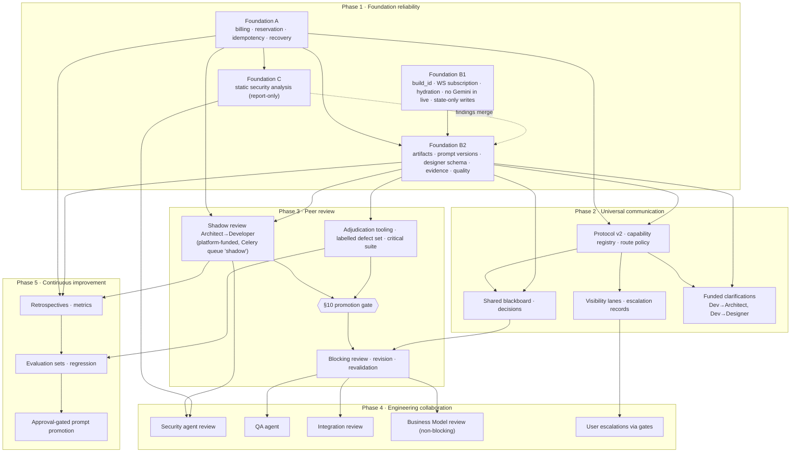

# Agent Collaboration & Continuous Quality: Plan (Revision 2)

Status: **planning revision and implementation proposal. No production code has
changed, and no implementation PR is open.** Revision 1 (commit `f6eaa2d`)
was the audit. This revision records the owner's decisions and turns them into
an implementation proposal.
Scope: the production build path (`backend/tasks/build_tasks.py` →
`backend/core/orchestrator.py`). `orchestration/` stays out of scope.
Line references are to commit `3351bbd`.

### Contents

| § | Deliverable requested |
|---|---|
| 1 | Decisions of record |
| 2 | New evidence: accounting reconciliation and new findings |
| 3 | **Revised architecture** |
| 4 | **Phases and updated dependency graph** |
| 5 | **Exact database model changes** |
| 6 | **Credit reservation formula, with reconciled ledger evidence** |
| 7 | **Foundation A, B and C PR boundaries** |
| 8 | **Regression tests for every identified issue** |
| 9 | **Shadow-review budget configuration** |
| 10 | **Measurable criteria for enabling blocking reviews** |
| 11 | **Migration and rollback strategy** |
| 12 | Confirmations still needed, each with a recommended default |
| A, B | Appendices: agent map and the Revision 1 audit |

---

## 1. Decisions of record

| # | Decision (owner) | Constraint it puts on the plan |
|---|---|---|
| A | Two funding models. **User-funded generation:** every production agent call, clarifications, necessary revisions and configured debug attempts. Reserve the maximum for the configured path, never spend past it, refund the unused part, reject up front what cannot be funded, never absorb overruns silently, record real usage. **Platform-funded shadow reviews:** a per-build cap, a monthly budget, a maximum number of calls, a maximum number of tokens, strict timeouts and retries, and no correction calls | §6, §9. The price table and reservation come from one function. Every provider call carries a funding source and an operation id |
| B | Execution status is separate from quality status. A quality failure never triggers a full refund, a duplicate run, a Celery retry or artifact loss. Unresolved critical findings block acceptance | §5.1 `quality`, §7 Foundation B2 |
| C | The backend is the single source of truth for live builds. Fix the `build_id` contract. Remove Gemini generation from live mode. Demo mode only behind an explicit flag | §7 Foundation B1 |
| D | Exactly one review relationship first, **Architect → Developer**, in shadow mode: platform-funded, non-blocking, evidence-referenced, no revisions, no open-ended discussion. Promotion needs 50+ real builds, independent adjudication, ≥95% precision on blocking findings, ≥90% recall on a labelled set, 100% on the critical suite, and budget compliance | §9, §10 |
| E | Three visibility levels: Activity, Decisions, Escalations. Escalate on unresolved disagreement, consequential ambiguity, security or permission decisions, extra spend, or scope change. Routine discussion goes in an expandable timeline | §3.4, Phase 2 |
| F | Business Model review last and non-blocking. QA after the review framework. Security agent high priority after the foundation. **Static security analysis as early as possible.** Universal communication: every agent *can* reach any authorized peer, and the orchestrator decides which interactions happen | §4. Static analysis becomes Foundation C |
| Priority | P0 billing and recovery correctness; P0 single source of truth; P1 persistence and evidence quality. Prompt versions are content-hashed. Interrupted provider calls are never repeated blindly | §7 |

---

## 2. New evidence

### 2.1 Reconciling "7 versus 5"

Both numbers are correct; they measure different things. This ledger trace comes
from the real `Orchestrator` with stub agents and the reservation `api/builds.py`
applies today (17 credits). `credits_used` is read at each `agent_start`.

| Point in the build | credits_used |
|---|---|
| start architect (+3) | 3 |
| start business_improver (+2) | 5 |
| start designer (+2) | 7 |
| start developer (+5); **clarification decision point** | **12** |

At that point:

| Quantity | Formula | Value |
|---|---|---|
| Remaining reservation (**your 5**) | R − U = 17 − 12 | **5** |
| Worst-case mandatory spend still ahead | PM 1 + 3 × (debug 2 + PM 1) | 10 (12 with integrations) |
| Ceiling the code compares against (**my 7**) | `credit_ceiling` = R − M = 17 − 10 (`orchestrator.py:544`); an absolute cap on `credits_used`, not headroom | **7** (5 with integrations) |
| Optional-spend headroom | R − U − M = 5 − 10, equivalently `ceiling − credits_used` = 7 − 12 | **−5** (−7 with integrations) |

The code's test is `credits_used + 1 ≤ ceiling`, which here is `13 ≤ 7`. It
fails, so clarifications are skipped. Revision 1 was right about the ceiling
but should have shown the headroom.

The real point: **before any clarification, the reservation is already 5 credits
short of the pipeline's own worst case.** That is exactly the full-debug-loop
overrun in the next table (22 − 17 = 5).

### 2.2 Stage-by-stage ledger trace

Prices come from `core/config.py:125-142`: architect 3, business model 2,
designer 2, developer 5, integration 2, PM 1, debug 2, clarification 1;
`developer_clarification_max_questions` 3; `MAX_DEBUG_ITERATIONS` 3. Every
charge is taken in `_start_agent`, **before** the LLM call.

| Scenario | Reserved | Charges, in order | Final `credits_used` | Over reservation |
|---|---|---|---|---|
| S1 happy path, no integrations | 17 | 3, 2, 2, 5, PM 1 | **13** | no |
| S2 happy path, integrations | 17 | 3, 2, 2, 5, int 2, PM 1 | **15** | no |
| S3 full debug loop, no integrations | 17 | 3, 2, 2, 5, PM 1, (dbg 2 + PM 1) × 3 | **22** | **+5** |
| S4 full debug loop + integrations | 17 | as S3 plus int 2 | **24** | **+7** |
| S5 S4 + 3 answered clarifications | 40 | as S4 plus 1 + 1 + 1 after developer start | **27** | n/a; this is the configured maximum |
| S6 developer fails with a non-transient error, plus 3 Celery retries | 17 | 3, 2, 2, then developer 5 on **each** of 4 attempts | **27** | **+10. Refund = 0: the user pays the full 17 for a build that produced no code**, and 4 developer steps are left RUNNING |

S5's 27 is the true configured maximum today; it becomes the reservation in §6.

### 2.3 New findings (F16 onward; F1–F15 are summarized in Appendix B)

| # | Finding | Evidence | Fixed in |
|---|---|---|---|
| **F16** | **Platform-funded calls leave no record.** The router writes `ai_usage` only when `user_id` is set (`core/llm/router.py:1166-1210`). The specialist shadow omits `user_id` (`core/specialist_shadow.py` GatewayRequest), and the LLM injection classifier records no usage at all (`router.py:1223-1275`). Separately, fire-and-forget `asyncio.create_task` in a Celery task only makes progress while a *later* task runs that worker's loop (`build_tasks.py:27-40` uses `run_until_complete`) | code reading | A (attribution), Phase 3 (shadow as its own Celery task) |
| **F17** | **The per-user daily token budget can kill an admitted build halfway.** `check_budget` pre-authorizes `input estimate + max_tokens` per call (`router.py:468-478, 991`). Measured with the real prompt builder, a tiny blueprint pre-authorizes about 8,978 tokens for the developer call alone, and the four main calls together about 19,866 (`agents/*` max_tokens 4096/3000/8000/2000). The free plan's daily budget is **10,000** (`core/ai_usage.py:41-46`). A free-plan build (including the free first build) cannot pass the developer stage unless earlier calls used under ~1,022 tokens, which their system prompts alone exceed. Admission (`api/builds.py`) checks credits only | measured pre-authorization; confirm with one staging trace | A (C2) |
| **F18** | **Every exception is retried, even non-transient ones.** `build_tasks.py:243-262` retries anything (budget exhaustion, policy violations, schema-invalid output) up to 3 times. Combined with F13 this produces S6: full reservation consumed and no output | S6 probe | A |
| **F19** | **Settlement is not idempotent, and nothing sweeps orphaned builds.** The refund is a bare `$inc` after the final build write (`build_tasks.py:184-200`). A redelivered task (`acks_late=True`) for an already-finished build re-runs PM and refunds again. If a task is lost, nothing ever settles the reservation, and the build stays `pending`. Production Redis is the Celery broker with `maxmemory-policy allkeys-lru` (`docker-compose.prod.yml:61, 197`), so queued tasks can be evicted under memory pressure | code reading | A |
| **F20** | **Any build can be deployed**, including FAILED or still-running ones. `POST /deployments` checks only ownership (`api/deployments.py:132-136`) | code reading | B2 |
| **F21** | Prices and reservation logic are duplicated: `CREDIT_COSTS` (`api/builds.py:46-54`), the same formula in `api/admin.py:504`, `credit_map` (`orchestrator.py:792-804`) and `_worst_case_cost_after_developer` (`:513-523`). The `(len(tech_stack)+1)` multiplier is dead because nothing ever writes `tech_stack` | code reading | A |
| **F22** | **Build-level status is never set to RUNNING.** A running build stays `pending` (only `DEBUGGING`, `SUCCESS` and `FAILED` are ever assigned: `orchestrator.py:422, 430, 460, 486`). A retryable failure persists FAILED and emits `build_failed` *before* Celery resumes, so users see "Build failed" and then the build carries on. The resumed attempt keeps status FAILED until it ends, and the duplicate-build guard (`api/builds.py:173-192`) cannot see it | code reading | A |
| **F23** | Uncharged provider calls on the build path: `architect.clarify` (interactive), `developer.identify_questions`, structured-output **repair** calls (`gateway/service.py:131-155`, one extra call whenever schema validation fails), router retries and model/provider fallbacks, the injection classifier (when configured) and the specialist shadow. None is priced on its own, and two leave no usage record | code reading | A (§6.3 policy) |
| **F24** | In a **production** frontend build, `/api/gemini/synthesize-code` is served by nothing. The Gemini middleware is a Vite dev-server plugin that production builds skip (`vite-plugins/loadGeminiPlugin.ts`), and nginx serves the SPA for unknown paths. So deployed live mode dispatches and **charges** a real backend build that the UI never subscribes to (F15), while the Gemini call fails. In local dev the Gemini path works and shows files the backend did not produce | code reading; confirm with Playwright against `vite build` | B1 |

---

## 3. Revised architecture

### 3.1 Principles

1. **`core/orchestrator.py` is the only control flow.** New modules are services
   it calls. None of them decides what runs next.
2. **One ledger, one price table.** Every paid or platform-funded provider call
   belongs to a ledger *operation* with a deterministic `operation_id` and a
   funding source. Credits are charged once per completed operation. Provider
   calls are recorded per operation in `ai_usage`.
3. **The commit point is a single-document write.** There are no Mongo
   transactions in this codebase, so state that must be atomic (operation status
   plus charge plus total) lives on the build document. Bulky content goes
   elsewhere and is written *before* the commit.
4. **Artifacts are immutable and versioned.** Agents consume artifact versions,
   not mutable dictionaries. Every review, finding and quality decision points
   at an `(artifact_id, content_hash)`.
5. **Quality never changes execution.** `quality.status` is computed from
   evidence. It never triggers retries, refunds or deletion.

### 3.2 Components by phase

| Component | Module | Phase | Reuses |
|---|---|---|---|
| Price table and `max_build_cost()` | `core/pricing.py` (new) | 1 (A) | `core/config.py` credit settings |
| Build ledger: authorize, dispatch, commit, fail, interrupt; ceiling | `core/build_ledger.py` (new) | 1 (A) | `_clarification_policy` logic, generalized |
| Provider response journal | `gateway/service.py` (+ collection) | 1 (A) | gateway `request_id` |
| Idempotent settlement and orphan sweeper | `tasks/build_tasks.py`, `tasks/maintenance_tasks.py` (new) | 1 (A) | Celery beat (already embedded with `-B`) |
| Usage attribution (funding source, operation, request id) | `core/ai_usage.py`, `core/llm/router.py` | 1 (A) | `track_usage` |
| Build subscription, hydration, state-only persistence | `frontend/...`, `tasks/build_tasks.py` | 1 (B1) | `GET /builds/{id}`, existing WS |
| Artifact store and file blobs | `core/build_artifacts.py` (new) | 1 (B2) | `build_files` |
| Prompt version registry (content hash) | `prompt_builder/versions.py` (new) | 1 (B2) | `prompt_builder.persistence` |
| Unified `Finding` and evidence verifier | `core/findings.py` (new) | 1 (B2) | `sandbox.moderation.Finding` shape |
| Quality evaluation | `core/quality.py` (new) | 1 (B2) | PM validation, moderation |
| Static security analysis (deterministic) | `sandbox/static_security.py` (new) | 1 (C) | `bandit` (already pinned in `requirements.txt`), moderation rules |
| Protocol v2, capability registry, route policy | `core/agent_communication.py` (extended) | 2 | existing router, budget and crash marker |
| Shared blackboard | `core/build_artifacts.py` (typed entries) | 2 | artifacts |
| Visibility levels and escalation records | `core/agent_communication.py`, `core/models.py` | 2 | interactive gates |
| Shadow review runner | `tasks/review_tasks.py` (new Celery task, queue `shadow`) | 3 | `specialist_shadow` safety contract, but not its `create_task` (F16) |
| Review coordinator (blocking, revisions, revalidation) | `core/peer_review.py` (new) | 3 | findings, verifier, ledger |
| Security, QA, Integration and Business Model edges | policy rows plus agent `review()` methods | 4 | the same coordinator |
| Retrospectives, evaluations, prompt promotion | `tasks/retro_tasks.py`, `harness/` | 5 | harness, admin-only template API |

### 3.3 Operation lifecycle (Foundation A)

```
AUTHORIZED ──dispatch──▶ DISPATCHED ──journal+commit──▶ COMPLETED (charged once)
    │                       │  ├─ provider error ──────▶ FAILED (uncharged)
    │                       │  └─ worker died ─────────▶ INTERRUPTED (found on resume)
    └─ ceiling/limit ───────▶ REFUSED (uncharged)
```

- **Dispatch:** `DISPATCHED` plus `dispatched_at` are persisted **before** the
  provider call. This generalizes today's `delivery_attempts` marker.
- **Journal:** when the gateway receives a response for a request carrying an
  `operation_id`, it writes `llm_response_journal` (an idempotent upsert) before
  returning to the agent.
- **Commit:** a single `$set` on the build doc moves the operation to
  `COMPLETED`, adds its credits to `credits_used`, and records `request_ids`.
- **Resume, for each `DISPATCHED` operation:**
  - **Journal entry exists:** reuse the response. There is no provider call. It
    is charged once, at commit.
  - **No journal entry, operation is optional** (clarification, review): close it
    as `INTERRUPTED`, uncharged, and never re-send it. This is today's behaviour.
  - **No journal entry, operation is mandatory** (a pipeline stage): re-dispatch
    **once**. The extra provider call is booked as `platform_recovery`, recorded
    and visible in telemetry; the user is charged once for the operation. A
    second interruption fails the build (execution FAILED) and settles the
    reservation.

  Provider-side idempotency is not used: none of the adapters in
  `backend/providers/` sends an idempotency key, so the journal is the
  reconciliation mechanism. (Confirmation C9.)

### 3.4 Visibility model (Phase 2, decision E)

Every message, decision and escalation record carries
`visibility ∈ {internal, activity, decision, escalation}`.

| Lane | Shows | Source |
|---|---|---|
| Activity | Agent state chips: working, waiting, reviewing, revising, validating, blocked, done | Ledger operations and stage events |
| Decisions | Accepted clarifications, resolved disagreements with rationale, approved changes | Blackboard `Decision` entries |
| Escalations | Action cards needing the user | `escalations[]` on the build |
| Timeline (collapsed) | Every `internal` message | `agent_messages` |

Escalation triggers (decision E) and what happens when no user can answer:

| Trigger | Interactive build | Non-interactive build |
|---|---|---|
| Unresolved technical disagreement | Gate `kind="escalation"` | Decision owner resolves; rationale recorded; quality ≤ PASSED_WITH_WARNINGS |
| Consequential ambiguity | Gate | The Architect's documented default; recorded as an Assumption |
| Security or permission decision | Gate | **Deny** (the safer option); recorded |
| Additional spend | Gate offering a top-up | **Never auto-approved**: the work that needs funding is skipped and quality becomes `incomplete` |
| Scope change | Gate | **Reject** (keep scope); recorded |

**Shadow-review findings are never shown to users.** They are unvalidated by
definition, and only admin and adjudication views read them.

---

## 4. Phases and updated dependency graph

| Phase | Contents | Exit criterion |
|---|---|---|
| **1. Foundation reliability** | **A:** billing, reservation, idempotency, recovery. **B1:** single source of truth, WebSocket, hydration, state-only writes. **B2:** artifacts, prompt versions, designer schema, evidence, `quality`. **C:** static security analysis, report-only | Every §8 test for F1–F7, F9, F12–F24 is green. One staging day shows zero ledger anomalies (consumed ≤ reserved; one charge per operation; every build settled) |
| **2. Universal communication** | Protocol v2, capability registry, default-deny route policy, blackboard, visibility and escalation records, **funded** Developer→Architect and Developer→Designer clarifications | Clarifications measurably run on metered builds; all messages authorized, persisted and hydrated |
| **3. Peer review** | Shadow Architect→Developer review (platform-funded), adjudication tooling, labelled defect set, critical suite; then, **only after the §10 gate**, blocking review with revision and revalidation | §10 met |
| **4. Engineering collaboration** | Security agent review (first), QA agent, Integration review, Business Model review (non-blocking), user escalations | Each edge passes its own §10 gate before blocking |
| **5. Continuous improvement** | Retrospectives, metrics, evaluation sets, approval-gated prompt promotion | Regression evaluation is mandatory for every promoted change |



- **Parallelism:** A and B1 can be built in parallel. Their only shared file is
  `tasks/build_tasks.py` (`emit`); whichever lands second rebases. C needs only A
  merged first, to avoid orchestrator conflicts. B2 needs A and B1.
- **Critical path to the shadow pilot:** A → B2 → SR.
- **Phase 2 is not on that path.** The shadow review needs artifacts, findings
  and platform attribution, not the message protocol. Phase 2 can run alongside
  Phase 3's shadow period.

---

## 5. Database model changes

All additions are optional fields with defaults, so pre-existing documents load
unchanged (Pydantic ignores unknown fields when old code reads new documents).
`schema_version` distinguishes builds created under the new ledger.

### 5.1 `builds` (existing collection): Foundation A and B2

```python
class FundingSource(str, Enum):          # A
    USER_CREDITS = "user_credits"
    BYOK = "byok"                        # user's own key; 0 credits reserved (C4)
    FREE_GRANT = "free_grant"            # first build; platform-funded, capped at max_cost

class OperationStatus(str, Enum):        # A
    AUTHORIZED = "authorized"; DISPATCHED = "dispatched"; COMPLETED = "completed"
    FAILED = "failed"; INTERRUPTED = "interrupted"; REFUSED = "refused"

class LedgerOperation(BaseModel):        # A, embedded: the atomic commit point
    operation_id: str                    # f"{build_id}:{kind}:{seq}", deterministic
    kind: str                            # architect|business_model|designer|developer|
                                         # integration|pm|debug|clarification|question_pass
    seq: int                             # monotonic per build
    agent: AgentType
    status: OperationStatus
    mandatory: bool                      # pipeline stage (True) vs optional (False)
    funding_source: FundingSource
    credits: int = 0                     # charged; non-zero only when COMPLETED
    price: int                           # price at authorization (from the pricing table)
    dispatch_count: int = 0              # 2 means one platform-funded recovery re-dispatch
    request_ids: List[str] = []          # gateway request ids, including repairs and retries
    reason: Optional[str] = None         # refusal, failure or interruption reason
    authorized_at: datetime
    dispatched_at: Optional[datetime] = None
    resolved_at: Optional[datetime] = None

class BuildFunding(BaseModel):           # A, written in the same insert as the build
    source: FundingSource
    reserved_credits: int                # what was debited from the user (0 for byok/free_grant)
    max_cost: int                        # max_build_cost() for the configured path
    breakdown: Dict[str, int]            # per-line maxima that sum to max_cost (§6.4)
    pricing_version: str                 # sha256 of the price table used

class BuildSettlement(BaseModel):        # A
    consumed: int                        # Σ credits of COMPLETED operations
    refunded: int                        # reserved_credits − consumed (never negative)
    settled_at: datetime

class QualityStatus(str, Enum):          # B2
    PENDING = "pending"; PASSED = "passed"; PASSED_WITH_WARNINGS = "passed_with_warnings"
    NEEDS_REVISION = "needs_revision"; BLOCKED = "blocked"
    INCOMPLETE = "incomplete"            # proposed sixth state; see C1

class BuildQuality(BaseModel):           # B2
    status: QualityStatus = QualityStatus.PENDING
    accepted: bool = False               # True only for PASSED / PASSED_WITH_WARNINGS
    reasons: List[str] = []
    blocking_finding_ids: List[str] = []
    incomplete_stages: List[str] = []
    evidence_artifact_id: Optional[str] = None
    evaluated_at: Optional[datetime] = None

class Build(BaseModel):                  # existing fields unchanged; additions:
    schema_version: int = 1              # A: 2 for builds created with the ledger
    funding: Optional[BuildFunding] = None
    ledger: List[LedgerOperation] = []   # bounded: ≤ ~25 entries per build
    settlement: Optional[BuildSettlement] = None
    attempt_token: Optional[str] = None  # A: fencing token, new per Celery attempt (CAS)
    heartbeat_at: Optional[datetime] = None        # A: throttled to ≤ 1 write / 30 s
    retry_scheduled_until: Optional[datetime] = None  # A: sweeper must wait past this
    collab_config: Optional[Dict[str, Any]] = None # A: flags and limits snapshot for the whole build
    quality: BuildQuality = BuildQuality()         # B2
    error: Optional[str] = None          # A: already written ad hoc by build_tasks; now declared
```

- **`build_status` (decision B).** The stored field stays `status`, with values
  unchanged, to avoid a data migration across about 24 references in the backend
  and frontend. The API and WS expose a derived `build_status`:

  | Stored `status` | `build_status` |
  |---|---|
  | `pending` before start | PENDING |
  | `running` (newly set, F22) / `debugging` | RUNNING |
  | `success` | COMPLETED |
  | `failed` | FAILED |

  (Confirmation C10.)
- **`credits_used`** is kept. For `schema_version == 2` it is by definition
  `Σ ledger[].credits`, written in the same `$set` as each commit.
- **Indexes:** `(status, heartbeat_at)` for the sweeper.

### 5.2 `AgentStep` (embedded in `builds.agents`): A and B2

```python
    operation_id: Optional[str] = None   # A: _complete_agent targets this (F13 root cause)
    outcome: Optional[str] = None        # A: completed|failed|interrupted
    prompt_ref: Optional[PromptRef] = None     # B2: {role, variant, content_hash, label}
    model: Optional[str] = None; provider: Optional[str] = None   # B2
    request_ids: List[str] = []          # B2
    usage: Optional[Dict[str, float]] = None   # B2: prompt_tokens, completion_tokens, cost_usd
    artifact_id: Optional[str] = None    # B2: the artifact version this step produced
```

An interrupted step keeps `status=failed` with `outcome="interrupted"`. No new
`BuildStatus` value is added.

### 5.3 New collections

| Collection | PR | Fields | Indexes / retention | GDPR |
|---|---|---|---|---|
| `llm_response_journal` | A | `operation_id`, `build_id`, `user_id`, `agent`, `dispatch_count`, `request_id`, `content` (text), `structured` (JSON or null), `usage`, `created_at`, `expires_at` | unique `operation_id`; TTL `expires_at` = 7 days | export and delete by `build_id` |
| `credit_transactions` | A | `id`, `user_id`, `build_id`, `kind` (`reserve`/`refund`/`release`), `amount`, `funding_source`, `created_at` | unique `(build_id, kind)`; **no TTL** (financial record) | export; on deletion, anonymize `user_id` |
| `build_artifacts` | B2 | `id`, `build_id`, `kind` (`blueprint`/`business_model`/`design`/`code_manifest`/`integration`/`pm_validation`/`static_security_report`/`quality_evidence`), `version`, `parent_id`, `producer {agent, operation_id, agent_profile_id}`, `content_hash` (sha256 of canonical JSON), `content` (JSON ≤ 256 KB) **or** `manifest {path: sha256}`, `schema_id`, `validation_status`, `prompt_ref`, `created_at` | unique `(build_id, kind, version)`; TTL `created_at` 90 days (matches `build_files`) | by `build_id` |
| `build_file_blobs` | B2 | `build_id`, `sha256`, `content`, `size`, `created_at` | unique `(build_id, sha256)`; TTL 90 days. Build-scoped, not global, so deletion stays per build and content is never addressable across tenants | by `build_id` |
| `prompt_versions` | B2 | `role`, `variant`, `content_hash`, `label`, `source` (`code`/`overlay`/`inline`), `template` (snapshot), `first_seen_at`, `created_by` | unique `(role, variant, content_hash)`. Written with `$setOnInsert`, so an unchanged prompt never creates a second version | none (no user data) |
| `shadow_reviews` | Phase 3 | `id`, `build_id`, `artifact_id`, `artifact_hash`, `reviewer`, `prompt_ref`, `model`, `status` (`completed`/`skipped`/`failed`/`timed_out`/`invalid_output`), `skip_reason`, `findings[]`, `truncated`, `usage`, `cost_usd`, `request_ids`, `created_at`, `completed_at` | `(build_id)`, `(created_at)` | by `build_id` |
| `finding_adjudications` | Phase 3 | `id`, `finding_id`, `review_id`, `adjudicator_id`, `label` (`valid`/`valid_lower_severity`/`invalid`/`cannot_determine`), `notes`, `created_at` | unique `(finding_id, adjudicator_id)` | anonymize on user deletion |

`Finding` (B2, in `core/findings.py`, embedded in artifacts and reviews):
`finding_id`, `source` (`moderation`/`static_security`/`pm`/`review`), `rule_id`,
`severity` (`critical`/`high`/`medium`/`low`/`informational`), `category`,
`description`, `evidence {artifact_id, locator, quote}`, `evidence_verified: bool`,
`recommended_fix`, `responsible_agent`, `status` (`open`/`resolved`/`dismissed`).

### 5.4 Changes to existing collections

| Collection | Change | PR |
|---|---|---|
| `ai_usage` | Add `funding_source` (missing on legacy rows means `user_credits`), `operation_id`, `request_id`, `beneficiary_user_id` (for platform rows). Indexes `(operation_id)`, `(funding_source, created_at)`. Platform rows are recorded even without `user_id`. `get_user_budget` excludes `platform_*` sources | A |
| `users` | Add `recent_settlements: List[str]` (build ids, capped with `$push`/`$slice -200`). This is the idempotency guard for refunds (§7, A7) | A |
| `budget_limits` | One AGENT-scope MONTHLY hard limit for `shadow_review_architect_developer`, as defence-in-depth (§9) | Phase 3 (data only) |
| `feature_flags` | New keys (§11.2) | per PR (data only) |
| `builds.agent_messages[]` | Protocol v2 fields plus `visibility` (Revision 1 §4.3 design, unchanged) | Phase 2 |
| `builds.escalations[]` | `{id, kind, summary, options[], recommended, evidence_refs, raised_by, status, resolution{by, choice, rationale, at}}` | Phase 2 |

---

## 6. Credit reservation formula

### 6.1 Inputs, all read from settings (nothing hard-coded)

| Symbol | Setting | Current value |
|---|---|---|
| p_arch, p_bm, p_des, p_dev, p_int, p_pm, p_dbg | `credits_architect` … `credits_debug` | 3, 2, 2, 5, 2, 1, 2 |
| p_clar | `credits_clarification` | 1 |
| p_qpass | new `credits_question_pass` (C3) | 0 |
| p_rev | new `credits_revision`; only once a blocking review is enabled | not used yet |
| N | `MAX_DEBUG_ITERATIONS` | 3 |
| Q | `developer_clarification_max_questions` if clarifications are enabled in `collab_config` | 3 |
| V | max revision cycles × enabled blocking review edges | 0 until Phase 3 enforcement |

### 6.2 Formula

```
max_build_cost = p_arch + p_bm + p_des + p_dev + p_int + p_pm          # one pass of every stage
               + N × (p_dbg + p_pm)                                     # configured debug loop
               + [Q > 0] × (p_qpass + Q × p_clar)                       # clarification bundle
               + V × p_rev                                              # production revisions
```

- Integration is **always included**, because the blueprint isn't known at
  admission. It is refunded if the blueprint has none.
- **With current settings: 15 + 9 + 3 + 0 = 27**, with clarifications enabled.
  Without clarifications it is 24. This matches the traced worst case S5 exactly
  (§2.2). A golden test enforces that equality (§8).

### 6.3 What the price of an operation covers (F23)

| Provider call | Funding | Credits |
|---|---|---|
| Primary call of a stage, PM pass, debug iteration or clarification answer | operation's source | its price, once, on COMPLETED |
| Structured-output repair, router retries, model/provider fallback for that operation | same operation | **included** in the price (no extra credits); recorded with the same `operation_id` |
| `developer.identify_questions` | clarification bundle | `p_qpass` (default 0, C3); recorded |
| `architect.clarify` (interactive user questions) | architect operation | included |
| Recovery re-dispatch after an interruption with no journal entry (§3.3) | `platform_recovery` | 0; recorded and reported |
| LLM injection classifier (when configured) | `platform_guardrail` | 0; **recorded** (it is invisible today) |
| Specialist shadow and shadow reviews | `platform_shadow` | 0; recorded; under the §9 caps |
| Failed operation (provider error, no output) | operation's source | **0**: users pay for completed work only (C8). Provider cost recorded as `uncharged_failure` |

### 6.4 Admission

| Funding | Admission rule | Debit |
|---|---|---|
| `user_credits` | `credits ≥ max_build_cost`, atomic `$gte`/`$inc` (as today) | `max_build_cost` |
| `byok` (snapshotted at admission, C4) | The key must exist at admission. The run refuses any platform-key call: if the key is gone at run time, the build fails fast | 0 |
| `free_grant` (first build) | As today, an atomic flag flip | 0. Ledger operations cap at `max_build_cost`, platform-funded (C5) |

- An unfunded request returns `402` with
  `{required, available, breakdown, pricing_version}`, so the UI can ask the
  user for a top-up.
- **Daily token budget (F17).** Recommended (C2): credit-metered and
  free-grant build operations are exempt from the per-user daily token budget,
  because credits and the per-build ceiling already bound them. Org, project
  and agent USD limits still apply. The daily budget keeps applying to non-build
  LLM features. The alternative, an admission pre-check, would reject every
  free-plan build at today's 10,000-token limit.

### 6.5 Run-time ceiling

- `authorize(op)` succeeds only if `consumed + in_flight + price(op) ≤ reserved`.
  For `free_grant` builds, `max_cost` takes the place of `reserved`.
- Because `max_build_cost` covers the whole configured path, a refusal means
  configuration drift. It is logged as an error metric, and the build completes
  gracefully: the unfunded work is skipped, and quality becomes `incomplete`
  with `incomplete_stages`. Nothing is spent past the reservation.

### 6.6 Effect on users with current settings

| | Today | Proposed |
|---|---|---|
| Admission threshold (metered) | 17 | 27 |
| Typical happy path (S1) consumed / refunded | 13 / 4 | 13 / 14 |
| Full debug loop + integrations (S4) | 24 consumed, user pays 17, platform absorbs 7 | 24 consumed and paid, 3 refunded |
| S6 (non-transient developer failure) | user pays 17, gets nothing | fails once with no retry; developer uncharged; pays 7 (architect, business model, designer) |
| Users with 17–26 credits | can start | receive a 402 with the required amount |

---

## 7. PR boundaries

The decision suggested two foundation PRs. I recommend **splitting B into B1 (P0)
and B2 (P1)**, so that PR boundaries follow your priorities: the frontend and
the backend deploy separately (Cloudflare Pages vs. backend), and B1 is small.
Static security analysis is its own small PR, **C**. (Confirmation C11.) No PR
mixes billing semantics with UI changes.

### Foundation A: billing, reservation, idempotency, recovery (backend only, P0)

| # | Change | Files | Fixes |
|---|---|---|---|
| A1 | `core/pricing.py`: a single price table, `max_build_cost()`, `pricing_version`. `api/builds.py` and `api/admin.py:504` use it; the dead `tech_stack` multiplier is removed | `core/pricing.py`, `api/builds.py`, `api/admin.py`, `core/config.py` | F1, F2, F21 |
| A2 | `BuildFunding` written in the same insert as the build; funding source snapshot (`user_credits`/`byok`/`free_grant`); 402 payload | `api/builds.py`, `core/models.py` | reservation persistence |
| A3 | Ledger operations replace charging in `_start_agent`. `_complete_agent` commits by `operation_id` instead of "the first RUNNING step of this type". Charge on completion | `core/build_ledger.py`, `core/orchestrator.py`, `core/agent_communication.py` | F13, stuck RUNNING steps |
| A4 | Hard ceiling for every operation. Graceful stop with `incomplete_stages` (B2 later renders it as quality) | `core/build_ledger.py`, `core/orchestrator.py` | F2 |
| A5 | Response journal, plus the §3.3 resume policy for DISPATCHED operations | `gateway/models.py` (`operation_id`, `funding_source`), `gateway/service.py`, `agents/base.py`, `core/orchestrator.py`, `core/database.py` | interrupted provider calls |
| A6 | Retry classification. `BudgetExceeded`, `BudgetLimitExceeded`, `PolicyViolation`, prompt-injection rejections, schema-invalid-after-repair and `BuildCancelled` are final. Only transient provider or worker errors retry | `tasks/build_tasks.py` | F18 |
| A7 | Idempotent settlement. A guarded user update (`recent_settlements $ne build_id` → `$inc` + `$push/$slice`) is the commit; a `credit_transactions` row is the audit record. A task that finds the build already settled is a no-op | `tasks/build_tasks.py`, `api/builds.py` (dispatch-failure path) | F19 |
| A8 | Status lifecycle: set `running` at each attempt start. A retryable failure emits `agent_update` ("recovering, retrying in N s") instead of `build_failed`. `attempt_token` fencing on every write | `core/orchestrator.py`, `tasks/build_tasks.py` | F22 |
| A9 | Orphan sweeper (beat, every 5 min). A build that is pending/running/debugging, past `max(heartbeat_at + build_timeout + 120 s, retry_scheduled_until)`, is CAS-swept: operations INTERRUPTED, execution FAILED, settled, dead-lettered with `orphaned` | `tasks/maintenance_tasks.py`, `celery_app.py` | F19, stuck builds |
| A10 | Usage attribution. `funding_source`, `operation_id`, `request_id` on every `ai_usage` row; platform rows are recorded; `get_user_budget` excludes platform sources; the injection classifier's usage is recorded | `core/ai_usage.py`, `core/llm/router.py` | F16, F23 |
| A11 | Daily token budget policy for build operations, per C2 | `core/llm/router.py`, `core/ai_usage.py` | F17 |
| A12 | Gate time budget: each gate's deadline is capped by the remaining build time; config validation rejects `gate_timeout × 4 ≥ build_timeout` | `core/orchestrator.py`, `core/config.py` | F14 |
| A13 | Broker durability: Celery broker on a Redis database or instance with `noeviction` (prod compose) | `docker-compose.prod.yml`, `core/config.py` | F19 (task loss) |
| A14 | GDPR export/delete for `llm_response_journal`, `credit_transactions` | `api/gdpr.py` | n/a |

**Out of scope for A:** any frontend change, `quality`, artifacts, the
communication protocol.

**Gate:** flag `ledger_v2`. When it is off, new builds keep `schema_version=1`
and the legacy charging path.

### Foundation B1: single source of truth for live builds (P0)

| # | Change | Files | Fixes |
|---|---|---|---|
| B1-1 | Typed `CreateBuildResponse {build_id, status, idempotent?}`; the workspace uses `build_id`; no hard-coded demo id in live mode | `frontend/src/lib/api.ts`, `frontend/src/pages/WorkspacePage.tsx` | F15 |
| B1-2 | Remove `synthesizeCodeForPrompt` from live mode. It runs only when `!LIVE_MODE && VITE_DEMO_SYNTHESIS === "true"` | `WorkspacePage.tsx`, `src/lib/env.ts` | F15, F24, decision C |
| B1-3 | Hydration. On mount and on **every** (re)connect: open the socket, buffer events, fetch `GET /builds/{id}` and `/files`, `hydrateFromBuild()`, then replay the buffer through idempotent reducers (upsert by `message_id`/agent/operation) | `src/hooks/useBuildSocket.ts`, `src/store/buildStore.ts` | F4 |
| B1-4 | `emit` persists only state-changing events. `stream_token` is broadcast-only; the heartbeat is throttled | `tasks/build_tasks.py` | F3 |
| B1-5 | `GET /builds/{id}` adds the derived `build_status` and omits nothing hydration needs | `api/builds.py` | decision B (read side) |

### Foundation B2: artifacts, prompt versions, designer schema, validation evidence (P1)

| # | Change | Files | Fixes |
|---|---|---|---|
| B2-1 | Artifact store plus blobs. Register blueprint, business model, design, code manifests (post-developer, post-integration, after each debug iteration), PM validation | `core/build_artifacts.py`, `core/orchestrator.py`, `tasks/build_tasks.py` | artifact consistency; prerequisite for the shadow review (`build_files` is overwritten by debug patches) |
| B2-2 | Resume reads the latest artifact version, falling back to `AgentStep.output` for older builds | `core/orchestrator.py` | n/a |
| B2-3 | Prompt version registry (template content hash plus few-shot set id; `$setOnInsert`); `AgentStep.prompt_ref`, `model`, `request_ids`, `usage`. Remove the per-call `VersionManager.record` from `BaseAgent` | `prompt_builder/versions.py`, `agents/base.py` | F6 |
| B2-4 | `DESIGN_SYSTEM_SCHEMA` via `_call_structured`. A streamed-generation parse failure becomes an explicit operation failure, not `{"files": {}}` | `agents/designer.py`, `agents/structured_schemas.py`, `agents/developer.py` | F9 |
| B2-5 | Remove `_evaluate_agent_output` from the build path (the harness stays available offline) | `core/orchestrator.py` | F5 |
| B2-6 | Unified `Finding` model, plus the deterministic evidence verifier: the locator resolves and the quote occurs in that artifact version | `core/findings.py`, `sandbox/moderation.py` | evidence |
| B2-7 | PM on evidence. Selected **full** files within a token budget (reusing `_select_relevant_files` with larger caps), sandbox output, deterministic findings, file manifest. `PM_VALIDATION_SCHEMA` v2: `passed` required, with no default of true; `issues[].evidence`. Unverified PM issues cannot block | `agents/pm.py`, `agents/structured_schemas.py`, `core/orchestrator.py` | F7 |
| B2-8 | `core/quality.py` (rules below). PM still failing after the debug budget gives **COMPLETED + needs_revision**, not FAILED. `build_complete` carries `build_status` and `quality`. The frontend renders a quality badge and the reasons | `core/quality.py`, `core/orchestrator.py`, `frontend/src/store/buildStore.ts`, `wsContract.ts` | decision B |
| B2-9 | Deploy guard: no deployment of `failed` or in-progress builds; `blocked` requires an explicit, audited override | `api/deployments.py` | F20 |
| B2-10 | GDPR and retention for `build_artifacts`, `build_file_blobs`; `RETENTION_TTL_SECONDS` entries | `api/gdpr.py`, `core/config.py` | n/a |

**Quality rules for B2, before any review exists.** Accepted means `passed` or
`passed_with_warnings`.

| Status | Condition |
|---|---|
| `blocked` | Any open verified **critical** finding, for example a moderation `block` line still present after the loop |
| `needs_revision` | PM not passed after the debug budget, or an open verified **high** finding |
| `incomplete` | PM or a mandatory check could not run or finish (ceiling, retries exhausted, provider failure after files exist). Files are kept |
| `passed_with_warnings` | PM passed, and only medium, low or informational findings remain (including all Foundation C findings while it is report-only) |
| `passed` | PM passed with no findings |

### Foundation C: static security analysis, report-only (P1, "as early as possible")

| # | Change |
|---|---|
| C-1 | `sandbox/static_security.py`. Runs `bandit` (already pinned, `requirements.txt:57`) as a subprocess over the generated `*.py` files written to a temp dir, with JSON output, a timeout and size caps. Generated code is only parsed, never executed |
| C-2 | Curated JS/TS rules (`dangerouslySetInnerHTML`, `eval`/`new Function`, tokens in `localStorage`, `http://` API bases, CORS wildcard with credentials) plus moderation's secret rules, each with `rule_id` and confidence |
| C-3 | Report attached to validation (and as a `static_security_report` artifact once B2 lands). 0 credits, no LLM. Per-rule hit metrics |
| C-4 | **Report-only.** A rule becomes blocking only after per-rule precision is measured (the same discipline as reviews) |

**Out of scope for C:** the LLM Security agent (Phase 4); semgrep and other new
dependencies (would need a licensing and performance review first).

---

## 8. Regression tests for every identified issue

All backend tests use the existing stub-agent harness (`tests/test_agent_communication.py`
pattern) **with the real reservation formula**, never `RESERVED_AMPLE`. "Fault
injection" means a reusable helper that raises inside `emit` (or the journal
write) after the N-th persisted write, for every N, and then resumes.

| Issue | Test (file::name) | Asserts | PR |
|---|---|---|---|
| Reconciliation | `test_pricing.py::test_max_build_cost_equals_traced_worst_case` | `max_build_cost()` from settings == consumed credits of the S5 worst-case stub run; per-line breakdown sums to the total | A |
| F21 | `test_pricing.py::test_single_price_source` | `api/builds`, `api/admin` and orchestrator prices all come from `core.pricing`; changing one setting changes all three | A |
| F1 | `test_build_ledger.py::test_clarifications_run_at_real_reservation` | At the real reservation, 3 questions are answered and charged | A |
| F2 | `test_build_ledger.py::test_no_path_exceeds_reservation` (parametrized: S1–S6 × crash points × PM verdict sequences) | `consumed ≤ reserved` always; refund ≥ 0 | A |
| F2 | `test_build_ledger.py::test_ceiling_refusal_completes_build_incomplete` | A forced price drift makes the operation REFUSED, the build completes, `incomplete_stages` is set, and nothing is spent past the reservation | A (+B2 quality) |
| F13 | `test_build_ledger.py::test_resume_does_not_recharge_crashed_stage` | Developer charged at most once across a crash and resume | A |
| F13 | `test_build_ledger.py::test_crashed_step_closed_interrupted_and_new_step_completed` | No step remains RUNNING; the old step has `outcome=interrupted` | A |
| Interrupted calls | `test_recovery.py::test_dispatched_with_journal_reuses_response` | 0 provider calls on resume; charged once | A |
| Interrupted calls | `test_recovery.py::test_dispatched_without_journal_mandatory_redispatched_once_platform_funded` | 1 re-dispatch; `dispatch_count=2`; `ai_usage` row `platform_recovery`; user charged once | A |
| Interrupted calls | `test_recovery.py::test_second_interruption_fails_and_settles` | Execution FAILED, settled, no third call | A |
| Interrupted calls | `test_recovery.py::test_optional_operation_never_redispatched` | Clarification closed INTERRUPTED, uncharged (keeps today's guarantee) | A |
| Interrupted calls | `test_recovery.py::test_fault_injection_every_write` | For every N: ≤ 1 charge per operation, ≤ 2 provider dispatches per mandatory operation, ≤ 1 per optional one | A |
| F18 | `test_build_tasks_retry.py::test_non_transient_errors_not_retried` (parametrized over the 6 classes) | `self.retry` not called; single attempt | A |
| F18 / S6 | `test_build_tasks_retry.py::test_s6_non_transient_developer_failure_charges_completed_work_only` | consumed == 7; refund == reserved − 7 | A |
| F19 | `test_settlement.py::test_settlement_idempotent_under_redelivery` | Running the success path twice refunds once; one `credit_transactions` refund row | A |
| F19 | `test_settlement.py::test_redelivered_task_for_settled_build_is_noop` | No agent calls; no events | A |
| F19 | `test_sweeper.py::test_orphan_swept_and_settled`, `::test_live_worker_wins_cas_race`, `::test_sweeper_waits_for_scheduled_retry` | CAS fencing and timing behave as specified | A |
| F22 | `test_build_tasks_retry.py::test_status_running_during_attempt_and_no_build_failed_before_retry` | `status=running` is persisted; only `agent_update` is emitted before a retry | A |
| F16 / F23 | `test_usage_attribution.py::test_platform_calls_recorded_without_user`, `::test_platform_usage_excluded_from_user_budget`, `::test_repair_call_shares_operation_id` | n/a | A |
| F17 | `test_usage_attribution.py::test_build_operations_follow_daily_budget_policy` (C2 variant) and `::test_free_plan_build_completes` | n/a | A |
| Funding | `test_admission.py::test_402_reports_required_available_breakdown`, `::test_byok_reserves_zero_and_never_uses_platform_key`, `::test_free_grant_capped_and_platform_attributed` | n/a | A |
| F14 | `test_config.py::test_gate_budget_fits_build_timeout`; `test_gates.py::test_gate_deadline_capped_by_remaining_time` | n/a | A |
| F15 | `WorkspacePage.test.tsx`: "subscribes to the build_id returned by create"; "never calls synthesizeCodeForPrompt in live mode" | n/a | B1 |
| F24 | Playwright `e2e/live-build.spec.ts` against `vite build` + preview with a stub backend: files shown are exactly the backend's; no request to `/api/gemini/*` | n/a | B1 |
| F4 | `buildStore.test.ts::hydrateFromBuild reproduces live-event state`; Playwright "socket dropped mid-build → reconnect → identical timeline" | n/a | B1 |
| F3 | `test_emit_persistence.py::test_stream_tokens_do_not_write_build_document` | 0 `update_one` per token; ≤ 1 heartbeat per 30 s | B1 |
| F6 | `test_prompt_versions.py::test_unchanged_prompt_single_version`, `::test_changed_template_new_hash`, `::test_agent_step_records_prompt_ref_model_request_ids` | n/a | B2 |
| F5 | `test_orchestrator_events.py::test_no_harness_self_evaluation_event` | n/a | B2 |
| F7 | `test_pm_evidence.py::test_pm_receives_selected_full_files_and_findings`, `::test_missing_passed_is_not_a_pass`, `::test_unverified_pm_issue_cannot_block` | n/a | B2 |
| F9 | `test_designer_schema.py::test_designer_uses_schema`; `test_developer_stream.py::test_parse_failure_is_failed_operation_not_empty_success` | n/a | B2 |
| Decision B | `test_quality.py::test_pm_exhausted_is_completed_needs_revision`, `::test_needs_revision_no_retry_no_full_refund_files_kept`, `::test_open_critical_blocks_acceptance`, `::test_incomplete_never_accepted` | n/a | B2 |
| Artifacts | `test_build_artifacts.py::test_post_developer_manifest_survives_debug_patches`, `::test_resume_reads_latest_artifact_version`, `::test_legacy_build_resumes_from_agentstep_output` | n/a | B2 |
| F20 | `test_deployments.py::test_refuses_failed_and_running_builds`, `::test_blocked_requires_audited_override` | n/a | B2 |
| Static security | `test_static_security.py`: seeded fixtures per rule; bandit timeout handled; 0 credits; report-only never changes quality beyond warnings | n/a | C |
| F8 | `test_agent_communication.py::test_agent_content_wrapped_untrusted` (+ injection strings) | n/a | Phase 2 |
| F12 | `test_mongo_integration.py::test_commit_is_single_document_write` (real Mongo in CI) | n/a | A |
| Compatibility | `test_schema_compat.py::test_v1_build_documents_load_resume_and_settle` (fixtures captured from today's schema) | n/a | A, B2 |
| Shadow | `test_shadow_review.py`: never charges the user; platform key even on BYOK builds; per-build and monthly caps; 0 retries; 0 revision calls; findings not broadcast to user WS; excluded from user daily budget; enqueued on `shadow` queue (not `create_task`) | n/a | Phase 3 |

---

## 9. Shadow-review budget configuration (Architect → Developer)

### 9.1 Where it runs

- After the post-developer `code_manifest` artifact is persisted, the
  orchestrator decides whether to sample this build. If so it enqueues
  `review_tasks.run_shadow_review(build_id, artifact_id)` on a **separate Celery
  queue `shadow`**, served by a dedicated worker process with concurrency 1.
- It never runs on the build's event loop (F16), never delays the build, and
  never touches build state other than its own `shadow_reviews` record.

### 9.2 Settings

The values below are proposed defaults; C12 confirms the money amounts.

| Setting | Default | Enforced at | When exceeded |
|---|---|---|---|
| flag `shadow_review_architect_developer` | off (fail-closed) | Enqueue | Not enqueued |
| `SHADOW_REVIEW_SAMPLE_RATE` | 0.25, stratified so §10.1 quotas fill | Enqueue | Not enqueued |
| `SHADOW_REVIEW_EXCLUDE_UNCONSENTED` | true (C7) | Enqueue | Not enqueued |
| `SHADOW_REVIEW_MAX_CALLS_PER_BUILD` | 2 (1 review + at most 1 structured-output repair) | Task | Recorded `invalid_output` |
| `SHADOW_REVIEW_MAX_RETRIES` | 0 (router config for this agent name: `max_attempts=1`, no model or provider fallback, model pinned) | Router | Recorded `failed` |
| `SHADOW_REVIEW_MAX_INPUT_TOKENS` | 24,000 (deterministic file selection; truncation recorded) | Task, before the call | Input truncated, `truncated=true` |
| `SHADOW_REVIEW_MAX_OUTPUT_TOKENS` | 2,000 | Request | Provider stops |
| `SHADOW_REVIEW_MAX_FINDINGS` | 20 | Parser | Extra findings dropped, count recorded |
| `SHADOW_REVIEW_TIMEOUT_SECONDS` | 90 per call; task soft limit 240 s | `asyncio.wait_for` + Celery | Recorded `timed_out` |
| `SHADOW_REVIEW_PER_BUILD_USD_CAP` | $0.25 | Pre-call estimate (`gateway.estimate_cost`) | Recorded `skipped: over_build_cap`. A post-call actual over the cap is a counted breach |
| `SHADOW_REVIEW_MONTHLY_USD_BUDGET` | $100 | Preflight: month-to-date `Σ ai_usage.cost where funding_source=platform_shadow` + worst-case estimate ≤ budget. **Defence in depth:** BudgetManager AGENT MONTHLY hard limit on `shadow_review_architect_developer` | Recorded `skipped: monthly_budget` |
| `SHADOW_REVIEW_MONTHLY_MAX_CALLS` | 1,000 | Preflight | Recorded `skipped: monthly_calls` |
| `SHADOW_REVIEW_MODEL` | pinned; **must have an explicit `MODEL_COSTS` entry** (unknown models are priced as the default model, `core/ai_usage.py:102`) | Startup validation | Feature refuses to enable |
| Funding and identity | `byok=None` always (platform key, even for BYOK builds); `funding_source=platform_shadow`; `beneficiary_user_id` recorded; concurrency lease under principal `platform:shadow`, never the user's | Gateway and router | n/a |
| Revisions and discussion | **None**: no `revise()`, no messages to the Developer, nothing emitted to the user's WS | By construction | n/a |

### 9.3 Cost envelope

At the `claude-sonnet-4-6` price in `MODEL_COSTS` (input $0.003 and output
$0.015 per 1K tokens):

- A worst-case call (24k in, 2k out) costs **$0.102**. With one repair call it
  is **$0.204**, inside the $0.25 per-build cap.
- $100 a month covers at least **490** worst-case reviews.
- The 50-build sample costs at most about $10.
- The rest of the budget buys the larger finding counts that §10.2 needs for
  statistical confidence.

---

## 10. Measurable criteria for enabling blocking reviews

These are promotion criteria for **one edge and one exact configuration**
(`prompt content_hash`, `model`). Changing either re-runs §10.3–§10.5 on the
frozen sets; a full new shadow period is not required. All counts come from
stored records, not from logs.

### 10.1 Representative sample (your "≥ 50 real builds")

- **≥ 50 completed shadow reviews of real builds**, stratified:
  - ≥ 10 with integrations;
  - ≥ 10 large (≥ 15 files);
  - ≥ 5 follow-up (amend) builds;
  - ≥ 5 interactive builds;
  - no single template above 30% of the sample.
- Builds come only from consenting sources (C7).
- Skipped, timed-out and invalid-output reviews do not count toward the 50, but
  their rate is reported (see §10.6).

### 10.2 Precision of proposed blocking findings (≥ 95%)

- **Blocking-eligible:** severity `critical` or `high` **and**
  `evidence_verified = true`. Unverified findings can never block, so they are
  excluded by design.
- **Adjudication:**
  - Two engineers, independent of the review prompt's author, label each
    blocking-eligible finding without seeing each other's labels. The labels are
    `valid`, `valid_lower_severity`, `invalid` and `cannot_determine`. A
    disagreement goes to a third adjudicator.
  - Each adjudicator sees the artifact version the review saw.
- **Precision** = valid / (valid + valid_lower_severity + invalid).
  `cannot_determine` must be ≤ 10% of findings and is reported.
- **Statistical floor (recommended addition, C13).** With 95% observed
  precision, the 95%-confidence (Wilson) lower bound is 86% at 60 findings, 89%
  at 100, and 91% at 200.
  - Recommendation: require **≥ 100 adjudicated blocking-eligible findings**
    (extend the shadow period past 50 builds if needed) and report the lower
    bound.
  - Stricter option: require the lower bound ≥ 90%.

### 10.3 Recall on a labelled defect set (≥ 90%)

- **The set:**
  - ≥ 20 frozen apps produced by the pipeline, plus ≥ 5 clean apps;
  - **≥ 100 seeded, labelled defects** across: missing blueprint endpoint,
    wrong method or path, model/field mismatch, `auth_required` with an
    unprotected route, frontend calling a non-existent API, integration misuse,
    data-flow inconsistency.
- **Matching rule (pre-registered before any run):** a finding detects a defect
  if its locator is in the same file within ±10 lines (or the same JSON
  pointer) **and** the category family matches.
- **Pass criteria:**
  - overall recall ≥ 90%;
  - recommended: every category ≥ 80%, so an average cannot hide a blind spot
    (C13);
  - blocking-eligible findings on clean apps in ≤ 1 of 5 apps.
- At 100 defects, 90% observed recall has a lower bound of about 83%. Report it.

### 10.4 Critical regression suite (100%)

The initial proposal is for you to agree. A case passes only if it is detected in
**3 out of 3** runs, because provider output is non-deterministic even at
temperature 0.

| # | Case | Required of |
|---|---|---|
| 1 | Blueprint-required endpoint missing | Architect edge |
| 2 | Frontend calls an API path the backend does not define | Architect edge |
| 3 | `auth_required: true`, but CRUD routes have no auth dependency | Architect edge |
| 4 | Admin route with no authorization check | Architect edge |
| 5 | Data model missing a field an endpoint reads or writes | Architect edge |
| 6 | Integration declared in the blueprint but never wired (or wired without its env var) | Architect edge |
| 7 | Payment webhook without signature verification | Architect edge |
| 8 | Hard-coded live secret | Combined gate (static + review) |
| 9 | SQL built by string formatting from request input | Combined gate |
| 10 | Plaintext password storage | Combined gate |
| 11 | CORS `*` with credentials | Combined gate |
| 12 | JWT verification disabled / `alg=none` | Combined gate |
| 13 | `eval`/`exec` on request data | Combined gate |
| 14 | Path traversal in file download | Combined gate |
| 15 | Destructive shell command in a startup script | Combined gate |

Splitting the suite is a recommendation (C13). Security-critical cases are
required of the *combined* gate now and of the Security edge in Phase 4. Holding
an architecture reviewer to them would test the wrong agent.

### 10.5 Budget compliance during the shadow period

All of these must hold:

- **0** user credits charged by shadow operations (ledger audit query);
- **0** shadow tokens counted in any user's daily budget;
- **0** retries and **0** revision calls;
- 100% of reviews within the per-build cap on the pre-call estimate, and
  ≥ 99% within it on actual cost, with every breach investigated;
- monthly spend ≤ budget in every month of the period.

### 10.6 Operational readiness (needed once a review blocks; recommended, C13)

- p95 review latency ≤ 60 s;
- timeout rate ≤ 2%;
- invalid-output rate ≤ 2%;
- a blocking review that times out yields `incomplete`, never `passed`.

### 10.7 After promotion: automatic demotion

Over any rolling 100 enforced builds, the edge returns to shadow automatically
(flag flip, recorded) if any of these happens:

- adjudicated or user-overridden false blocks > 2%;
- timeout rate > 5%;
- a critical-suite regression on the nightly frozen-set run.

---

## 11. Migration and rollback

### 11.1 Rules for every PR

1. **Additive data only.** Every new field is optional, and no stored value
   changes meaning. Old code reading new documents ignores the extra fields.
2. **Per-build snapshot.** `schema_version`, `funding` and `collab_config` are
   fixed when the build is created. Resumed attempts follow the snapshot, never
   the current flags.
3. **Builds already in flight at deploy time** have `schema_version=1` and
   resume on the legacy path until they finish (≤ `build_timeout` + 3 × 60 s
   retries). The legacy path stays in code for one release after the flag
   reaches 100%.
4. **Each PR ships with its fixtures for `test_schema_compat.py`.**

### 11.2 Flags (fail-closed `feature_flags` keys)

| Flag | PR | Off means |
|---|---|---|
| `ledger_v2` | A | Legacy charging and reservation (17) for new builds |
| `ledger_v2_build_token_exemption` | A (C2) | Build operations stay subject to the daily token budget |
| `live_single_source` | B1 | Not used for safety (B1 is a pure bug fix); kept only to time the frontend release |
| `artifacts_v1` | B2 | No artifact writes; resume uses `AgentStep.output` |
| `quality_status_v1` | B2 | PM exhaustion stays FAILED (legacy); no quality field |
| `pm_evidence_v2` | B2 | PM uses previews (legacy) |
| `static_security_report` | C | Scanner not run |
| `shadow_review_architect_developer` | Phase 3 | No shadow reviews |

### 11.3 Order of release

| Step | Release | Notes |
|---|---|---|
| 1 | **A** with `ledger_v2` off | Enable for internal accounts, then 10%, then 100%. Watch: ledger anomalies (target 0), 402 rate (expected to rise for users holding 17–26 credits; release note), settlement count == terminal build count |
| 2 | **B1** frontend (Cloudflare Pages) and backend `emit` change | Independent of A; either order |
| 3 | **C** (flag on: report-only, no user-facing blocking) | Watch: scanner runtime p95, per-rule hit rates |
| 4 | **B2**: frontend first (tolerates a missing `quality`), then backend flags `artifacts_v1` → `pm_evidence_v2` → `quality_status_v1` | Turning on `quality_status_v1` changes outcomes, so it needs a release note: a PM-exhausted build becomes "Completed · needs revision", and analytics must report build success and quality pass rates separately |
| 5 | Phase 3 shadow (data-only rollout): worker on queue `shadow` + flag + `budget_limits` row | n/a |

### 11.4 Rollback

| PR | Procedure | Data left behind |
|---|---|---|
| A | (1) Flag `ledger_v2` off, so new builds are legacy. (2) Wait for v2 in-flight builds to finish: they settle with their stored `reserved_credits`, and the Celery argument carries the same value, so a legacy settlement is also correct. (3) Revert the deploy if needed | `ledger`, `funding`, `credit_transactions`, `recent_settlements`: harmless, kept for audit. The journal expires in 7 days. The broker policy change (A13) is independent and should stay |
| B1 | Revert the frontend deploy. The backend `emit` change is independent; reverting it restores per-token writes | none |
| B2 | Flags off in reverse order (`quality_status_v1` → `pm_evidence_v2` → `artifacts_v1`); revert if needed | Builds already marked `completed + needs_revision` stay that way (correct under decision B); artifacts expire at 90 days |
| C | Flag off | Reports remain on old validations |
| Shadow | Flag off; stop the `shadow` worker | `shadow_reviews` and adjudications kept for analysis |

### 11.5 Privacy and retention

- New collections follow existing retention: blobs and artifacts at 90 days
  (as `build_files`), the journal at 7 days. `credit_transactions` has no TTL
  (financial record).
- All new collections are added to GDPR export and delete in the PR that
  creates them.

---

## 12. Confirmations still needed

Each item has a recommended default. A PR implements the default unless you say
otherwise.

| # | Question | Recommended default | Blocks |
|---|---|---|---|
| C1 | Add `incomplete` as a sixth quality state (validation could not finish)? | **Yes.** `needs_revision` would misstate it, and the TRS requires naming unvalidated stages | B2 |
| C2 | Daily token budget vs. builds (F17) | **Exempt credit-metered and free-grant build operations**; keep USD limits; keep the daily budget for non-build features | A11 |
| C3 | Price of the Developer's question-generation call | **0 extra.** It is part of the clarification bundle (1 credit per answer), with cost recorded | A1 |
| C4 | BYOK reservation | **0 credits**, funding snapshotted at admission, no platform-key fallback | A2 |
| C5 | Free first build includes clarifications? | **Yes**, platform-funded within `max_build_cost`, recorded as `free_grant` | A2 |
| C6 | Follow-up builds amend from…? | **Latest `completed` build regardless of quality**, with its open findings passed forward as context | B2 |
| C7 | Human adjudication reads real users' prompts and code | **Only internal, dogfood or explicitly opted-in builds until legal reviews `PRIVACY_POLICY.md`.** §3 there does not mention human review of build content | Phase 3 |
| C8 | Failed operations (provider error, no output) | **Uncharged**; provider cost recorded as `uncharged_failure` | A3 |
| C9 | Recovery of an interrupted *mandatory* call with no journal entry | **One platform-funded re-dispatch**, then fail and settle | A5 |
| C10 | `build_status` as a derived API field over the stored `status` | **Yes** (no data migration) | B1, B2 |
| C11 | Split Foundation B into B1 (P0) and B2 (P1); static security as PR C | **Yes** | planning |
| C12 | Shadow money limits | **$0.25 per build, $100 per month, 1,000 calls per month** | Phase 3 |
| C13 | Additions to the promotion gate | **Yes** to: ≥ 100 adjudicated blocking findings, per-category recall ≥ 80%, split critical suite, operational readiness and demotion rules | Phase 3 |
| C14 | Who pays for a review once it blocks (after the pilot) | Decide before enforcement; no default proposed now | Phase 3 enforcement |

---

## Appendix A: agent map

| Agent | AgentType → registry role | Position | LLM calls | Output (schema) | Credits | Communication today |
|---|---|---|---|---|---|---|
| `ArchitectAgent` | ARCHITECT → architect/leadership | Stage 1 | `clarify()` (interactive), `blueprint()`, `answer()` | `ARCHITECT_BLUEPRINT_SCHEMA` | 3 | Responder for developer→architect |
| `BusinessModelAgent` | BUSINESS_IMPROVER → business_improver/research | Stage 2 | `improve()` | `BUSINESS_MODEL_SCHEMA`; consumed by no downstream agent (F11); inline prompt, so it bypasses the template registry | 2 | none |
| `DesignerAgent` | DESIGNER → designer/frontend | Stage 3 | `design()` | **No schema** (F9) | 2 | none |
| `DeveloperAgent` | DEVELOPER → developer/specialists | Stage 4 | `identify_questions()`, `generate_files()` (streamed), `patch_files()` | `{files}` | 5 | Sender developer→architect |
| `IntegrationAgent` | INTEGRATION → integration/backend | Stage 5, only if `integrations` | `integrate()` (sees only `backend/main.py`) | `INTEGRATION_SCHEMA` | 2 | none |
| `PMAgent` | PM → build_validator/qa | Stage 7 and every debug iteration | `validate()` (500-char previews, F7) | `PM_VALIDATION_SCHEMA` | 1 per pass | none |
| Debugger (`DeveloperAgent.patch_files`) | DEBUGGER → debugger/qa | Debug loop, ≤ 3 | `patch_files()` | `{files}` | 2 | none |
| `QAAgent`, `SecurityAgent`, `DevOpsAgent`, `ResearchAgent` | QA, SECURITY, DEVOPS, RESEARCH | **Not called** (F10) | free-text task, raw `json.loads` | none | 2 each (unused) | none |
| Non-LLM checks | n/a | After stage 5 | none | `apply_csp`, sandbox (`py_compile` + light TS check), `scan_code` moderation | 0 | none |
| Specialist shadow | registry backend specialists | After stage 4, flag-gated | 1 (unrecorded, F16) | logged comparison | 0 | none |

## Appendix B: Revision 1 audit, condensed

**Execution path.**

1. `POST /builds/` reserves credits atomically (`api/builds.py:125-163`; the
   first build is free) and dispatches `run_build` to Celery.
2. The Celery task (`tasks/build_tasks.py:76`) loads the build. Its `emit`
   callback `$set`s status, agents, `credits_used`, business model and
   `agent_messages` on every event, then publishes over Redis pub/sub.
3. `Orchestrator.run_build` (`core/orchestrator.py:75`) runs:
   Architect → Business Model → Designer → Developer (with clarifications) →
   Integration → CSP, sandbox and moderation → PM ⇄ Debugger (≤ 3) → complete.
4. The task refunds `max(0, reserved − credits_used)`.
5. Resume skips stages that have a SUCCESS `AgentStep`. The PM loop always
   restarts.

**Context flow.** Explicit arguments: blueprint, design, files. `previous_outputs`
is plumbed through `BaseAgent` but never passed by the orchestrator.
`AgentStep.output` is used only for resume.

**Existing communication** (`core/agent_communication.py`):

- route allow-list plus registered responder;
- per-build question limit;
- credit ceiling;
- timeout;
- `delivery_attempts` persisted before the paid call, with resume closing it
  as `interrupted`;
- charge and ANSWERED status in one build-document write;
- `agent_message_request` / `agent_message_response` events.

It has 21 tests in `tests/test_agent_communication.py` plus 2 crash tests in
`tests/test_build_tasks_resume.py`, all passing.

**F1–F15** (details in Revision 1, commit `f6eaa2d`):

| # | Summary |
|---|---|
| F1 | Clarifications never run at the real 17-credit reservation (§2.1) |
| F2 | Stage charges exceed the reservation (22 / 24) |
| F3 | Per-token full-document rewrites |
| F4 | No WS persistence or rehydration |
| F5 | Tautological harness evaluation |
| F6 | In-memory, per-call prompt "versions" |
| F7 | PM uses 500-character previews |
| F8 | Agent content inlined unmarked |
| F9 | Designer without a schema; silent empty files on a stream parse error |
| F10 | QA, Security, DevOps and Research agents unused |
| F11 | Business Model output consumed by no one |
| F12 | No Mongo transactions; single-document atomicity only |
| F13 | Resume re-charges a stage and leaves a dangling RUNNING step |
| F14 | 4 gates × 180 s > 600 s build timeout |
| F15 | The workspace reads `b.id` instead of `build_id` and never subscribes to the real build |

**Reproduction.** F1, F2, F13 and the §2.2 traces (including S6) were reproduced
with throwaway probes that drive the real `Orchestrator` with stub agents.
F17's token figures come from the real prompt builder and `estimate_tokens`.
The probes are not committed. §8 turns each into a permanent test.
