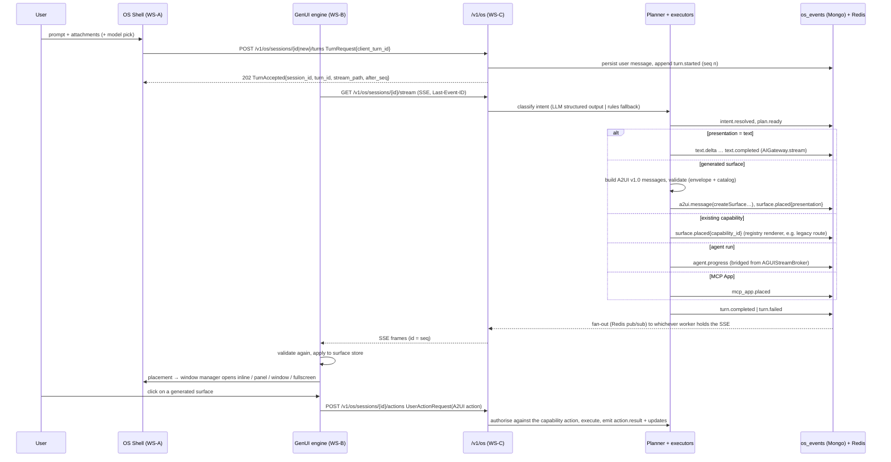

# Forge OS architecture (Phase 1 design)

Forge's signed-in experience becomes a prompt-first workspace. The user sees Forge branding, a centred
prompt composer, a collapsible nav and history panel, and the account menu. Nothing else is on screen until
they ask for it. Each prompt is answered with plain text or with a **generated interface chosen by
intent**, which opens inline, in a panel, in a macOS-style window, or full screen. Every existing feature is
still there. It opens on demand from a prompt, the command palette or the capability library, and its old
URL keeps working.

Related documents:
[CAPABILITY_MATRIX.md](CAPABILITY_MATRIX.md) (every feature → capability),
[A2UI_DECISION.md](A2UI_DECISION.md) (the generated-UI wire format),
[IMPLEMENTATION_PLAN.md](IMPLEMENTATION_PLAN.md) (workstreams and file ownership).
The contracts are code: `frontend/src/os/contracts.ts`, `backend/core/os_contracts.py` and the JSON
Schemas in `shared/os-schemas/`.

## Principles

1. **Hide complexity, not functionality.** No feature is deleted. Dashboards stop being permanent and
   become surfaces you summon.
2. **Generated UI is data, never code.** The LLM produces A2UI v1.0 JSON. The trusted shell renders it
   only through a closed, hand-written component registry after JSON Schema validation. No `eval`, no
   `dangerouslySetInnerHTML`, no LLM-authored CSS or URLs beyond validated http(s) links. Anything richer
   runs as a sandboxed MCP App iframe.
3. **The server is authoritative.** Intent, plan, validation, permissions, persistence and the event log
   all live on the server. The client is a validating renderer with a cache.
4. **Works with no LLM key.** A deterministic planner (rules plus the capability index) covers every
   capability when no provider is configured or the LLM fails.
5. **Reuse the existing infrastructure.** That means the fetch-based SSE reader, `StreamingResponse` with
   Last-Event-ID replay, the LLM router and AI Gateway, Mongo and Redis, cookie or Bearer auth with CSRF,
   project access checks, the agent kernel, AG-UI and MCP Apps.
6. **Ember Night stays.** Near-black canvas, one ember accent, pills, glass chrome, mono numbers
   (`docs/design/EMBER_NIGHT_DESIGN_LANGUAGE.md`). Windows and panels get Linear-like precision: hairlines,
   tight type, and no decorative chrome.

## Layers

```
┌──────────────────────────────────────────────────────────────────────────────────────┐
│ 1. OS Shell (WS-A)        minimal home · composer (attachments, voice, model picker)    │
│                           nav/history panel · window & panel manager · sessions         │
│                           command palette + capability library · legacy-route bridge    │
├──────────────────────────────────────────────────────────────────────────────────────┤
│ 2. Generative UI Engine   OS stream client · surface store (A2UI v1.0) · data binding   │
│    (WS-B)                 catalog registry · validation · action dispatch · text        │
│                           fallback · AG-UI progress · MCP Apps host                     │
├──────────────────────────────── network: /v1/os/* (SSE + JSON) ───────────────────────┤
│ 3. Intelligence Kernel    session/turn service · intent classifier · presentation       │
│    (WS-C)                 planner · context builder · surface validator · event log     │
│                           + fan-out · capability registry API                           │
├──────────────────────────────────────────────────────────────────────────────────────┤
│ 4. Agents, skills, tools  agent kernel (core/agent_kernel.py) · skill engine · MCP       │
│    (existing; WS-D wraps) gateway · A2A · builds/deployments · PM agents · reviews       │
├──────────────────────────────────────────────────────────────────────────────────────┤
│ 5. Infrastructure         FastAPI · MongoDB (motor) · Redis · LLM router + AI Gateway    │
│    (existing)             (providers/, budgets, guardrails) · auth/CSRF · Celery         │
└──────────────────────────────────────────────────────────────────────────────────────┘
```

What already exists at each layer (audit summary):

| Layer | Existing pieces reused |
|---|---|
| Shell | `AppShell.tsx`, `LeftNavRail.tsx`, `TopNavBar.tsx`, `CommandPalette.tsx` (static command list), `OSWindow.tsx` (window chrome), `uiStore` (persisted sidebar state), `VoiceInputButton` and `useVoiceToText`, `NotificationsBell` |
| GenUI | `components/a2ui/A2UIRenderer.tsx` (16 typed components), `parseA2UI.ts` (runtime narrowing, `safeHttpUrl`), `MCPAppFrame.tsx` and `mcpAppSecurity.ts` (sandboxed `srcdoc` iframe, size-only postMessage bridge), `kernelApi.subscribeAguiStream` / `subscribeAiSdkUiStream` (fetch-based SSE readers with Last-Event-ID) |
| Kernel | `core/llm/router.py` (provider failover, budgets, rate limits, prompt-injection detection), `gateway/service.py` `AIGateway` (guardrailed `generate` / `stream`, `structured_output_schema`), `core/protocol_gateway.py` (A2UI builder and validator, AG-UI broker, AI SDK UI adapter, MCP gateway), `core/mcp_apps.py` |
| Agents | `core/agent_kernel.py` with `api/kernel.py`, `core/skill_engine.py`, `api/agent_registry.py` (org, chat, WS), `core/a2a_adapter.py`, builds pipeline (`api/builds.py` plus WS), PM layer (`api/initiatives.py` plus WS), review orchestrator (`orchestrator/`) |
| Infra | `core/database.py` (motor, Redis), `api/auth.py` `get_current_user` (cookie `access_token` or Bearer), `core/security.py` CSRF middleware, `core/permissions.py` (`has_project_access`, org roles), `/v1` versioned routers |

## Data flow: prompt → intent → plan → events → surfaces → windows



Step by step:

1. **Compose.** The composer posts a `TurnRequest`. `client_turn_id` makes retries idempotent. Attachments
   are uploaded first and referenced by id (`AttachmentRef`). `model` is `auto` (the router decides) or
   `pinned`. The first prompt on the home screen creates the session (`POST /v1/os/sessions/new/turns`), and
   the composer animates to the bottom.
2. **Accept.** WS-C persists the user message, appends `turn.started`, and returns `202 TurnAccepted` at once.
   The work runs as an `asyncio` task in the request's worker (a Celery task later, if turns get long).
3. **Understand.** The intent classifier calls `AIGateway.generate` with
   `structured_output_schema = $defs/IntentResult` and the capability index (ids, titles, intents,
   keywords) as context. If no provider is registered, the call fails, or the output fails schema
   validation, the **deterministic classifier** takes over (`source: "rules"`): keyword and entity rules,
   attachment MIME types (a CSV means `analyze_data`), explicit `/capability` mentions, then `chat`. Palette
   and library launches skip classification (`source: "explicit"`).
4. **Plan.** The presentation planner turns `IntentResult` into a `PresentationPlan`. It picks the
   capability, checks the caller's permissions, plan tier and project access, chooses the presentation from
   the capability's `surfaces` and `default_surface` (adjusted by `size_hint` and what is already open in
   `context`), and lists the steps. Steps that need approval (`requires_approval`) render an `ApprovalCard`
   and wait. The planner never executes destructive actions on its own.
5. **Execute.** One executor per step kind:
   - `respond_text`: `AIGateway.stream`, which emits `text.delta` windows, then `text.completed`.
   - `render_surface`: the LLM (or a deterministic template for no-key mode) fills a surface **from the
     catalog only**. The server validates it with `validate_a2ui_message`, drops invalid components (the
     current `_finalize_a2ui_surface` behaviour), and emits `a2ui.message` and `surface.placed`.
   - `open_capability`: emits `surface.placed{capability_id}`. The client renders the capability's
     `renderer` (`component`, `legacy_route` or `a2ui`), which uses the feature's existing endpoints.
   - `run_agent`: starts a kernel run (`/kernel/runs`) and bridges `AGUIStreamBroker` events as
     `agent.progress`. An `ExecutionTimeline` composite renders them.
   - `open_mcp_app`: emits `mcp_app.placed`. The client fetches the sanitised resource and mounts
     `MCPAppFrame`.
6. **Stream.** Each event is appended to the session's event log with the next `seq`, then published.
   The SSE endpoint replays from the log after `Last-Event-ID` or `?after_seq=`, then tails live events.
7. **Render.** The client validates again (`validateOsEvent`). The surface store applies A2UI messages, and
   the window manager places surfaces using `surface.placed`. If a surface fails validation, the user sees a
   text fallback ("I couldn't display this result") plus a link to the capability, never a broken widget.
8. **Interact.** Clicks on generated components dispatch A2UI v1.0 `action` messages to
   `/v1/os/sessions/{id}/actions`. The server maps `action.name` to a capability action, re-checks
   permissions, runs it, and streams `action.result` plus surface or data updates. Destructive actions need
   `requires_confirmation` and the client shows a confirm dialog first.

## Event protocol (`forge-os/1`)

The schemas are `$defs/OsEvent` in `shared/os-schemas/os-contracts.schema.json`, mirrored as `OsEvent`
in TypeScript and Pydantic.

- **Envelope:** `{v: "forge-os/1", seq, session_id, turn_id, ts, type, data}`. Envelopes are closed
  (`additionalProperties: false`).
- **Types:** `turn.started`, `intent.resolved`, `plan.ready`, `text.delta`, `text.completed`,
  `a2ui.message`, `surface.placed`, `mcp_app.placed`, `agent.progress`, `action.result`,
  `turn.completed`, `turn.failed`, `heartbeat`.
- **Ordering:** `seq` is monotonic **per session**, allocated by an atomic Mongo counter. It is the SSE
  `id:`. A2UI needs ordered delivery: `createSurface` arrives before `updateComponents`.
- **Replay:** reconnect with `Last-Event-ID` (or `?after_seq=`). Every event except `heartbeat` is
  persisted. Heartbeats repeat the last seq (as the AG-UI broker does today) and are never stored.
- **Turn end:** exactly one `turn.completed` or `turn.failed` per turn. `POST …/turns/{turn_id}/cancel`
  ends a turn with `turn.completed{status: "cancelled"}`.
- **Errors:** `OsError{code, message, retryable}`. `llm_unavailable` with `retryable: false` is how the
  client learns there is no key and the deterministic path was not enough (for example, free-form chat
  with no LLM).
- **Wire format:** `id: <seq>\nevent: <type>\ndata: <json>\n\n`, written by
  `core.os_contracts.os_event_to_sse`.

## Streaming transport: SSE, not WebSocket

**Decision: SSE for server→client, plain JSON POSTs for client→server.**

| Concern | SSE (chosen) | WebSocket |
|---|---|---|
| Existing infra | Already in production: `StreamingResponse(text/event-stream)` with `X-Accel-Buffering: no` and Last-Event-ID replay in `api/protocols.py`. The fetch-based reader with auth headers is in `kernelApi.subscribeAguiStream` | Three WS managers exist (`services/ws_manager.py`, `pm_ws_manager.py`, `org_ws_manager.py`) but need short-lived `ws-token`s and their own reconnect logic |
| Auth and CSRF | Normal cookie or Bearer auth on GET. POSTs go through the existing CSRF middleware unchanged | Token in the query string; CSRF does not apply |
| Resumability | Built in (`id:` plus Last-Event-ID), which maps one-to-one onto `seq` | Custom |
| A2UI fit | The spec is transport-agnostic and needs ordered, framed delivery; SSE events provide that | Equivalent |
| Proxies | Works through nginx and Cloudflare with buffering off and heartbeats | Needs upgrade support end to end |
| Upstream | User actions are rare and need CSRF, idempotency and authorisation anyway; POST fits | Bidirectional, but not needed |

Existing WebSocket channels (build progress, PM board, org) **stay as they are**. Composite surfaces such as
`build.workspace`, `plan.initiative.board` and `agents.org` keep using their current hooks
(`useBuildSocket`, `usePMSocket`, `useOrgSocket`). The OS stream does not replace them.

**Multi-worker gap found in the audit:** `AGUIStreamBroker` publishes to Redis
(`forge:agui:run:{run_id}`), but nothing subscribes, and its replay buffer is in-process memory. An SSE
client connected to worker B misses events published on worker A. The OS stream avoids this from the start:
the Mongo event log is the replay source, and a Redis `psubscribe("os:session:*")` listener (the pattern
`services/ws_manager.py` already uses for `build:*`) wakes local SSE subscribers. WS-C also bridges kernel
AG-UI events into `agent.progress` through the same log. Fixing the existing AG-UI endpoint is listed as an
open question.

## New backend API (`/v1/os/*`, WS-C)

Everything requires `get_current_user`. Every query is scoped to `user_id`, plus `org_id` where the session
is project-bound, plus `has_project_access` for project resources. POSTs carry `X-CSRF-Token`.

| Method and path | Body → response | Notes |
|---|---|---|
| `POST /v1/os/sessions/new/turns` | `TurnRequest` → `TurnAccepted` | Creates a session; title derived from the first prompt |
| `POST /v1/os/sessions/{session_id}/turns` | `TurnRequest` → `TurnAccepted` | Idempotent on `client_turn_id`; 409 if a turn is already running |
| `POST /v1/os/sessions/{session_id}/turns/{turn_id}/cancel` | → 204 | |
| `GET /v1/os/sessions/{session_id}/stream` | SSE of `OsEvent` | `Last-Event-ID` / `?after_seq=`; 15 s heartbeat |
| `POST /v1/os/sessions/{session_id}/actions` | `UserActionRequest` → 202 | Result arrives on the stream as `action.result` |
| `GET /v1/os/sessions` | → `SessionSummary[]` (paginated) | History panel |
| `GET /v1/os/sessions/{id}` · `PATCH` · `DELETE` | → session + `SessionMessage[]` + `StoredSurface[]` | Rename, pin, archive; delete is soft |
| `GET /v1/os/workspaces/current` · `PUT /v1/os/workspaces/{id}` | `WorkspaceState` | Optimistic concurrency on `version` (409 on mismatch) |
| `GET /v1/os/capabilities` | → `CapabilityCatalog` | Filtered by permissions, admin flag and plan |
| `POST /v1/os/capabilities/{id}/invoke` | `CapabilityInvocation` → 202 or result | Palette and library launches; same authorisation path as actions |
| `GET /v1/os/models` | → model metadata (no secrets) | Needed by the composer model picker and `models.compare`; `/api/llm/models` is admin-only |
| `POST /v1/os/attachments` | multipart → `AttachmentRef` | Size and type limits match `AttachmentRef` (50 MB cap) |

The existing `/v1/projects/{project_id}/os/*` router (`api/enterprise.py`) is unrelated and keeps its paths.

## Security model

**Trust boundaries.** The browser shell is trusted code. LLM output, MCP server output, A2A peers, uploaded
files and any text derived from them are untrusted data.

1. **No generated code in the shell.** Generated UI is A2UI JSON validated against the closed Forge Ember
   catalog, which allows only 38 components, closed props and no functions. Rendering maps a component name
   to a hand-written React component. Props are plain text, numbers, booleans, `{"@path"}` bindings,
   component ids, http(s) links (`HttpUrl` pattern plus `safeHttpUrl` at render time) and agent-side
   `Action.event` names. React escaping applies. There is no `dangerouslySetInnerHTML` path. Markdown
   `Text` is rendered with the existing safe markdown path (no raw HTML).
2. **Validate twice.** The server validates every A2UI message before persisting or streaming it
   (`validate_a2ui_message`). The client validates every event before applying it (`validateOsEvent`).
   Both use the same JSON Schema files, kept byte-identical by drift tests. On failure the component is
   dropped or the text fallback is shown. Validation errors are logged, never rendered.
3. **Richer UIs only via MCP Apps.** They render in `<iframe srcdoc sandbox="allow-scripts">` with no
   `allow-same-origin`, a strict CSP from `core/mcp_apps.py`, a size-only postMessage bridge, and sanitised
   HTML capped server-side. They never render in the shell DOM.
4. **Actions are requests, not commands.** An A2UI `action` is mapped server-side to a registered
   `CapabilityAction`. The server re-checks `permissions`, project access, plan and budget. Destructive
   actions require an explicit confirmation step and are never auto-run by the planner. Action names are
   pattern-restricted, and `context` is validated against the action's `input_schema`.
5. **Prompt injection.** User and attachment text goes through the router's existing sanitisation and
   injection detection. Tool and MCP output is wrapped as data in the planner prompt. The planner's output
   is schema-constrained (`IntentResult`, `PresentationPlan`) and checked against the capability registry,
   so an injected "open admin.ops" still fails authorisation.
6. **Tenant isolation.** Every `os_*` document carries `user_id` (and `org_id` / `project_id` when bound).
   Every read filters on them. Unknown or foreign ids return 404, not 403, matching
   `_assert_project_access`. SSE streams are authorised per session on connect.
7. **Links and navigation.** `legacy_route` windows accept only in-app paths starting with `/` (schema
   pattern), resolved by the router. External links open with `rel="noopener noreferrer"`.
8. **Abuse limits.** Turns count against the existing LLM budgets, rate limits and concurrency leases in
   `LLMRouter`. Schemas cap prompt (16k chars), attachments (10 × 50 MB), components (200 per message) and
   text (100k chars).
9. **Audit.** Turn, plan and action records include intent source, model and capability id. MCP and A2A
   calls keep their existing audit trails.

## Persistence model

| Collection (Mongo) | Contents | Keys and indexes | Retention |
|---|---|---|---|
| `os_sessions` | `SessionSummary` + `user_id`, `org_id?`, `seq_counter`, `deleted_at` | `(user_id, updated_at desc)`, `(user_id, pinned)` | until deleted (soft) |
| `os_messages` | `SessionMessage` | `(session_id, created_at)` | with the session |
| `os_events` | `OsEvent` (no heartbeats) | unique `(session_id, seq)` | 30 days (replay window); then a session reloads from messages and surfaces |
| `os_surfaces` | `StoredSurface` snapshot after applying every A2UI message | unique `surface_id`, `(session_id)` | with the session |
| `os_workspaces` | `WorkspaceState` + `user_id` | unique `(user_id, id)` | until deleted |
| `os_turns` | turn status, `client_turn_id`, plan, usage | unique `(session_id, client_turn_id)` | with the session |

- **Feature data does not move.** Projects, builds, kernel runs, initiatives and so on stay in their own
  collections and APIs (`persistence: "server"` in the matrix). A session stores only references (ids in
  `entities`, `capability_id`, `window.params`) and generated surfaces.
- **Client cache.** `WorkspaceState` is mirrored to `localStorage` (as `uiStore` does today) for an instant
  first paint, then reconciled with the server. The server wins on a `version` conflict, and the client
  merges window-local changes. Session lists use React Query with the existing 30 s `staleTime`.
- **Reload and replay.** Opening a session loads messages and surface snapshots, then attaches the stream at
  the stored `last_seq`. A live turn resumes exactly where it was.

## Routing and legacy routes

- New authenticated home: **`/os`** (with `/os/s/:sessionId` for a session). It ships behind
  `VITE_OS_SHELL` and becomes the redirect target of `RootRoute`, `PublicRoute` and `/demo` (currently
  `/command`) when the flag is on. With the flag off, nothing changes.
- **Every existing route keeps working.** Inside the OS shell, a legacy route renders the current page
  component inside an OS window or full-screen surface (`CapabilityRenderer{kind: "legacy_route"}`).
  Navigating to the URL directly opens that window over the minimal home. Redirect aliases (`/models`,
  `/llm-management`, `/flow`, `/project/:id` and so on) are kept as they are. The coverage test in
  `frontend/src/os/contracts.test.ts` fails if a route has no capability.
- The left rail's grouped nav becomes the collapsible nav/history panel (sessions first, pinned
  capabilities second). The full feature list moves to the capability library. ⌘K searches capabilities,
  sessions and actions using the registry instead of the static `COMMANDS` array.

## Frontend module layout

```
frontend/src/os/
  contracts.ts  validate.ts  jsonSchema.ts  schemas/      shared contracts (change by contract PR only)
  shell/                                                  WS-A: OsHome, Composer, NavHistoryPanel, WindowManager, …
  genui/                                                  WS-B: surfaceStore, registry/, renderer, binding, actions
  stream/                                                 WS-B: osStreamClient (SSE reader, replay, validation)
  capabilities/                                           WS-D: descriptors + adapters wrapping existing pages
```

Catalog components and capability adapters are lazy-loaded (`lazyWithRetry`), so the minimal home stays
small. CI enforces the bundle budget (`scripts/check-bundle-size.js`). JSON Schemas (about 120 KB raw) are
imported only by `validate.ts`, which loads with the GenUI engine and not on the landing page.

## Accessibility and motion

Windows are `role="dialog"` with `aria-modal` (full screen) or `role="region"` (panels), with focus trapped
and restored. All window operations have keyboard shortcuts and palette commands. Live text streams use
`aria-live="polite"` and do not announce per token. The composer's move from centre to bottom respects
`prefers-reduced-motion`. Generated components inherit the a11y behaviour of their hand-written
implementations, which is why the catalog never accepts raw markup.

## Rollout

1. Contracts (this phase) → 2. WS-A, B, C and D in parallel behind `VITE_OS_SHELL` and backend flag
`os_shell` (`core/feature_flags.py`) → 3. Internal dogfood with no-key deterministic mode tested →
4. Flip the default and keep legacy routes indefinitely → 5. Later, retire permanent dashboards from
the default nav (they stay as capabilities).
