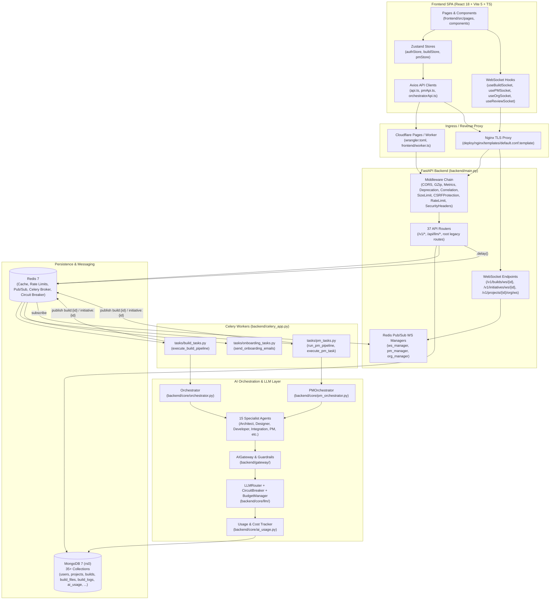

# Forge AI — Verified System Architecture & Technical Assessment (`engineering/ARCHITECTURE.md`)

**Status**: Verified from Live Source Code (Gate `G0` / `G1`)  
**Authors**: `architect`, `backend-engineer`, `frontend-engineer`, `ai-engineer`, `qa-engineer`, `security-engineer`, `devops-engineer`  
**Adversarial Verification**: `independent-reviewer`  
**Last Updated**: 2026-11-14

---

## 1. Repository Topology & Subsystem Status

Every path below was inspected directly in [`/Users/keshav/forge-ai`](file:///Users/keshav/forge-ai) rather than relying on legacy documentation (`docs/ARCHITECTURE.md`, `*AUDIT*.md`, `P0_FIXES_APPLIED.md`).

| Directory / File | Operational Status | Verified Purpose & Current State |
| :--- | :--- | :--- |
| [`backend/`](file:///Users/keshav/forge-ai/backend/main.py) | **Active (Primary API & Workers)** | FastAPI REST + WebSocket backend ([`backend/main.py`](file:///Users/keshav/forge-ai/backend/main.py#L1-L574)), Celery workers ([`backend/celery_app.py`](file:///Users/keshav/forge-ai/backend/celery_app.py#L1-L52)), Motor/MongoDB + Redis ([`backend/core/database.py`](file:///Users/keshav/forge-ai/backend/core/database.py#L1-L400)), 37 API routers ([`backend/api/`](file:///Users/keshav/forge-ai/backend/api)), multi-agent build/PM pipelines ([`backend/core/orchestrator.py`](file:///Users/keshav/forge-ai/backend/core/orchestrator.py#L1-L889), [`backend/core/pm_orchestrator.py`](file:///Users/keshav/forge-ai/backend/core/pm_orchestrator.py#L1-L273)), LLM Router ([`backend/core/llm/router.py`](file:///Users/keshav/forge-ai/backend/core/llm/router.py#L1-L1231)), and Autonomous Engineering Org ([`backend/agent_registry/`](file:///Users/keshav/forge-ai/backend/agent_registry)). |
| [`backend/app/`](file:///Users/keshav/forge-ai/backend/app/services/deployment_service.py) | **Dead Duplicate Package** | Contains [`deployment_service.py`](file:///Users/keshav/forge-ai/backend/app/services/deployment_service.py#L1-L134), [`log_streamer.py`](file:///Users/keshav/forge-ai/backend/app/services/log_streamer.py#L1-L80), and [`deployment.py`](file:///Users/keshav/forge-ai/backend/app/tasks/deployment.py#L1-L127). Never imported by `backend/main.py`, `backend/celery_app.py`, or `backend/api/deployments.py`. |
| [`frontend/`](file:///Users/keshav/forge-ai/frontend/package.json) | **Active (SPA + Cloudflare Worker)** | React 18.3 + TypeScript + Vite 5 + Tailwind CSS + Zustand + TanStack Query SPA ([`frontend/src/App.tsx`](file:///Users/keshav/forge-ai/frontend/src/App.tsx#L1-L728)), plus Hono-based Cloudflare Worker `/api/*` proxy ([`frontend/worker.ts`](file:///Users/keshav/forge-ai/frontend/worker.ts#L1-L31)). |
| [`orchestration/`](file:///Users/keshav/forge-ai/orchestration/api.py) | **Standalone Internal Tooling** | File-backed JSON workflow/state engine (`orchestration/engine/`, `orchestration/tool_gateway.py`, `orchestration/api.py`). Not imported by `backend/`, except [`backend/api/admin.py:799-820`](file:///Users/keshav/forge-ai/backend/api/admin.py#L799-L820) (`GET /admin/engineering-health`) reads static JSON reports from `./orchestration/` when mounted. `AgentDispatcher.dispatch` ([`orchestration/engine/dispatcher.py:164-270`](file:///Users/keshav/forge-ai/orchestration/engine/dispatcher.py#L164-L270)) is a state-only simulation stub that makes no LLM calls. |
| [`orchestrator/`](file:///Users/keshav/forge-ai/orchestrator/Dockerfile) | **Broken / Missing Source Files** | Contains only [`orchestrator/Dockerfile`](file:///Users/keshav/forge-ai/orchestrator/Dockerfile#L1-L17) and [`orchestrator/README.md`](file:///Users/keshav/forge-ai/orchestrator/README.md#L1-L210). The Python application files (`orchestrator/main.py`, `orchestrator/requirements.txt`, `orchestrator/service.py`) do **not** exist on disk, causing `docker-compose.yml`'s `orchestrator` service ([`docker-compose.yml:78-107`](file:///Users/keshav/forge-ai/docker-compose.yml#L78-L107)) and [`backend/agent_registry/review_board_bridge.py:99-227`](file:///Users/keshav/forge-ai/backend/agent_registry/review_board_bridge.py#L99-L227) to fail. |
| [`deploy/`](file:///Users/keshav/forge-ai/deploy/nginx/templates/default.conf.template) | **Active (VPS Prod/Staging)** | Nginx reverse-proxy template ([`deploy/nginx/templates/default.conf.template`](file:///Users/keshav/forge-ai/deploy/nginx/templates/default.conf.template#L1-L148)) and Let's Encrypt/staging bootstrap scripts ([`deploy/scripts/`](file:///Users/keshav/forge-ai/deploy/scripts)) used by [`docker-compose.prod.yml`](file:///Users/keshav/forge-ai/docker-compose.prod.yml) and [`.github/workflows/deploy.yml`](file:///Users/keshav/forge-ai/.github/workflows/deploy.yml). |
| [`k8s/`](file:///Users/keshav/forge-ai/k8s/README.md) | **Reference Manifests (Drifted)** | Kubernetes manifests for namespace, secrets, backend, frontend, celery-worker, orchestrator, mongodb, redis, ingress, monitoring, and backup/restore jobs. Not wired into CI/CD; contains multiple schema and runtime defects (Section 8). |
| [`.github/workflows/`](file:///Users/keshav/forge-ai/.github/workflows/ci.yml) | **Active CI/CD Pipelines** | [`ci.yml`](file:///Users/keshav/forge-ai/.github/workflows/ci.yml), [`deploy.yml`](file:///Users/keshav/forge-ai/.github/workflows/deploy.yml), [`deploy-staging.yml`](file:///Users/keshav/forge-ai/.github/workflows/deploy-staging.yml), [`deploy-cloudflare.yml`](file:///Users/keshav/forge-ai/.github/workflows/deploy-cloudflare.yml), and [`secret-scanning.yml`](file:///Users/keshav/forge-ai/.github/workflows/secret-scanning.yml). |
| [`.agents/`](file:///Users/keshav/forge-ai/.agents) & [`engineering/`](file:///Users/keshav/forge-ai/engineering) | **Active Governance Layer** | 9 persistent custom agents ([`.agents/agents/*.md`](file:///Users/keshav/forge-ai/.agents/agents)), workspace plugin ([`.agents/plugins/forge-engineering/`](file:///Users/keshav/forge-ai/.agents/plugins/forge-engineering/plugin.json)), 5 shared rules ([`AGENTS.md`](file:///Users/keshav/forge-ai/AGENTS.md), [`.agents/rules/*.md`](file:///Users/keshav/forge-ai/.agents/rules)), and 6 engineering management documents ([`engineering/*.md`](file:///Users/keshav/forge-ai/engineering)). |

---

## 2. High-Level System Architecture Diagram

---

## 3. Revalidation of the 4 Historical Issues

Per CTO instructions, none of the previously reported audit claims were assumed fixed or broken. All four were revalidated line-by-line against current source files:

### Historical Issue 1: Placeholder Secrets in [`k8s/secrets.yaml`](file:///Users/keshav/forge-ai/k8s/secrets.yaml#L1-L68)
- **Verdict**: **PARTIALLY RESOLVED (No Plaintext/`CHANGE_ME_*` Strings, Still P1 Operational Hazard)**.
- **Live Source Evidence**:
  - [`k8s/secrets.yaml:21-37`](file:///Users/keshav/forge-ai/k8s/secrets.yaml#L21-L37) (`forge-ai-prod`) and [`k8s/secrets.yaml:51-63`](file:///Users/keshav/forge-ai/k8s/secrets.yaml#L51-L63) (`forge-ai-staging`) have replaced all `CHANGE_ME_*` strings with empty strings `""` and added comments instructing injection via External Secrets Operator or SealedSecrets.
  - **Remaining Defect**: Because `k8s/secrets.yaml` is still a raw `kind: Secret` manifest in `k8s/`, running `kubectl apply -f k8s/` will overwrite populated secrets in the cluster with `""`, crashing all pods on `settings.validate_production_secrets()` ([`backend/core/config.py:139-192`](file:///Users/keshav/forge-ai/backend/core/config.py#L139-L192)). Additionally, `metrics-token` (referenced as `optional: true` in [`k8s/backend.yaml:121-125`](file:///Users/keshav/forge-ai/k8s/backend.yaml#L121-L125)) and `mongodb-keyfile` (mounted in [`k8s/mongodb.yaml:106-108`](file:///Users/keshav/forge-ai/k8s/mongodb.yaml#L106-L108)) are missing from `k8s/secrets.yaml`.

### Historical Issue 2: Incomplete LLM Usage Tracking in [`backend/core/ai_usage.py`](file:///Users/keshav/forge-ai/backend/core/ai_usage.py#L1-L201)
- **Verdict**: **STILL BROKEN (P0 Severity — 100% of Streaming & `BaseAgent.run()` Calls Record Zero Tokens/Cost)**.
- **Live Source Evidence**:
  1. **Streaming & `BaseAgent.run()` Drop All Usage (`AIO-01`)**:
     - Provider streaming methods ([`backend/providers/anthropic.py:55-72`](file:///Users/keshav/forge-ai/backend/providers/anthropic.py#L55-L72), [`backend/providers/openai.py:60-79`](file:///Users/keshav/forge-ai/backend/providers/openai.py#L60-L79), [`backend/providers/openrouter.py:27-46`](file:///Users/keshav/forge-ai/backend/providers/openrouter.py#L27-L46)) yield raw text strings (`AsyncIterator[str]`) and discard token usage metadata.
     - `LLMRouter.stream()` constructs `fake_resp = CompletionResponse(text="".join(collected), provider=..., model=...)` with default empty `usage={}` in both the BYOK path ([`backend/core/llm/router.py:826-831`](file:///Users/keshav/forge-ai/backend/core/llm/router.py#L826-L831)) and standard path ([`backend/core/llm/router.py:973-979`](file:///Users/keshav/forge-ai/backend/core/llm/router.py#L973-L979)).
     - `LLMRouter._record_usage()` ([`backend/core/llm/router.py:1040-1045`](file:///Users/keshav/forge-ai/backend/core/llm/router.py#L1040-L1045)) normalizes `usage={}` to `prompt_tokens=0, completion_tokens=0` and **returns early** at `if prompt_tokens + completion_tokens <= 0: return` (line 1045) before calling `track_usage()`!
     - Because `BaseAgent.run()` ([`backend/agents/base.py:427-456`](file:///Users/keshav/forge-ai/backend/agents/base.py#L427-L456)) is implemented as `async for chunk in self.stream(...): full_response += chunk`, **every streaming build stage (`DeveloperAgent.generate_files` at [`orchestrator.py:283-287`](file:///Users/keshav/forge-ai/backend/core/orchestrator.py#L283-L287)) AND all 11 `BaseAgent.run()` methods (`DesignerAgent.design`, `ArchitectAgent.clarify/answer`, `DeveloperAgent.identify_questions`, and all 8 Agile PM agents in [`pm_orchestrator.py:50-228`](file:///Users/keshav/forge-ai/backend/core/pm_orchestrator.py#L50-L228) and [`pm_tasks.py:216-236`](file:///Users/keshav/forge-ai/backend/tasks/pm_tasks.py#L216-L236)) record 0 tokens and \$0.00 in `db.ai_usage`!**
  2. **Incomplete `MODEL_COSTS` & Wrong Provider Attribution (`AIO-06`)**:
     - [`backend/core/ai_usage.py:20-27`](file:///Users/keshav/forge-ai/backend/core/ai_usage.py#L20-L27) only lists 6 models (`claude-sonnet-4-6`, `claude-opus-3`, `gpt-4-turbo`, and 3 `anthropic/*` IDs). Models registered in `LLMRouter._register_default_providers` ([`router.py:1182-1231`](file:///Users/keshav/forge-ai/backend/core/llm/router.py#L1182-L1231))—including `gpt-4o-mini`, `gpt-4.1`, `gemini-1.5-pro`, `llama-3.1-8b`, `llama3.2`, `mistral-small-latest`, and `openrouter/auto`—silently fall back to `claude-sonnet-4-6` (\$3/\$15 per 1M) pricing ([`ai_usage.py:84`](file:///Users/keshav/forge-ai/backend/core/ai_usage.py#L84)) and `"anthropic"` provider attribution ([`ai_usage.py:92-94`](file:///Users/keshav/forge-ai/backend/core/ai_usage.py#L92-L94)).
  3. **Unattributed LLM Security Classifiers**:
     - `LLMRouter._check_injection_with_llm` ([`router.py:1119-1125`](file:///Users/keshav/forge-ai/backend/core/llm/router.py#L1119-L1125)) and `GuardrailsEngine._check_with_llm` ([`backend/gateway/guardrails.py:106-112`](file:///Users/keshav/forge-ai/backend/gateway/guardrails.py#L106-L112)) invoke `provider.chat_completion` directly, bypassing `_record_usage()`.

### Historical Issue 3: CI Jobs Using `continue-on-error`
- **Verdict**: **RESOLVED in `ci.yml`, STILL PRESENT in `secret-scanning.yml` (P0/P1)**.
- **Live Source Evidence**:
  - [`.github/workflows/ci.yml:1-433`](file:///Users/keshav/forge-ai/.github/workflows/ci.yml#L1-L433) contains **zero** `continue-on-error` flags and enforces a strict `quality-gate` job ([`ci.yml:421-433`](file:///Users/keshav/forge-ai/.github/workflows/ci.yml#L421-L433)).
  - **Remaining Defect**: [`.github/workflows/secret-scanning.yml:54-56`](file:///Users/keshav/forge-ai/.github/workflows/secret-scanning.yml#L54-L56) still sets `continue-on-error: true` on `Scan all files for secrets (full history)` (`git secrets --scan-history`), and [`secret-scanning.yml:80-120`](file:///Users/keshav/forge-ai/.github/workflows/secret-scanning.yml#L80-L120) has drifted from [`scripts/git-hooks/pre-commit:26-134`](file:///Users/keshav/forge-ai/scripts/git-hooks/pre-commit#L26-L134).

### Historical Issue 4: Frontend/Backend WebSocket Authentication Mismatch
- **Verdict**: **RESOLVED for Build & Initiative Sockets, STILL BROKEN (P0/P1) for Engineering Org & Review Sockets**.
- **Live Source Evidence**:
  - **Build & Initiative Sockets (Fixed)**: [`useBuildSocket.ts:49-64`](file:///Users/keshav/forge-ai/frontend/src/hooks/useBuildSocket.ts#L49-L64) and [`usePMSocket.ts:51-63`](file:///Users/keshav/forge-ai/frontend/src/hooks/usePMSocket.ts#L51-L63) fetch a 60s token via `POST /v1/auth/ws-token` and pass `[wsToken]` in `Sec-WebSocket-Protocol`. Both [`backend/api/builds.py:427`](file:///Users/keshav/forge-ai/backend/api/builds.py#L427) and [`backend/api/initiatives.py:909`](file:///Users/keshav/forge-ai/backend/api/initiatives.py#L909) echo `await websocket.accept(subprotocol=ws_token)`.
  - **Engineering Org Socket (Broken Handshake + Unstarted Redis Pub/Sub)**:
    1. [`frontend/src/hooks/useOrgSocket.ts:121`](file:///Users/keshav/forge-ai/frontend/src/hooks/useOrgSocket.ts#L121) connects with `new WebSocket(\`${WS_URL}/v1/projects/${id}/org/ws\`, [wsToken])`.
    2. [`backend/api/agent_registry.py:558-560`](file:///Users/keshav/forge-ai/backend/api/agent_registry.py#L558-L560) (`org_websocket`) authenticates the token from `Sec-WebSocket-Protocol` but calls `await websocket.accept()` **without** `subprotocol=ws_token`! Per RFC 6455 §4.2.2, browsers immediately abort the connection when the server does not echo the offered subprotocol.
    3. [`backend/main.py:106-107`](file:///Users/keshav/forge-ai/backend/main.py#L106-L107) starts `ws_manager.start()` and `pm_manager.start()`, but **never calls `org_manager.start()`** (or `await org_manager.stop()` at shutdown).
  - **Review Socket (Unauthenticated)**: [`frontend/src/hooks/useReviewSocket.ts:44`](file:///Users/keshav/forge-ai/frontend/src/hooks/useReviewSocket.ts#L44) connects to `ws://localhost:8100/reviews/${id}/stream` with zero authentication.
  - **Production `WS_URL` Fallback Bug**: In [`useBuildSocket.ts:6`](file:///Users/keshav/forge-ai/frontend/src/hooks/useBuildSocket.ts#L6), [`usePMSocket.ts:6`](file:///Users/keshav/forge-ai/frontend/src/hooks/usePMSocket.ts#L6), and [`useOrgSocket.ts:6`](file:///Users/keshav/forge-ai/frontend/src/hooks/useOrgSocket.ts#L6), `const WS_URL = import.meta.env.VITE_WS_URL || 'ws://localhost:8000'` falls back to `ws://localhost:8000` when `VITE_WS_URL=""` (the default in [`frontend/Dockerfile:19`](file:///Users/keshav/forge-ai/frontend/Dockerfile#L19)).

---

## 4. Detailed Subsystem Architecture Findings

### 4.1 Backend API, Auth, CSRF & Billing (`backend/`)
- **Entrypoint & Lifespan ([`backend/main.py:79-170`](file:///Users/keshav/forge-ai/backend/main.py#L79-L170))**: Initializes settings, Sentry, Motor MongoDB connection pool + indexes (`connect_db()`), Redis ping, default marketplace templates, WebSocket pub/sub listeners (`ws_manager`, `pm_manager`), stuck-build reconciliation loop (`_reconcile_loop`), default autonomous org profiles (`ensure_default_org`), and graceful `SIGTERM` drain (`_shutting_down`).
- **Route Mounting Asymmetry ([`backend/main.py:303-334`](file:///Users/keshav/forge-ai/backend/main.py#L303-L334) vs [`backend/api/v1.py:46-76`](file:///Users/keshav/forge-ai/backend/api/v1.py#L46-L76))**:
  - `repos_router` is mounted **only** under `/v1/repos` ([`v1.py:70`](file:///Users/keshav/forge-ai/backend/api/v1.py#L70)), while [`frontend/src/lib/api.ts:144`](file:///Users/keshav/forge-ai/frontend/src/lib/api.ts#L144) (`reposApi.importRepo`) posts to `/repos/import` (root), returning HTTP 404.
  - Conversely, `cashfree_router`, `optimizer_router`, `org_llm_policy_router`, `budget_router`, `retrieval_router`, and `engineering_router` are mounted at root in `main.py` but omitted from `v1.py`, while `deprecation_middleware` ([`main.py:279-299`](file:///Users/keshav/forge-ai/backend/main.py#L279-L299)) advertises non-existent `/v1` successor headers on them.
- **CORS Method Omission ([`backend/main.py:223`](file:///Users/keshav/forge-ai/backend/main.py#L223))**: `allow_methods=["GET", "POST", "PUT", "DELETE", "OPTIONS"]` omits `"PATCH"`, blocking cross-origin `PATCH` requests (`pmApi.ts:94`, `agent_registry.py:451`).
- **CSRF Middleware Over-Blocking ([`backend/core/security.py:345-421`](file:///Users/keshav/forge-ai/backend/core/security.py#L345-L421))**: `_CSRF_EXCLUDED_PATHS` omits `/auth/refresh` (`/v1/auth/refresh`), `/razorpay/webhook`, `/cashfree/webhook`, `/tasks/github/webhook`, and `/v1/projects/{id}/monitoring/webhook/findings`. Once a user's 30-minute `access_token` cookie expires, `POST /v1/auth/refresh` is rejected with `403 CSRF: Invalid or expired session`, and external Razorpay/Cashfree/GitHub webhooks are rejected with `403 CSRF: No session token`.

### 4.2 AI Orchestration & Multi-Agent Pipelines (`backend/core/`, `backend/agents/`, `backend/prompt_builder/`)
- **Build Pipeline ([`backend/core/orchestrator.py:75-497`](file:///Users/keshav/forge-ai/backend/core/orchestrator.py#L75-L497))**:
  - Runs `ArchitectAgent.blueprint` (with optional interactive `clarify` gate) → `BusinessModelAgent.improve` → `DesignerAgent.design` → `_run_developer_clarifications` → `DeveloperAgent.generate_files` (streaming) → `IntegrationAgent.generate_integrations` → `PMAgent.validate` + self-healing debug loop (`DeveloperAgent.patch_files`, up to `MAX_DEBUG_ITERATIONS = 3`).
  - **Critical P0 Return-Shape Mismatch (`AIO-02`)**: Both `DeveloperAgent.generate_files` (streaming branch at [`backend/agents/developer.py:76`](file:///Users/keshav/forge-ai/backend/agents/developer.py#L76)) and `DeveloperAgent.patch_files` ([`developer.py:172`](file:///Users/keshav/forge-ai/backend/agents/developer.py#L172)) unwrap the `"files"` key (`return parsed.get("files", parsed)`), returning `{"path/to/file": "content"}`. However, `Orchestrator.run_build` ([`orchestrator.py:288, 294, 303, 445`](file:///Users/keshav/forge-ai/backend/core/orchestrator.py#L288)) calls `files_result.get("files", {})` and `patched.get("files", {})` a second time, yielding `{}` (zero generated/patched files)!
  - **Critical P0 Missing Prompt Templates (`AIO-03`)**: `DeveloperAgent.identify_questions` ([`developer.py:123`](file:///Users/keshav/forge-ai/backend/agents/developer.py#L123)) requests `prompt_template_version="questions-v1"` and `ArchitectAgent.answer` ([`backend/agents/architect.py:83`](file:///Users/keshav/forge-ai/backend/agents/architect.py#L83)) requests `prompt_template_version="answer-v1"`. Neither is registered in `TEMPLATE_REGISTRY` ([`backend/prompt_builder/templates/__init__.py:26-46`](file:///Users/keshav/forge-ai/backend/prompt_builder/templates/__init__.py#L26-L46)), raising `TemplateNotFoundError` and rendering the entire inter-agent clarification system dead code.

### 4.3 Frontend Architecture & Design System (`frontend/src/`)
- **Design Tokens**: [`frontend/src/lib/designTokens.ts`](file:///Users/keshav/forge-ai/frontend/src/lib/designTokens.ts) and [`frontend/src/index.css`](file:///Users/keshav/forge-ai/frontend/src/index.css) define a comprehensive 3-layer token hierarchy (`--color-*`, `--space-*`, `--radius-*`, `--shadow-*`). However, multiple feature pages (`Login.tsx`, `Register.tsx`, `Landing.tsx`, `Builder.tsx`, `Dashboard.tsx`) still use hardcoded Tailwind hex literals (`bg-[#0B0F17]`, `bg-[#FF3B00]`).
- **Accessibility & Interactive States**: Only ~24 `aria-*` attributes exist across 46 `.tsx` files; custom modals (`Initiatives.tsx`, `Kanban.tsx`, `Epics.tsx`) lack `role="dialog"`, `aria-modal="true"`, Escape-key handling, and focus traps.

### 4.4 Infrastructure, Docker, Kubernetes & Git State
- **Git Working Tree State (P0 Blocker `TASK-001`)**: The repository has an uncommitted in-progress merge on `main` (`.git/MERGE_HEAD` exists) with ~120 staged files, including accidental root binary/payload artifacts (`eng.traineddata` 5.2 MB, `req.json` 139 KB, `reference_image.jpg` 104 KB, `.stash/*`) and untracked `gemini_resp.json` and `dump.rdb`. Because Antigravity read-only subagents (`Workspace: "inherit"`) inspect committed `HEAD` (`3b4e11d1`) rather than uncommitted staged files, resolving this merge state on a dedicated branch is a mandatory prerequisite before spawning Gate `G3` worktrees.
- **Production & Staging Compose Startup Crash (`DEVOPS-P0-1`)**: [`docker-compose.prod.yml:56,120`](file:///Users/keshav/forge-ai/docker-compose.prod.yml#L56) and [`docker-compose.staging.yml:25,84`](file:///Users/keshav/forge-ai/docker-compose.staging.yml#L25) set `APP_ENV=production` with `MONGODB_URL=mongodb://forge:${MONGO_PASSWORD:?}@mongo:27017/forge?authSource=admin` (no `replicaSet=`), which triggers `ValueError("MONGODB_URL must include replicaSet=rs0...")` in [`backend/core/config.py:81-85`](file:///Users/keshav/forge-ai/backend/core/config.py#L81-L85) and crashes `backend` and `worker` on startup.
- **Missing Backup Scripts (`DEVOPS-P0-2`)**: `scripts/backup_mongodb.py` and `scripts/backup_verify.py` (invoked by `docker-compose.prod.yml:217-218` and `docker-compose.staging.yml:173-174`) do not exist in `scripts/`.

