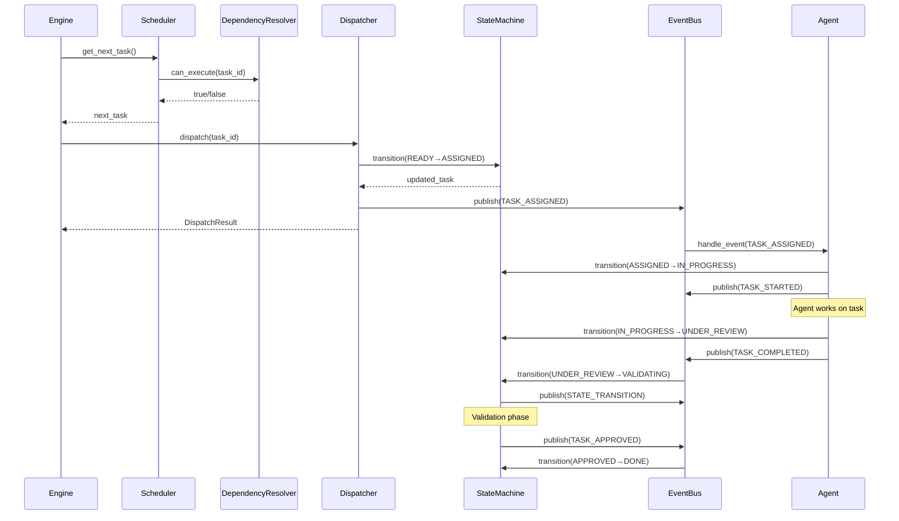
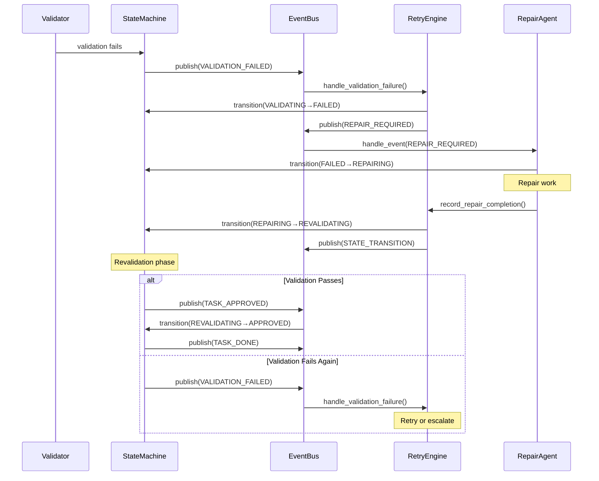
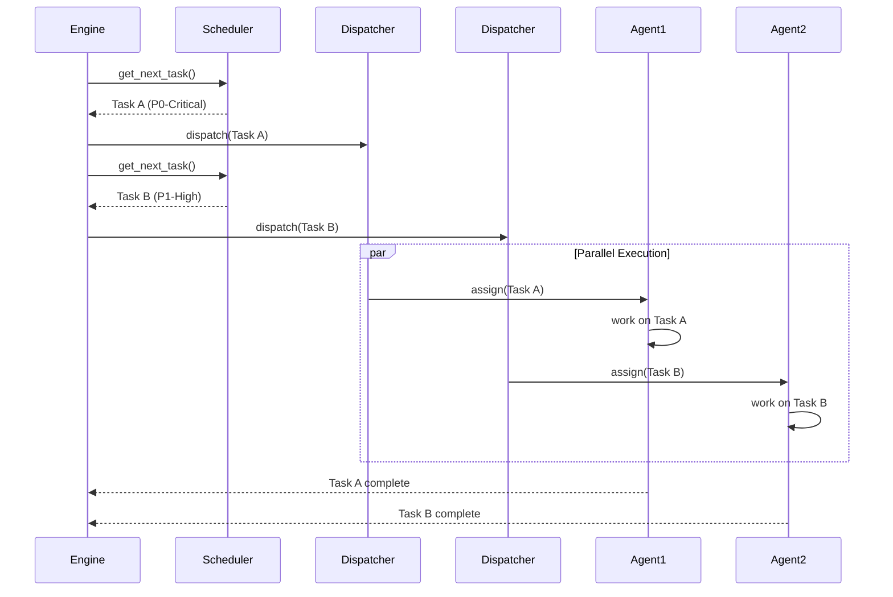
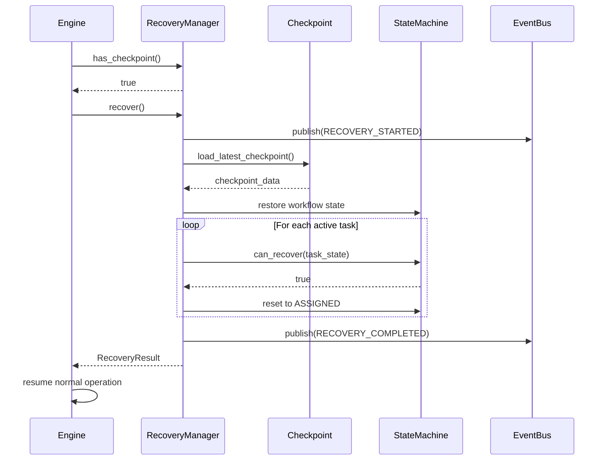
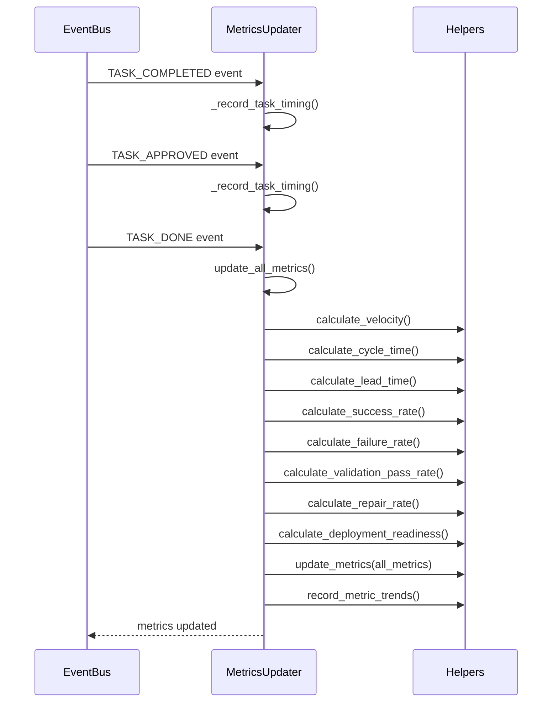

# Workflow Engine Architecture

## Overview

The Workflow Engine is the autonomous execution engine that controls all agents in the AI engineering platform. It implements a complete task lifecycle management system with scheduling, dependency resolution, agent dispatch, retry logic, event-driven communication, state machine enforcement, recovery mechanisms, and automatic metrics tracking.

## Architecture Diagram

```
┌─────────────────────────────────────────────────────────────────┐
│                    Workflow Engine                               │
│                                                                   │
│  ┌──────────────┐  ┌──────────────┐  ┌──────────────┐         │
│  │    Engine    │  │   Scheduler  │  │  Dependency  │         │
│  │   (Main)     │◄─┤              │  │   Resolver   │         │
│  └──────┬───────┘  └──────┬───────┘  └──────┬───────┘         │
│         │                  │                  │                 │
│         │    ┌─────────────┴──────────────┐  │                 │
│         │    │                            │  │                 │
│         │    │   Task Queue (READY)       │  │                 │
│         │    │                            │  │                 │
│         │    └─────────────┬──────────────┘  │                 │
│         │                  │                  │                 │
│  ┌──────┴───────┐  ┌──────┴───────┐  ┌──────┴───────┐         │
│  │   Dispatcher │  │ State Machine│  │ Retry Engine │         │
│  │              │◄─┤              │  │              │         │
│  └──────┬───────┘  └──────┬───────┘  └──────┬───────┘         │
│         │                  │                  │                 │
│         │    ┌─────────────┴──────────────┐  │                 │
│         │    │                            │  │                 │
│         │    │   Event Bus (Pub/Sub)      │──┘                 │
│         │    │                            │                     │
│         │    └─────────────┬──────────────┘                     │
│         │                  │                                     │
│  ┌──────┴───────┐  ┌──────┴───────┐  ┌──────────────┐         │
│  │   Recovery   │  │   Metrics    │  │    Agents    │         │
│  │   Manager    │  │   Updater    │  │  (External)  │         │
│  └──────────────┘  └──────────────┘  └──────────────┘         │
└─────────────────────────────────────────────────────────────────┘
```

## Core Components

### 1. Task State Machine

Enforces valid state transitions for tasks in the orchestration pipeline.

**State Flow:**
```
READY → ASSIGNED → IN_PROGRESS → UNDER_REVIEW → VALIDATING
    ↓           ↓            ↓              ↓
  (skip)    (skip)      FAILED ←────────┘
              ↓            ↓
           REPAIRING ←────┘
              ↓
          REVALIDATING
              ↓
           APPROVED
              ↓
              DONE
```

**Valid Transitions:**
- `READY → ASSIGNED`: Task assigned to agent
- `ASSIGNED → IN_PROGRESS`: Implementation started
- `IN_PROGRESS → UNDER_REVIEW`: Implementation complete
- `UNDER_REVIEW → VALIDATING`: Validation started
- `VALIDATING → UNDER_REVIEW`: Validation failed
- `VALIDATING → APPROVED`: Validation passed
- `FAILED → REPAIRING`: Repair started
- `REPAIRING → REVALIDATING`: Repair complete
- `REVALIDATING → REPAIRING`: Revalidation failed
- `REVALIDATING → APPROVED`: Revalidation passed
- `APPROVED → DONE`: Task fully complete

### 2. Event Bus

Provides publish/subscribe communication between components.

**Event Types:**
- `TASK_ASSIGNED`: Task has been assigned to an agent
- `TASK_STARTED`: Task implementation has begun
- `TASK_COMPLETED`: Task implementation is complete
- `VALIDATION_FAILED`: Validation check failed
- `REPAIR_REQUIRED`: Repair cycle initiated
- `TASK_APPROVED`: Task has been approved
- `TASK_DONE`: Task is fully complete
- `STATE_TRANSITION`: Task state changed
- `WORKFLOW_ADVANCED`: Workflow stage changed
- `ERROR`: Error occurred during execution
- `RECOVERY_STARTED`: Recovery process started
- `RECOVERY_COMPLETED`: Recovery process completed

### 3. Task Scheduler

Continuously monitors and prioritizes READY tasks.

**Prioritization Factors:**
1. **Severity** (weight: 2x)
   - Critical: 100 points
   - High: 75 points
   - Medium: 50 points
   - Low: 25 points

2. **Priority** (weight: 1.5x)
   - P0: 100 points
   - P1: 75 points
   - P2: 50 points
   - P3: 25 points

3. **Business Impact** (weight: 1x)
   - +20 points per blocked task

4. **Risk/Effort** (weight: 0.5x)
   - Inverse of estimated hours
   - Lower hours = higher score

**Total Score = (Severity × 2) + (Priority × 1.5) + (Blocking × 20) + (Effort × 0.5)**

### 4. Dependency Resolver

Validates prerequisites before task execution.

**Dependency Types:**
- **Task Dependencies**: Other tasks that must be DONE
- **Blocked By**: Explicit blockers
- **Agent Availability**: Required agent types exist
- **Resource Dependencies**: External resources available

**Validation:**
- All prerequisite tasks must be in DONE status
- Required agents must be registered
- Blocking validations must have passed

### 5. Agent Dispatcher

Automatically invokes appropriate agents based on task state.

**State → Agent Mapping:**
- `READY` → Orchestrator (assigns task)
- `ASSIGNED/IN_PROGRESS` → Developer (implements)
- `UNDER_REVIEW` → Code Reviewer (reviews)
- `VALIDATING/REVALIDATING` → Validator (validates)
- `FAILED/REPAIRING` → Repair Agent (fixes)
- `APPROVED` → CTO (approves)

**Agent Discovery:**
- Agents register themselves in `AGENT_REGISTRY.json`
- Scheduler discovers them automatically
- No code changes needed for new agents

### 6. Retry Engine

Handles validation failures with automatic repair loops.

**Repair Loop:**
```
Implementation → Validation → FAILED
                              ↓
                         Repair Initiated
                              ↓
                         Repair Complete
                              ↓
                         Revalidation
                              ↓
                    ┌─────────┴─────────┐
                    ↓                   ↓
                  PASS                 FAIL
                    ↓                   ↓
                 APPROVED          (retry or max reached)
```

**Retry Configuration:**
- Security tasks: 5 retries
- Implementation tasks: 3 retries
- Validation tasks: 2 retries
- Default: 3 retries

**Escalation:**
- Max retries reached → Task marked as FAILED
- Error event published
- Manual intervention required

### 7. Recovery Manager

Handles unexpected execution stops.

**Checkpoint Strategy:**
- Automatic checkpoints every 5 minutes
- Checkpoints include:
  - Workflow state
  - Active tasks
  - Completed tasks
  - Failed tasks
  - Event bus state
- Maximum 10 checkpoints retained

**Recovery Process:**
1. Load latest checkpoint
2. Restore workflow state
3. Reset active tasks to ASSIGNED
4. Resume execution
5. No work is lost

### 8. Metrics Updater

Automatically tracks performance metrics.

**Metrics Tracked:**
- **Velocity**: Tasks completed per day
- **Cycle Time**: Average start-to-completion time (days)
- **Lead Time**: Average creation-to-completion time (days)
- **Success Rate**: Percentage of successful tasks
- **Failure Rate**: Percentage of failed tasks
- **Validation Pass Rate**: Percentage of validations that pass
- **Repair Rate**: Percentage of tasks requiring repair
- **Deployment Readiness**: Composite score (0-100)

**Automatic Updates:**
- Subscribes to workflow events
- Updates metrics on task completion/approval
- Records trend data
- Recalculates all metrics periodically

## Sequence Diagrams

### 1. Normal Task Execution Flow



### 2. Validation Failure and Repair Flow



### 3. Parallel Task Execution



### 4. Recovery Flow



### 5. Metrics Update Flow



## Data Flow

### Task Lifecycle Data Flow

```
TASK_REGISTRY.json
    ↓
Scheduler (reads READY tasks)
    ↓
Dependency Resolver (validates prerequisites)
    ↓
Scheduler (prioritizes tasks)
    ↓
Dispatcher (assigns to agent)
    ↓
State Machine (transitions state)
    ↓
Event Bus (publishes events)
    ↓
Agent (executes task)
    ↓
State Machine (transitions through states)
    ↓
Validator (validates completion)
    ↓
[If FAILED] Retry Engine (repair loop)
    ↓
[If PASSED] CTO (approves)
    ↓
State Machine (DONE)
    ↓
Metrics Updater (updates metrics)
    ↓
METRICS.json updated
```

## Extensibility

### Adding New Agents

1. **Register in AGENT_REGISTRY.json:**
```json
{
  "agent": "new-agent-type",
  "role": "Description of agent role",
  "tools": ["tool1", "tool2"],
  "can_modify_code": true/false,
  "can_approve": true/false
}
```

2. **Agent is automatically discovered** by the dispatcher
3. **No code changes required** - the dispatcher maps task categories to agents

### Adding New Event Types

1. Add event type to `EventType` enum in `event_bus.py`
2. Subscribe handlers in components
3. Publish events when needed

### Adding New Metrics

1. Add metric calculation method to `MetricsUpdater`
2. Call from `update_all_metrics()`
3. Metric is automatically tracked and trended

## Configuration

### Engine Configuration

```python
engine = WorkflowEngine(
    auto_start=False,
    poll_interval=2,  # seconds
    max_concurrent_tasks=5,
    auto_checkpoint_interval=300  # 5 minutes
)
```

### Retry Configuration

```python
retry_config = RetryConfig(
    max_retries=3,
    strategy=RetryStrategy.IMMEDIATE,
    initial_delay_seconds=0,
    max_delay_seconds=60,
    backoff_multiplier=2.0
)
```

## Thread Safety

All components are thread-safe:
- **State Machine**: Uses file-based locking via JSON writes
- **Event Bus**: Thread-safe with locks for history management
- **Scheduler**: Thread-safe with locks for task queue
- **Dispatcher**: Thread-safe with locks for agent cache
- **Recovery**: Thread-safe with locks for checkpoint management
- **Metrics**: Thread-safe with locks for timing data

## Error Handling

### Component-Level Errors
- Each component catches and logs its own errors
- Errors are published to event bus
- Engine continues operation despite component errors

### Engine-Level Errors
- Engine catches exceptions in main loop
- Logs error and continues
- Publishes ERROR event
- Can trigger recovery if needed

### Recovery Triggers
- Unhandled exceptions in engine loop
- Manual recovery trigger
- Startup with existing checkpoint

## Performance Considerations

### Optimizations
- **Caching**: Dependency resolution results are cached
- **Lazy Loading**: Agents loaded on demand
- **Event Filtering**: Subscribers only receive relevant events
- **Checkpoint Throttling**: Max 10 checkpoints retained
- **Concurrent Execution**: Up to 5 tasks simultaneously

### Scalability
- Horizontal scaling ready (multiple engine instances)
- Event bus supports multiple subscribers
- Checkpoint system supports distributed recovery
- Agent registry supports dynamic registration

## Monitoring

### Key Metrics to Monitor
- Engine state (RUNNING/PAUSED/ERROR)
- Active task count
- Queue depth (READY tasks)
- Validation pass rate
- Repair rate
- Average task completion time
- Event bus throughput

### Health Checks
- Engine running status
- Component initialization
- Checkpoint availability
- Agent registry loaded
- Event bus operational

## Security Considerations

### Access Control
- Agents have specific capabilities (can_modify_code, can_approve)
- Dispatcher validates agent capabilities before assignment
- No agent can exceed its defined permissions

### Audit Trail
- All state transitions logged
- All events recorded in execution log
- Checkpoints preserve complete state
- Full history maintained in task records

### Isolation
- Tasks run in isolated contexts
- Agent capabilities are sandboxed
- Recovery ensures no cross-contamination